<p align="center">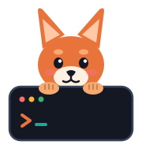</p>

# Kelpie

**A fast desktop workbench for running many coding-agent CLIs — Claude Code, Codex, OMP, Gemini, Cursor, OpenCode, Copilot and 16 more, plus plain shells — across many projects at once.**

Agents live in a background session daemon, so switching projects, closing the window or a UI crash never stops them. Only what is on screen is rendered: 20 agents in the background cost the UI almost nothing, and switching between projects takes ~30 ms.

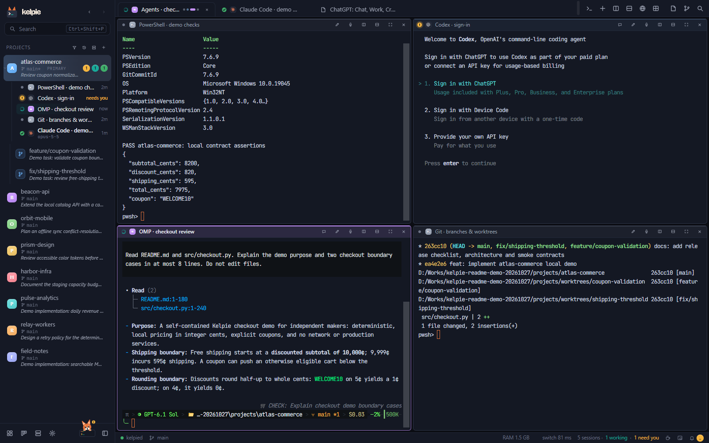

- **Windows 10 1809+ / 11** (tested) and **macOS 12+** (built in CI).
- Tauri 2 · SolidJS · xterm.js (WebGL) · CodeMirror 6 · a Rust session daemon (`kelpied`) built on `alacritty_terminal` and ConPTY / Unix PTYs.

---

## Contents

- [Features](#features)
  - [Sessions and agents](#sessions-and-agents)
  - [Terminals](#terminals)
  - [Chat view and past conversations](#chat-view-and-past-conversations)
  - [Projects, worktrees and the board](#projects-worktrees-and-the-board)
  - [Source control and review](#source-control-and-review)
  - [Files, viewers and search](#files-viewers-and-search)
  - [Activity and automations](#activity-and-automations)
  - [Usage, settings and shortcuts](#usage-settings-and-shortcuts)
  - [Layouts, runs, remote hosts and more](#layouts-runs-remote-hosts-and-more)
- [How it works](#how-it-works)
- [Performance](#performance)
- [Install](#install)
- [Build from source](#build-from-source)
- [Scripting](#scripting)
- [Keyboard shortcuts](#keyboard-shortcuts)
- [Privacy and data](#privacy-and-data)
- [Testing](#testing)
- [Project layout](#project-layout)
- [Documentation](#documentation)
- [Status](#status)

---

## Features

### Sessions and agents

- **Sessions that never stop.** Every PTY and agent process is owned by `kelpied`, a per-user daemon. The window can close, crash or restart; sessions keep running and re-attach with the same screen. If the daemon itself stops, sessions come back as *exited* with their last screen and agents resume their conversation (`claude --resume`, `codex resume`, `omp --resume`, and each preset's own resume flag).
- **Live status** from hooks (Claude Code, Codex), prompts on screen (menus and yes/no questions of agents without hooks) or output activity: *working*, *needs you*, *done (unread)*, *idle* — in the sidebar, on tabs, in the dashboard, with desktop notifications for sessions you are not looking at.
- **Attention queue**: the dashboard lists who needs you, longest wait first; answer a prompt from the dashboard or the bell without switching to the session; `Ctrl+Shift+.` jumps to the next one waiting.
- **23 agent CLIs preset**: Claude Code, Codex, OMP, Gemini, Cursor CLI, OpenCode, GitHub Copilot, Grok, Qwen Code, Droid, Aider, Amp, Goose, Kimi, Crush, Cline, Kiro, Continue, Devin, Auggie, CodeBuddy, Mistral Vibe and Pi. Kelpie finds the installed ones; they appear in the launchers, the others can be hidden. Arguments and environment per agent.
- **Permissions**: one *Manual / Yolo* switch adds or removes each agent's skip-permission flag; Claude Code and Codex keep their own permission mode / approval policy.
- **First prompt at launch**: type the task in the new-session menu; Kelpie passes it on the command line or types it once the agent is ready (long prompts are pasted).
- **Hand-off**: start another agent seeded with a bounded transcript of the current session (terminal context menu).
- **Hibernation** (opt-in): finished agents idle in background projects are stopped and resume their conversation when you show them again; *Sleep* a project or worktree on demand.
- **Keep the computer awake**: off, while agents are working, or always — from the coffee cup in the status bar.
- **Typing stays quick on a busy machine** (Windows): the session on screen runs its agent and console host above normal priority, so a keystroke is not stuck behind other agents' builds and tests or other programs; nothing else is slowed down (Settings → Agents → *Prioritize visible terminals*, on by default).
- **Composer**: `Ctrl+Shift+I` opens a floating prompt box over any session (shell, agent TUI or chat view) with `@` mentions for files, folders, the selection, the diff, review notes, other terminals and issues, pasted or dropped pictures, and an Up-arrow history per project; Claude, Codex and Gemini get `@path`, other programs get the content fenced and labelled, with caps and secrets masked.
- **Conversation upkeep**: *Compact conversation*, *Clear conversation* and *Restart, keeping the conversation* (a fresh process, same conversation) from a session's menu or the command palette.

| | |
|---|---|
| 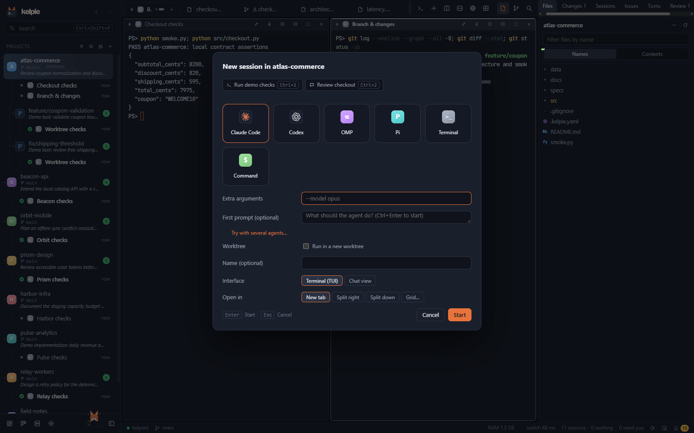 **New session** — any installed agent or a shell, TUI or chat view, placement, first prompt, quick commands. | 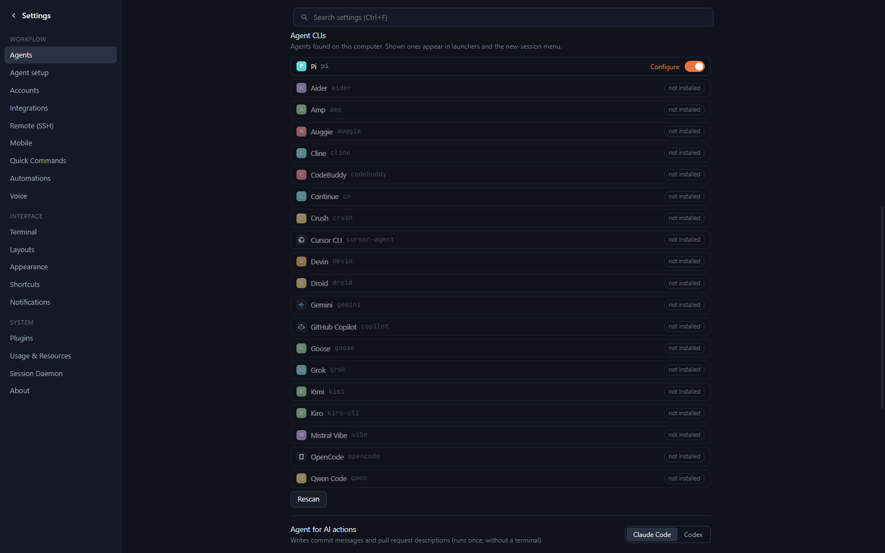 **Agents** — the preset list with what is installed, shown in launchers or hidden. |
| 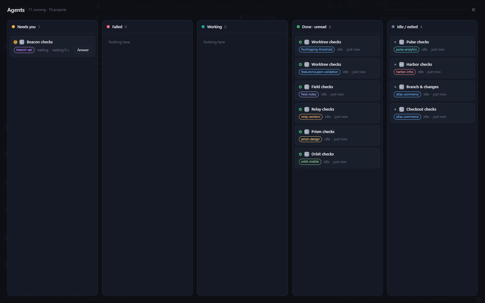 **Agent dashboard** — every session of every project, grouped by *needs you / working / done*. | 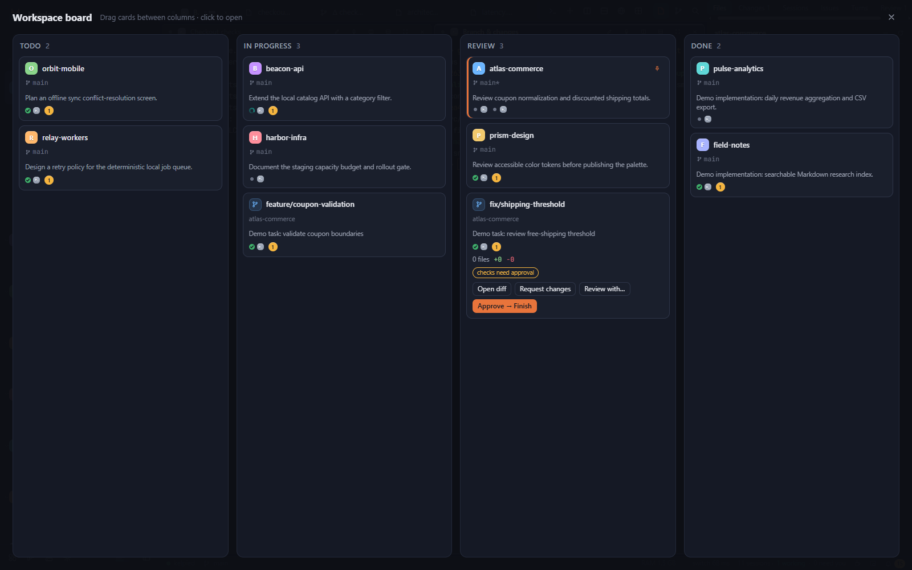 **Workspace board** — projects and worktrees by status, with the comment each agent left. |

### Terminals

- xterm.js with the WebGL renderer, a bundled modern ConPTY on Windows, true colour, Nerd Font glyphs, OSC 52 clipboard (only from the visible terminal), links, find, drag-and-drop of file paths.
- Splits right / down that ask which agent or shell to start, maximize, tabs per project (drag to reorder or merge), keyboard focus cycling.
- **Long output**: scrolled up, a pill counts new lines and takes you back to the bottom; `Ctrl+Shift+↑ / ↓` jumps between the prompts you sent, so a conversation of thousands of lines reads turn by turn.
- **Context menu**: copy, paste, select all, *Copy Context* (the transcript, ready to paste into another agent), find, clear, split, insert a quick command, hand off to another agent.
- **Nine terminal colour themes** (Dracula, Nord, One Dark, Tokyo Night, Catppuccin Mocha, Gruvbox, Solarized dark / light, GitHub Light) on top of the dark and light app themes; the daemon's snapshots use the same palette.
- **Floating terminal**: a global shell over everything, one shortcut away (`Ctrl+Shift+`` ` / `⌘⌥A`); it keeps running when hidden.
- App shortcuts stay off the keys agent TUIs need (`Ctrl+Shift` on Windows); when Kelpie does keep a key from a terminal it says so once.

| | |
|---|---|
| 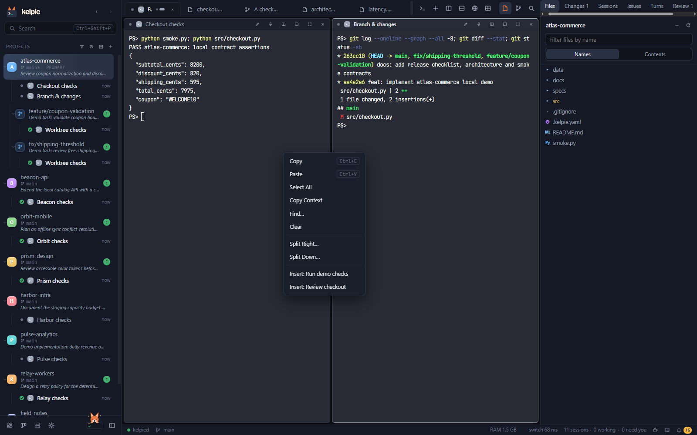 **Context menu** — Copy Context, splits, quick commands; here with the Dracula theme. | 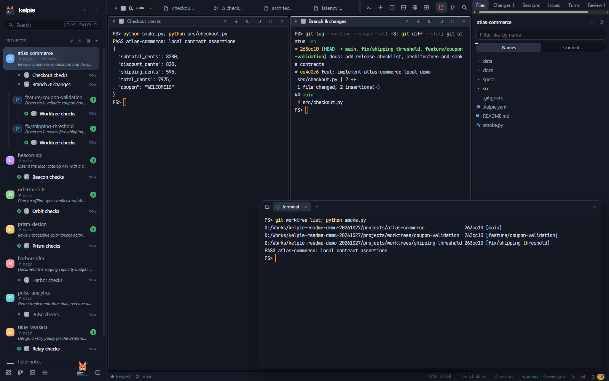 **Floating terminal** — a shell above the workspace, toggled with one chord. |

### Chat view and past conversations

- Any Claude Code, Codex or OMP session can continue in a chat UI — messages, tool cards with diffs, Allow / Deny prompts, cost — and switch back to the TUI. Kelpie stops one front-end before starting the other, so a conversation never has two writers.
- **The agent's own commands in chat**: `/` completes the commands the agent reports (Claude Code's built-ins, skills, custom and plugin commands, MCP prompts; OMP's commands; Codex's `/compact`, `/review`, `/new`, `/model`), `$` completes Codex skills and `@` the folder's files; pickers under the message field switch model, effort and permission mode. A command only the terminal UI has (`/doctor`, say) offers to continue there and runs it.
- **Past conversations**: the Sessions panel lists earlier Claude, Codex and OMP conversations from their own transcripts (this folder / project / all), searchable, resumable in a terminal or in chat view. 1.2 GB of transcripts list in 0.5 s the first time and in ~30 ms afterwards.

| | |
|---|---|
| 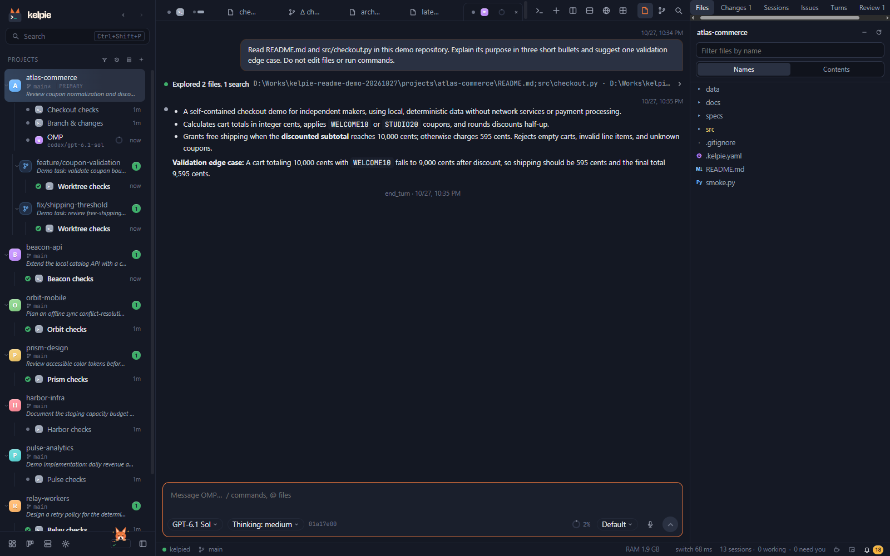 **Chat view** — the same Claude Code conversation with tool cards, rendered markdown and cost. |  **Past conversations** — earlier agent sessions of this folder, resumable in a terminal or chat. |

### Projects, worktrees and the board

- A sidebar with every project: branch, dirty state, ahead / behind, pull-request chip and all its sessions (status, task title, model, last activity); filter, sort, fold, pin, rename inline, *Open in* VS Code / Cursor / Zed / ….
- **Git worktrees as child projects**: create one from any local or remote branch, tag or commit with a suggested name and folder (or straight from search: type a name, pick *Create worktree*).
- **Ignored files follow the worktree**: `.worktreeinclude` and `copy:` entries are copied (`.env`), `link:` entries are shared as links (`node_modules`); the repository's `.kelpie.yaml` setup is shown in full and runs only when you tick it.
- Safe removal: refuses when a detached HEAD holds commits no branch has, removes shared links before the folder, and can delete the branch afterwards.
- **Worktree comments**: a line saying what the worktree is doing now, set by you or by an agent with `kelpied worktree set --comment …`, shown in the sidebar and on the board.
- A workspace board (Todo / In progress / Review / Done) with drag and drop, pins and the agents running in each card.
- **Review queue and Finish**: the Review column (and a Review tab in the right panel) shows each worktree's files, +/- lines, checks, cost and turns, with *Open diff*, *Request changes* (your review notes go to the agent) and *Approve → Finish*: save uncommitted files as a WIP commit, merge (squash, merge or rebase) with a conflict check first, run the `check:` commands of the base branch's `.kelpie.yaml` (only after you approved that exact file) in a temporary worktree of the result, move the target branch only if it did not change meanwhile, delete the branch only when its work is in it, remove the worktree last — never forced. Worktrees that edit the same file get an *Also changed in …* chip; new agent sessions can start in a worktree of their own, named from the first prompt.

| | |
|---|---|
| 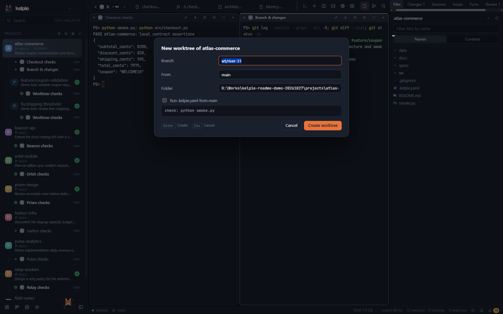 **New worktree** — branch, start from any ref, folder, and the `.kelpie.yaml` it would run. | 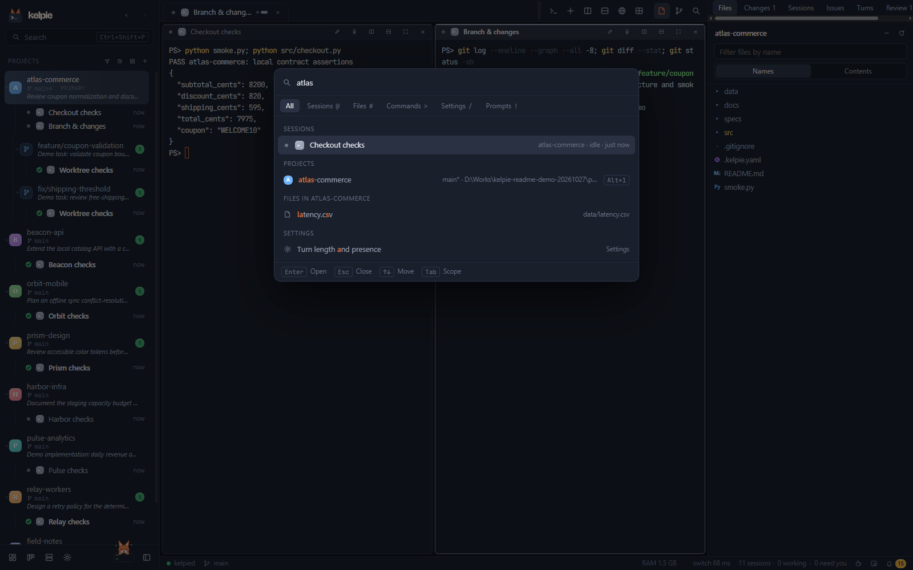 **Search everything** — sessions, projects, files, commands and settings in one box. |

### Source control and review

- **Changes panel**: staged / unstaged files, side-by-side or unified diffs, stage, discard, commit, amend.
- **Remote**: push (publishes the branch with upstream), pull (fast-forward only), sync, and force-with-lease only as its own explicit action; a diverged branch is explained instead of failing silently.
- **Merge / rebase / cherry-pick / revert in progress** shows a banner with *Abort* and *Resolve with AI*.
- **AI helpers** (one-shot `claude -p` or `codex exec`, your own sign-in): commit message from the staged diff, *Fix with AI* when a commit hook fails.
- **GitHub pull requests** through `gh`: the branch's PR with state and checks, a sidebar chip, *Create pull request* with an AI-written title and description, *Fix broken checks*.
- **Review notes**: click a diff line, write a note, and send every note to a running or new agent as one prompt; F7 / Shift+F7 jump between changes.

| | |
|---|---|
| 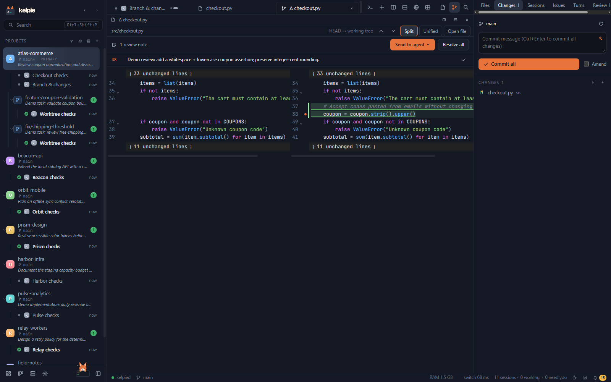 **Review notes** — notes on diff lines, sent to an agent in one batch. | 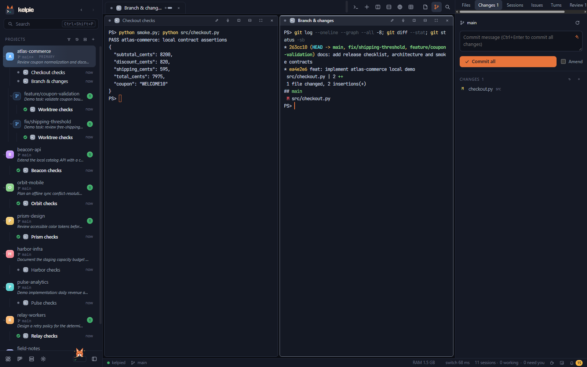 **Changes** — push / pull / sync, AI commit message, amend, pull request. |

### Files, viewers and search

- File tree with ignore-aware dimming and a name filter; search in files or in one folder (*Find in Folder…* from the tree).
- A CodeMirror 6 editor with syntax highlighting, save conflict detection and word wrap (`Alt+Z`); close all editor tabs at once.
- **Rich viewers**: Markdown preview with **Mermaid** diagrams, `.mmd` diagrams with zoom, **CSV / TSV** tables (sort, filter), **PDF**, **Jupyter** notebooks (read-only) and images; the rendered ones have a *Source* toggle.
- **One search box** (`Ctrl+Shift+P`) for recent items, sessions that need you, sessions, projects, files, commands and settings; `@ # > /` narrow it down.

| | |
|---|---|
| 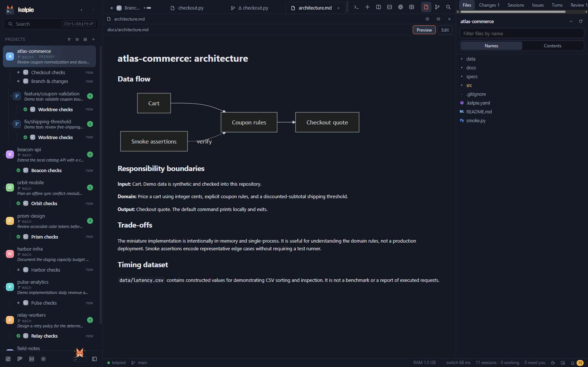 **Markdown + Mermaid** — diagrams render in the preview. | 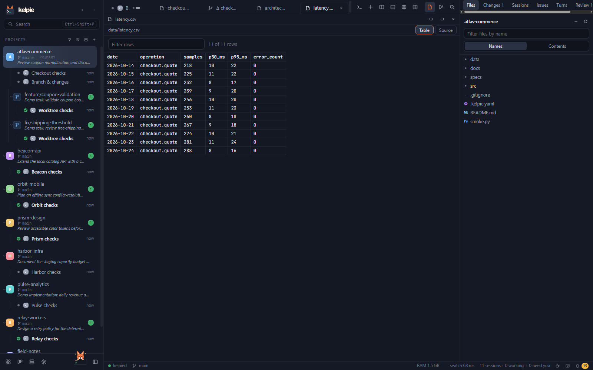 **CSV table** — sortable columns and a row filter. |
| 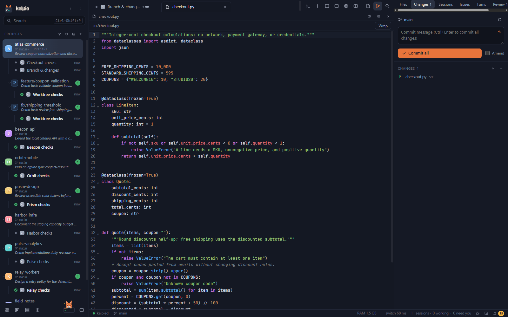 **Editor** — CodeMirror 6 with syntax highlighting and save conflict detection. | |

### Activity and automations

- **Activity inbox** behind the bell in the status bar: agents that finished or need you, automation runs and new worktrees across every project, newest first; jump to any of them, mark read, filter. An optional sound plays with desktop notifications.
- **Notifications on your phone, with the window closed**: the daemon sends needs-you, done, failed, automation, run-approval and cost-cap events to ntfy (random topic), Telegram or a webhook, with credentials masked, per-event switches and a turn-length filter. Secrets stay in the OS credential store.
- **Usage-limit actions**: a Claude Code session stopped by its usage limit offers *Continue at reset* (typed by the daemon, only if the session is still limited and untouched), *Switch account* (the conversation moves to the other account's folder) and *Hand off*.
- **Scheduled automations**: an agent prompt (or shell command) in a folder every hour, day, weekday or week. The daemon runs them, also while the window is closed; *Run now*, enable / disable, and every run lands in the inbox.

| | |
|---|---|
| 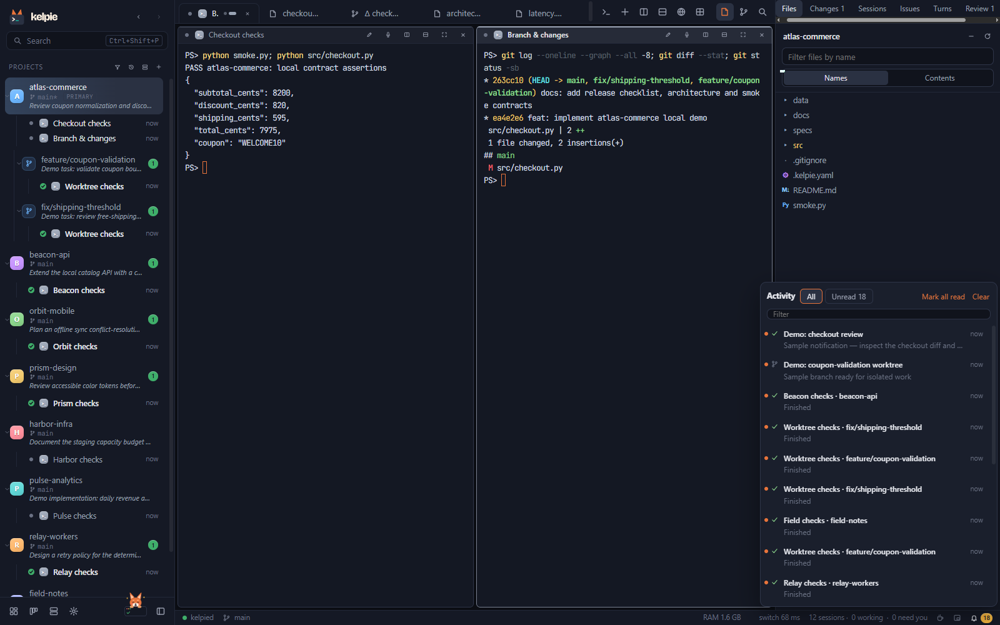 **Activity** — what finished, what needs you, what ran. | 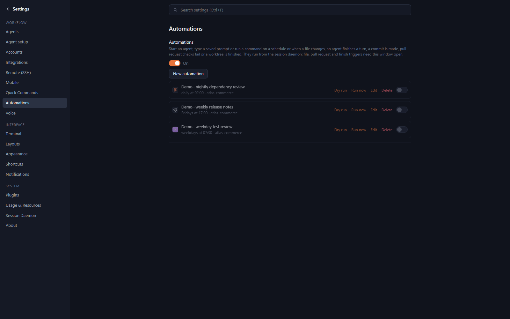 **Automations** — agent prompts on a schedule, run by the daemon. |

### Usage, settings and shortcuts

- Claude and Codex plan usage (5 h and weekly windows) and Kelpie's own memory use in the status bar.
- **Context ring, tokens and cost** per session (Claude Code, Codex, OMP, chat view): amber from 70 % of the context window, red from 85 % with a one-time Compact / Hand off hint, numbers read from the agent's own transcript only when the session maps to it exactly. A **Usage & cost** page (by day, week, project, agent, model) and an optional per-session cost cap.
- **Turns and undo** (opt-in, Settings -> Agents): a snapshot of an agent's git folder at the end of each turn, kept under `refs/kelpie` and never touching your index or branch. A **Turns** panel with per-turn diffs, who touched which files, the files a turn produced (markdown, images, Mermaid, CSV rendered; comments become review notes) and a previewed **undo** that refuses to silently revert files another session also worked on.
- **Quick commands**: saved shell commands or agent prompts, run from search, the new-session menu or the terminal context menu.
- A searchable settings page: per-agent arguments, permission mode / approval policy and environment, terminal font, renderer and colour theme, dark and light themes, compact density, interface text size, notifications, hibernation, keep-awake.
- Every shortcut can be re-recorded; Kelpie warns about keys other commands, AltGr layouts or terminal programs use.

| | |
|---|---|
| 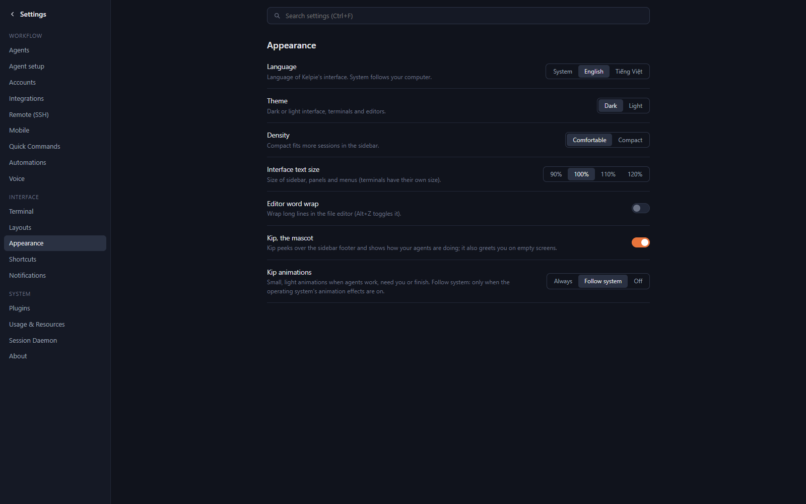 **Settings** — searchable, grouped sections. | 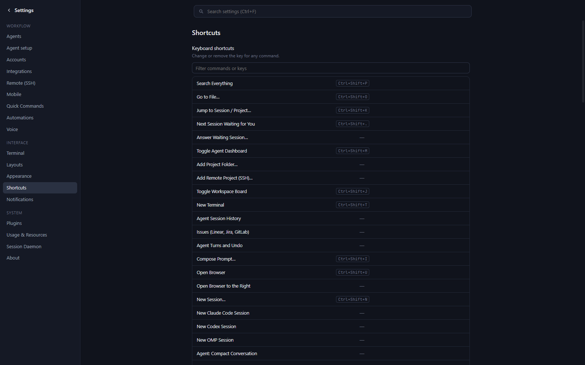 **Shortcuts** — record a key, see conflicts. |

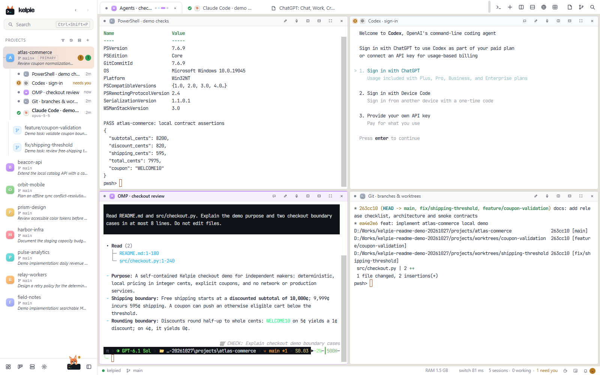
*Light theme — the interface, terminals and editors switch together.*

### Layouts, runs, remote hosts and more

- **Grid layouts**: arrange a tab as rows × columns (or per-row counts like `3,2`), start one agent per cell, drag panes to swap or move them, equalize, focus panes by direction, broadcast typing to every terminal of a tab, save layouts and open them from a project's start page.
- **Resume after a restart**: when the daemon stops while agents work (reboot, update, crash), their sessions come back interrupted and resume the same conversation when you open them, all at once, or on request.
- **Several Claude Code / Codex accounts**, each with its own sign-in, settings, history and usage meter; new sessions use the active account, running ones keep theirs.
- **Orchestration runs**: split a job into agent tasks with dependencies, approval gates and a worktree per task (or let an AI plan them); the daemon runs them and agents report back with `kelpied run report`.
- **Cross-review and best of several**: ask another agent (another vendor, if you like) to *Review with…* — it starts in the worktree with the masked diff and leaves comments on diff lines (`kelpied review add`) that show in your normal diff view — or *Try with several agents…*: one prompt to 2 to 5 agents, each in its own worktree (with the repository's approved `link:` / `copy:` files), compared side by side by status, time, cost, files, lines, checks and turns; *Use this one* finishes the winner and removes the others.
- **Plan tab (specs and tasks)**: the right panel reads the markdown the repository already has (`plans/<name>/plan.md` with its `phase-*.md`, `specs/**`, `.kiro/specs/**`, `docs/plans/**`) as phases and tasks with checkboxes and progress, live as any agent edits the files. Tick a box in the panel and only that character of the file changes (refused, and read again, if the file changed meanwhile); *Run with…* hands a task to an agent of any vendor, here, in a worktree of its own or on an SSH host linked to the project, and the row shows the run's status; remote projects have the tab too; *New spec* writes `specs/<name>/` plan-first (requirements, design, tasks). No format of our own.
- **Linear, Jira and GitLab**: your issues in a panel (start an agent or a worktree from one, change its state), GitLab merge requests and pipelines next to GitHub pull requests. Tokens stay in the OS credential store.
- **Browser panes with design mode**: open a page next to your agents, click elements to collect their selector, HTML and screenshot, and send them to an agent; localhost links from terminals open there.
- **Remote projects over SSH**: terminals and agents on another machine (kept alive in tmux), with files, search and git through your own `ssh` config.
- **SSH panes in any project**: a local project holds terminals and **Claude Code on any saved host** next to its local panes (splits, grids, saved layouts). Each new pane picks where it runs; projects link hosts with a folder each, and panes on a host carry its colour, name and terminal theme.
- **SSH hosts (Termius-style)**: saved hosts with groups, tags, notes, colour, terminal theme and an OS badge; one box to search or add `user@host:port`; a side drawer to add or edit a host and connect; key, agent or password login (passwords in the OS credential store); one click for a terminal or **Claude Code on the server** in tmux, in the host's own project or the one you have open; fingerprint check on first connect; file browser with upload / download; keys (generate, import, install on a host, add to the agent); known hosts; local / remote / SOCKS port forwarding; a command or quick command run on several hosts at once.
- **Phone access** (opt-in): pair a phone with a QR code to see every session, read its screen and answer agents that need you.
- **Voice dictation** on this computer: Vietnamese or ~100 languages with Whisper, into any text field or terminal.
- **Plugins**: declarative manifests that add agents, commands, quick commands, themes, layouts and status-bar items, enabled only after you review what they run.
- **Agent setup** (Settings → Agent setup): one page for the MCP servers of Claude Code, Codex, Gemini, OpenCode and Cursor (user and project files, switch on and off, copy between agents with a warning before a repository's server reaches your own settings, secrets never written into project files), instruction files (**one file for all agents**: AGENTS.md as the source), a read-only list of skills, commands and subagents, and **Find more agents** from the ACP registry (one request, on click). Every change shows a diff, keeps a backup and is undone at once if the file stops parsing.
- **English and Vietnamese** interface.

Screenshots are taken from the running app by [`scripts/e2e/readme_shots.py`](scripts/e2e/readme_shots.py).

## How it works

```
Kelpie (Tauri app)                        kelpied (session daemon, one per user)
├─ WebView: SolidJS UI, xterm.js, CM6     ├─ Session × N  (PTY + VT state + ring buffer)
├─ Rust core: daemon client, fs, git,     ├─ ChatSession × N (agent stdio JSON relay)
│  search, file watcher, transcript       ├─ status ticker (250 ms) + persistence (30 s)
│  history, usage, memory meter, gh,      ├─ automations, runs, keep-awake, comments
│  accounts, plugins, integrations, ssh   ├─ phone server (opt-in)
├─ local socket ◄──────────────────────►  └─ local socket server
└─ kelpie-stt (speech helper, on demand)  kelpied hook  ◄── agent hooks (Claude/Codex)
                                          kelpied terminal / worktree / run ◄── scripts, agents
```

- **The UI owns nothing that must keep running.** `kelpied` parses every PTY byte once (`alacritty_terminal`), keeps a 1 MiB ring and an ANSI snapshot per session, and fans output out to attached views. A slow view is told to resync; the PTY never pauses.
- **Attach is cheap and exact**: a view that comes back gets a delta replay of what it missed, or a snapshot when it fell too far behind.
- **Render only what is visible.** Hidden terminals unsubscribe and park; the most recent keep their WebGL context so switching back is instant. Output reaches the webview through one binary channel per visible terminal, coalesced every 4 ms. Solid's fine-grained stores re-render only what changed.
- **Transport** is a local socket only (Windows named pipe with an owner-only DACL, Unix socket mode 0600) with length-prefixed binary frames.
- **Process control**: Job Objects on Windows, process groups on macOS; a login shell on macOS so agents see the user's PATH.

Details: [docs/architecture.md](docs/architecture.md).

## Performance

Measured on Windows 10 (numbers and method in [`plans/reports/`](plans/reports)):

| | |
|---|---|
| Project switch (3 projects with terminals, release) | p50 ≈ 30 ms, p95 40–52 ms |
| 20 sessions × 2 MiB output through the daemon | 40 MiB in 3.9 s, 0 sequence gaps |
| Re-attach with snapshot | p50 4.4 ms, p95 5.8 ms |
| Session history, 421 transcripts / 1.2 GB | first scan 0.5 s, later launches 34 ms |
| Keystroke → screen, Claude Code, 4 cores saturated by other sessions (`kelpied bench-echo`) | p50 ≈ 6 ms (370 ms without *Prioritize visible terminals*) |
| … saturated by programs outside Kelpie | p50 ≈ 9 ms, p95 ≈ 65 ms (300 ms / 550 ms without) |

## Install

Agents are not bundled: install the CLIs you use (`claude`, `codex`, `gemini`, `opencode`, …) as usual. Kelpie finds them on your PATH (Windows) or through your login shell (macOS); Settings → Agents shows which ones it found.

Installers are published on [GitHub Releases](https://github.com/baopeak/kelpie/releases) (`.github/workflows/release.yml`, signed) and produced by CI on every push (`.github/workflows/ci.yml`, build artifacts):

- **Windows**: `Kelpie_x.y.z_x64-setup.exe` (per-user NSIS installer, no admin needed). Installing over a running Kelpie restarts only the app: running sessions keep going (from 0.1.x, once, sessions stop and agents resume).
- **macOS**: `.dmg` (one universal build for Apple Silicon and Intel) — drag Kelpie to Applications.

**Updates**: Kelpie checks GitHub Releases 30 s after start and every 6 hours (Settings → About → *Check for updates*), shows *Update x.y.z* in the status bar, and installs a signed update now or once no agent is working. Only the app restarts: the session daemon and every session keep running, and the updated app reconnects to them.

Optional: the GitHub CLI (`gh`, signed in) for pull requests; VS Code / Cursor / Zed / … for *Open in*; an OpenSSH client (built into Windows 10+ and macOS) and, on remote hosts, `tmux` for remote projects.

## Build from source

Requirements: Rust (stable), Node 22+, pnpm 11, and on Windows the MSVC build tools.

```bash
cd app && pnpm install && cd ..
scripts/build-release.sh --bundles nsis      # Windows installer
scripts/build-release.sh --bundles app,dmg   # macOS
scripts/build-release.sh --no-bundle         # just the executables
```

Development, on an isolated daemon endpoint and data folder:

```bash
scripts/dev-daemon.sh run                     # kelpied on endpoint "kelpie-dev"
cd app && KELPIE_ENDPOINT=kelpie-dev pnpm tauri dev
```

## Scripting

Agents and scripts can drive other sessions and report progress through the `kelpied` executable:

```bash
kelpied terminal list                           # sessions with handle, kind, status, folder
kelpied terminal send 3 "run the tests" --enter # type into session 3
kelpied terminal wait 3 --timeout-ms 600000     # until it stops working
kelpied terminal read 3 --lines 80              # its last 80 lines, scrollback included
kelpied worktree set --comment "fix reproduced; writing test" --status progress
kelpied worktree get                            # comment and status of this worktree
kelpied run create run.json                     # an orchestration run (tasks, deps, approvals)
kelpied run report done "tests pass"            # from inside a run's agent session
```

The raw daemon API is available too:

```bash
kelpied call session.list
kelpied call session.create '{"kind":"claude","cwd":"D:/proj","prompt":"Summarize the open TODOs"}'
kelpied call session.input  '{"handle":3,"data":"run the tests\r"}'
kelpied call session.read   '{"handle":3,"lines":200}'
```

`kelpied` authenticates on its own: outside Kelpie with the user token the daemon writes for its
endpoint, inside a session with that session's token. Programs in a session get the commands above
(hook and run reports always for their own session); Settings → Agents → *Agents can control other
sessions* limits them to their own session. Settings, automations, custom agents and phone access
are only reachable from the app or from `kelpied` run outside a Kelpie session.

## Keyboard shortcuts

App shortcuts use `Ctrl+Shift` on Windows so plain `Ctrl+letter` keys reach the agent TUIs. All of them can be changed in Settings → Shortcuts.

| Action | Windows | macOS |
|---|---|---|
| Search everything | Ctrl+Shift+P | ⌘⇧P |
| Go to file | Ctrl+Shift+O | ⌘P |
| Jump to session / project | Ctrl+Shift+K | ⌘K |
| Agent dashboard / workspace board | Ctrl+Shift+M / Ctrl+Shift+J | ⌘⇧M / ⌘⇧J |
| Next session waiting for you | Ctrl+Shift+. | ⌘⇧. |
| New terminal / new session… | Ctrl+Shift+T / Ctrl+Shift+N | ⌘T / ⌘⇧N |
| Floating terminal | Ctrl+Shift+` | ⌘⌥A |
| Split right / down | Ctrl+Shift+D / Ctrl+Shift+S | ⌘D / ⌘⇧D |
| Maximize pane, close pane | Ctrl+Shift+Enter, Ctrl+Shift+W | ⌘⇧↩, ⌘W |
| Close all editor tabs | Ctrl+Alt+W | ⌘⌥W |
| Word wrap (editor focused) | Alt+Z | ⌥Z |
| Next / previous change in a diff | F7 / Shift+F7 | F7 / ⇧F7 |
| Back / forward | Alt+Shift+← / → | ⌘⌥← / → |
| Layout menu, focus pane by direction | Ctrl+Shift+L, Ctrl+Alt+arrows | ⌘⇧L, ⌃⌥ arrows |
| Runs, browser, dictate | Ctrl+Shift+R, Ctrl+Shift+U, Ctrl+Shift+Space | ⌘⇧R, ⌘⇧U, ⌘⇧Space |
| SSH hosts | Ctrl+Alt+H | ⌘⌥H |
| Previous / next prompt in a terminal | Ctrl+Shift+↑ / ↓ | ⌘↑ / ↓ |
| Project 1…9 | Alt+1…9 | ⌘1…9 |
| Settings | Ctrl+, | ⌘, |

The full list is in the [user guide](docs/user-guide.md#keyboard-shortcuts).

## Privacy and data

- Everything stays on your machine: sessions, layouts, settings, worktree comments, automations, runs, plugins and speech models live in `%LOCALAPPDATA%\Kelpie` (Windows) or `~/Library/Application Support/Kelpie` (macOS). Pictures pasted into the composer and text too long to inline (diffs, selections) wait in the system temp folder (`kelpie-composer`) and are removed after three days. There is no telemetry, and notifications leave the computer only through a channel you switch on (ntfy, Telegram, webhook). No network port is opened unless you turn on **phone access** (one address and port you choose, paired devices only, optional HTTPS).
- **Upgrading from Erka** (the project's former name). Quit Erka, then start Kelpie. On its first start Kelpie:
  - stops Erka's background daemon if it still runs; its sessions come back in Kelpie as exited, resumable from their conversation;
  - moves your sessions, layouts, settings, accounts, saved hosts, plugins and speech models from the `Erka` folder, and points the paths stored in them at the new folder;
  - moves saved secrets (SSH passwords, integration tokens) in the credential store, and the browser-pane profile, on first use.

  Repositories' `.erka.yaml`, plugins' `erka-plugin.json` and remote tmux sessions started by Erka keep working, and paired phones stay paired. Then uninstall Erka. Scripts of your own that call `erkad` or read `ERKA_*` variables need the new names (`kelpied`, `KELPIE_*`); run branches are now named `kelpie/…` and `TERM_PROGRAM` is `Kelpie`.
- **Network use you ask for**: issue trackers and GitLab (with tokens kept in the OS credential store), remote projects and saved SSH hosts through your `ssh` (saved passwords and key passphrases stay in the OS credential store), plugin installs from git, and one-time speech-model downloads (GitHub / Hugging Face, checked against pinned SHA-256). Voice is recognised locally.
- **Usage meters** read the agents' own sign-in (`~/.claude/.credentials.json` or the macOS keychain, and `~/.codex/auth.json`). Tokens stay in Kelpie's Rust core and are sent only to the vendor's usage endpoint, identifying as Kelpie; the UI only sees percentages and reset times. The meters can be turned off in Settings.
- **AI helpers** (commit messages, PR text, conflict help) run your installed `claude` or `codex` CLI with your own sign-in; only the diff or context shown in the request is sent. **Pull requests** go through your `gh` login.
- **Session history** reads the agents' transcript folders (`~/.claude/projects`, `~/.codex/sessions`, `~/.omp/agent/sessions`) locally.
- Agent environment variables set in Settings are stored in plain text in Kelpie's settings file.
- `app-state.json` is versioned; before a format change, or when a file cannot be read, a timestamped backup is written first.

## Testing

```bash
cargo test --workspace             # protocol, daemon, app backend
cd app && pnpm typecheck && pnpm test && pnpm i18n:check   # test: vitest (layout maths, Claude / Codex adapters)
kelpied bench --sessions 20 --mb 2   # daemon throughput
kelpied bench-echo --cmd claude --ready ❯ --load 6   # keystroke → screen latency under CPU load
```

The performance gate measures the release build and compares it with `scripts/perf/baseline.json`: cold start, project switch and keystroke echo (timed inside the page), idle CPU and memory with 20 shells, long tasks, bundle size and daemon throughput. It exits non-zero over budget; see [scripts/perf/README.md](scripts/perf/README.md).

```bash
python scripts/perf/perf_gate.py --label my-change --compare scripts/perf/baseline.json
```

End-to-end tests drive the real app through WebDriver (`tauri-driver` + a matching `msedgedriver`), against an isolated daemon (`KELPIE_ENDPOINT` / `KELPIE_DATA_DIR`):

| Script | Covers |
|---|---|
| `scripts/e2e/smoke.py` | boot, typing into a PTY, splits, 30 project switches with timing, re-attach, editor, git, palette |
| `scripts/e2e/restart.py` | closing the app keeps sessions; reopening restores the same screen |
| `scripts/e2e/chat.py` | Claude / Codex / OMP: TUI ↔ chat with the same conversation (real model calls) |
| `scripts/e2e/phase1.py` … `phase5.py` | key hints, explorer, sidebar, search, history, usage, quick commands, settings, shortcuts, navigation, themes, worktrees, board, state migration |
| `scripts/e2e/parity.py` | agent presets and Yolo, startup prompts, `kelpied terminal` / `worktree` CLI, push / pull / sync / abort, worktree copy / link, review notes, inbox, floating terminal, hibernation, keep-awake, themes, viewers, automations (`--ai`: one real one-shot call) |
| `scripts/e2e/finish.py` | review cards, Review tab, request changes, Finish (WIP commit, approved checks, squash, branch and worktree cleanup), a branch editing `.kelpie.yaml`, conflicts, overlap chips, auto-worktree, automation delivery, queue refresh time |
| `scripts/e2e/layouts.py` | grids, per-row counts, drag to swap / move, equalize, broadcast, saved layouts, resume after a daemon restart (real Claude, terminal and chat) |
| `scripts/e2e/tabs_panes.py` | a lone pane has no header; Tile all gathers one-pane tabs into an even grid (4 → 2 × 2, 5th → 3 + 2), Spread into tabs undoes it; split tabs stay |
| `scripts/e2e/composer.py` | composer: mentions per agent, inert delivery, selection menus, pictures (TUI path, chat image block), prompt history |
| `scripts/e2e/spec_panel.py` | the Plan tab: specs detected and listed, live progress, a one-byte tick that keeps CRLF, a concurrent edit and a swapped folder refused, Run with… (@path and inlined content, scrubbed hostile headings, worktree with approved copies, on an SSH test host: remote project, linked host, scoping), New spec |
| `scripts/e2e/accounts.py`, `runs.py`, `integrations.py` | several accounts; orchestration runs (real agent reporting, AI planning); Linear / Jira / GitLab (GitLab live) |
| `scripts/e2e/browser.py`, `remote.py`, `mobile.py` | browser panes and design mode (trusted page input via DevTools); SSH projects (local test host); phone pairing and replies |
| `scripts/e2e/ssh_hosts.py` | SSH hosts page against a local test host: password login through askpass, fingerprint check, terminal and Claude Code on the host, files, port forwards, keys installed and used, known hosts, config import (set `KELPIE_SSH_DIR`) |
| `scripts/e2e/ssh_panes.py` | SSH panes in a local project against a local test host: "Run on" in the launcher, splits that keep the host, a local and a remote pane in one tab, host links per project, "Open in" the current project, saved layouts on a host, quick connect, OS badge, host theme (set `KELPIE_SSH_DIR`) |
| `scripts/e2e/notify.py` | ntfy / Telegram / webhook channels against a local server (secrets in the credential store under the run's own endpoint), desktop and phone agreeing on what is in front of the user, needs-you with the window closed, filters and rate limit, redaction, the usage-limit strip, "continue at reset" typing only into a still-limited untouched session, switching account |
| `scripts/e2e/attention.py` | prompts on screen (PowerShell `Read-Host (y/n)`, a numbered menu) turn sessions *needs you* with `waiting_since` and keys; `session.answer` refuses a stale prompt and types the current answer; ordinary output is not a prompt; sessions may not answer (daemon only) |
| `scripts/e2e/updater.py` | updates keep sessions running: installer script stops only programs directly in the install folder; a daemon running from its copy keeps its pid and sessions through an install; uninstall stops it; `latest.json` (daemon only) |
| `scripts/e2e/daemon_auth.py` | who may call the daemon: anonymous and forged callers refused, session tokens get scripting but no admin methods, hook reports bound to the caller's session, the "agents can control other sessions" policy and restricted sessions (daemon only) |
| `scripts/e2e/agent_resume.py` | Claude / Codex / OMP resume the same conversation after the daemon is killed (real model calls, daemon only) |
| `scripts/e2e/scrollback.py` | long output: back-to-bottom with a new-lines count, jumping between the prompts sent |
| `scripts/perf/perf_gate.py` | the performance gate above (release build, `pip install psutil`) |
| `scripts/e2e/typing_latency.py` | keystroke → rendered frame through the whole app (shell, Claude Code), idle and with busy background sessions, *Prioritize visible terminals* off and on |
| `scripts/e2e/chat_parity.py` | chat view: each agent's `/` commands, `@` files, Codex `$` skills, model / effort / mode pickers, `/context` answered in chat, terminal-only commands handed to the TUI |
| `scripts/e2e/agent_setup.py` | Agent setup page on fixture config homes: list and provenance, toggle, project → user copy confirmation, secrets masked and never in project files, diff / backup / restore, auto-restore of a bad write, one file for all agents, skills, ACP registry (fake server: one request per click, confirm, nothing run) |
| `scripts/e2e/plugins.py`, `voice.py` | plugin install / review / every contribution; speech-model download, dictation into terminals and fields |
| `scripts/e2e/i18n.py` | Vietnamese interface: no untranslated text on 30 surfaces, dates, switching languages without a reload |
| `scripts/e2e/ui_tour.py` | screenshots of every surface in dark, light, compact and small-window layouts |
| `scripts/e2e/readme_shots.py` | the screenshots in this README, from a demo repository |

## Project layout

```
app/                 Tauri app: SolidJS UI (src/) and Rust core (src-tauri/)
crates/kelpie-proto/   wire protocol and endpoint / data-dir conventions
crates/kelpied/      session daemon: PTYs, VT state, snapshots, hooks, chat relay,
                     automations, runs, phone server, keep-awake, worktree comments, CLI
crates/kelpie-stt/   speech-to-text helper (sherpa-onnx), started by the app on demand
scripts/             dev daemon, release build, end-to-end tests
third_party/conpty/  sideloaded ConPTY (conpty.dll + OpenConsole.exe) for Windows
docs/                user guide, architecture, screenshots
plans/               implementation plans and reports
```

## Documentation

- [User guide](docs/user-guide.md) — everyday use, agents, terminals, worktrees and `.kelpie.yaml`, source control and review, viewers, automations, layouts, resume, accounts, runs, issue trackers, browser panes, remote projects, phone access, voice, plugins, language, settings, shortcuts.
- [Architecture](docs/architecture.md) — processes, protocol, threading, attach semantics, rendering policy, chat mode, daemon services, layouts, runs, integrations, remote, phone server, plugins, voice, languages.
- [Plugins](docs/plugins.md) — the `kelpie-plugin.json` format and how approval works.
- [ConPTY notes](docs/third-party-conpty.md) — the bundled Windows console host.
- [Agent logos](docs/third-party-agent-logos.md) — the agent CLIs' marks, their source and the rules for showing them.
- [Brand](docs/brand.md) — logo, colors, type and the mascot Kip, with the asset files.
- [Plans and reports](plans/) — design decisions, UI and feature comparisons with Orca, measurements and test results.

## Status

Version 0.1.0. Developed and tested on Windows 10; the macOS build is produced by CI but has had less hands-on testing. The UI design and feature set take inspiration from [Orca](https://github.com/stablyai/orca).

Licensed under the [MIT license](LICENSE). The bundled ConPTY binaries in `third_party/conpty` are Microsoft's, also MIT — see [docs/third-party-conpty.md](docs/third-party-conpty.md).

Claude, Codex, Gemini, Cursor, OpenCode, GitHub Copilot and their logos are trademarks of their respective owners, shown only to identify the tools Kelpie launches. Kelpie is not affiliated with or endorsed by them — see [docs/third-party-agent-logos.md](docs/third-party-agent-logos.md).
