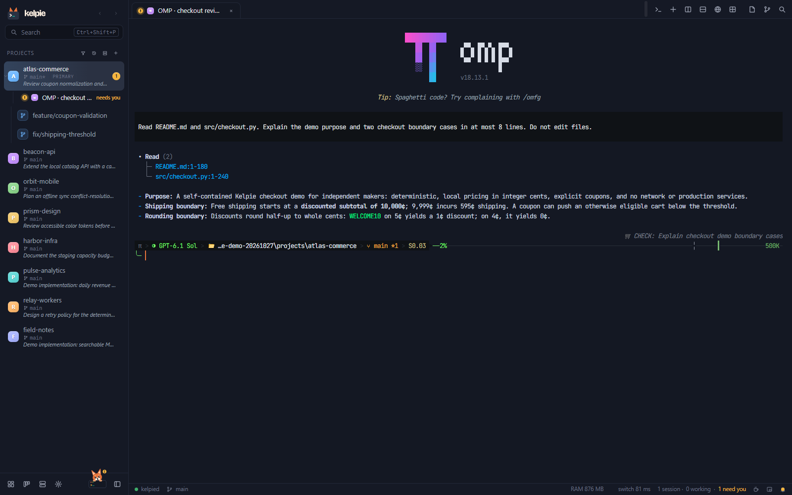
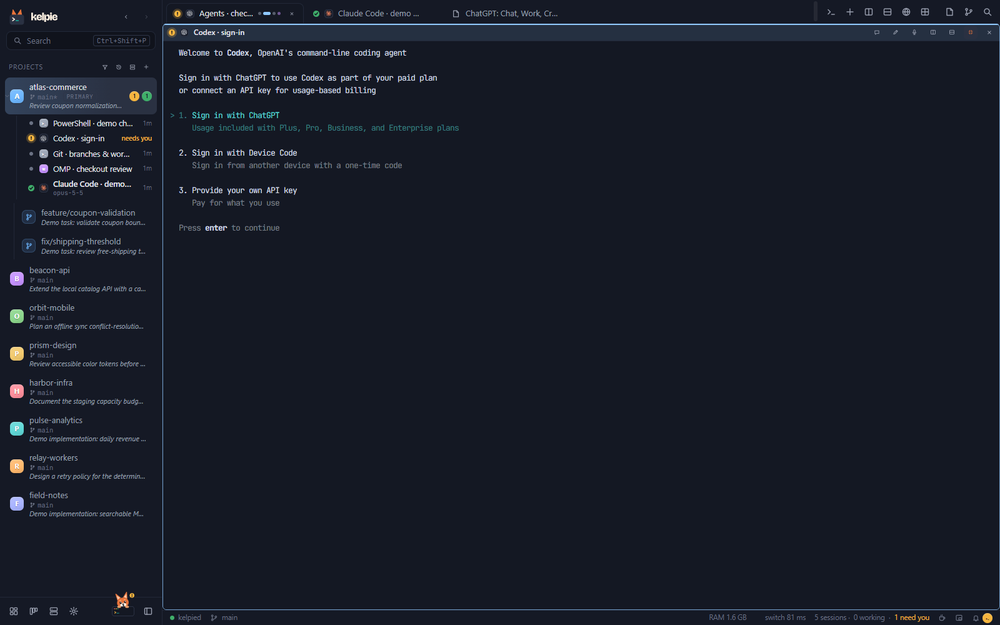
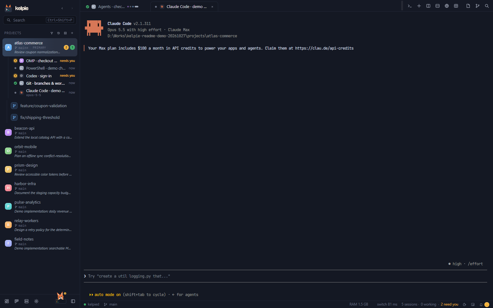
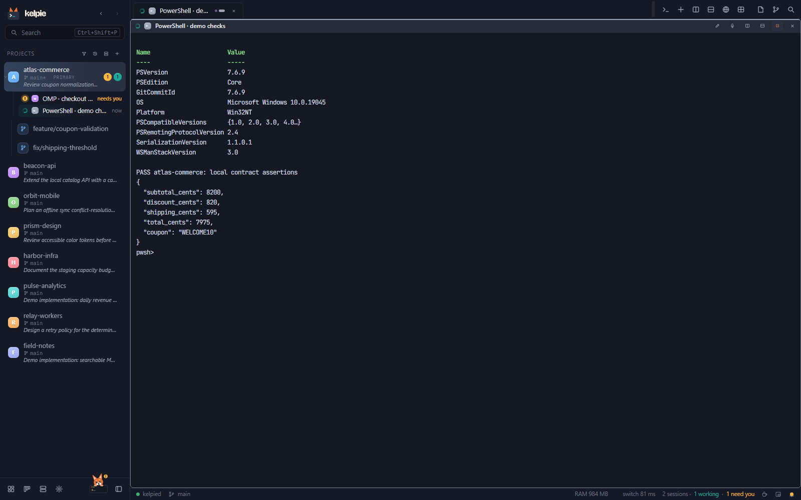
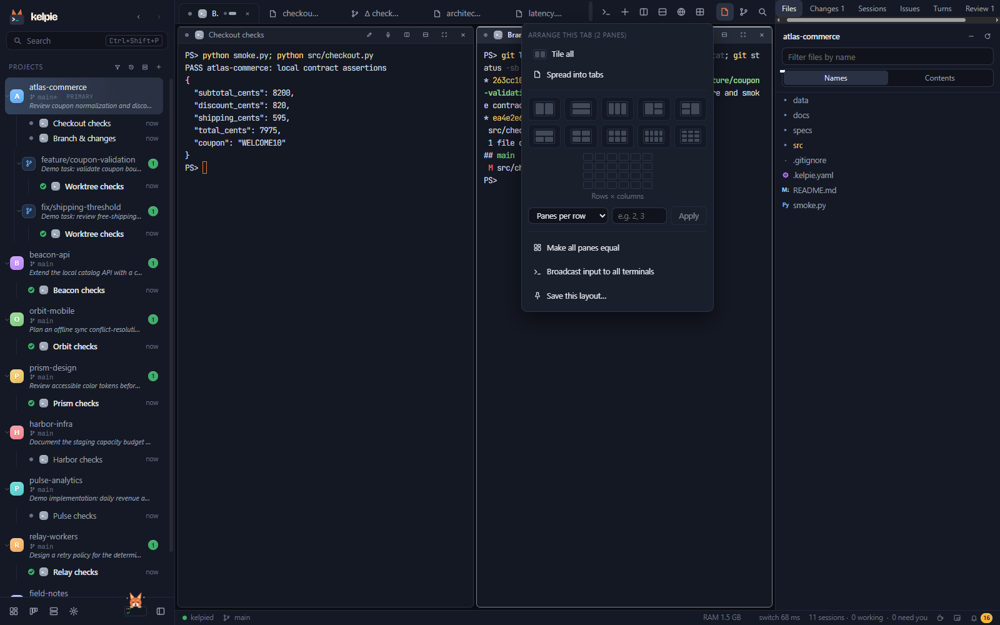
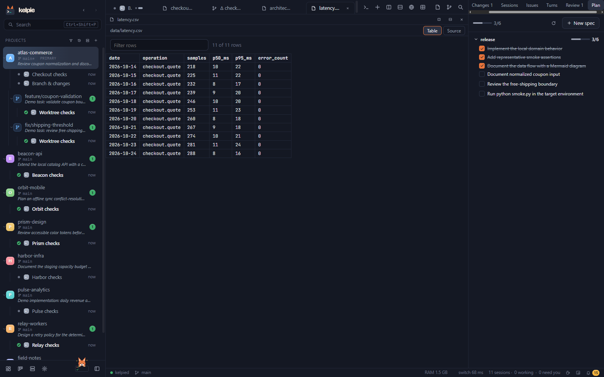
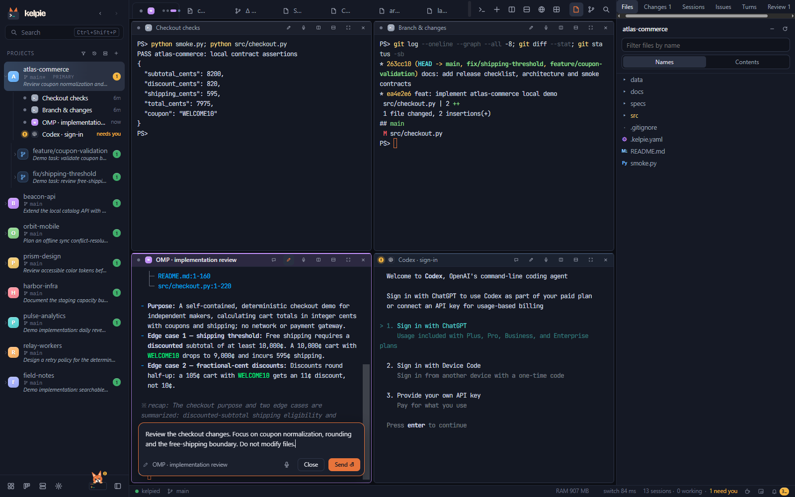
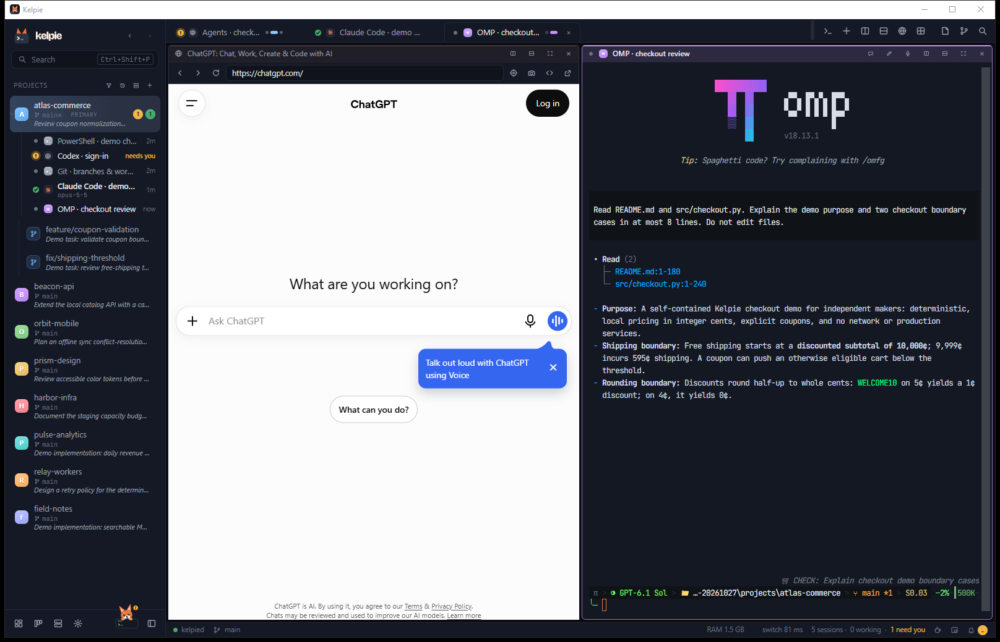
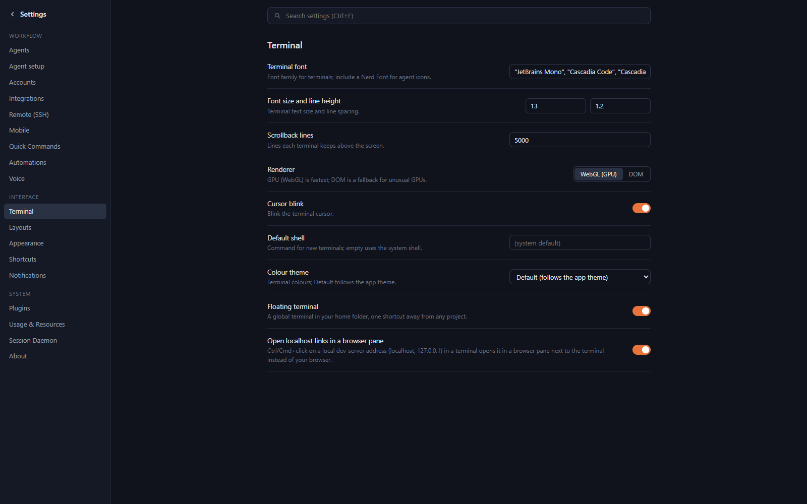
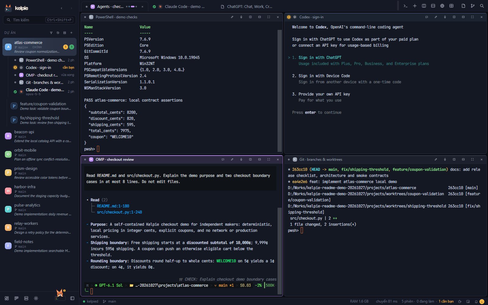

<p align="center"></p>

# Kelpie

**More agents. Less juggling. One place to bring the work together.**

It starts with one terminal. Then another agent takes a second task. A test needs its own shell, a bug needs another branch, and the browser is somewhere behind everything else.

Soon, the hard part is not starting the work. It is remembering where it all went: which agent needs an answer, which checkout belongs to which task, and what is actually ready to review.

**Kelpie is a desktop workbench for that moment.** Run your coding-agent CLIs and shells side by side, keep each project and worktree in view, and come back to sessions that keep running when you close the window.

[**Download Kelpie**](https://github.com/baopeak/kelpie/releases) · [Follow the workflow](#a-day-with-kelpie) · [Try the demo](#try-the-demo-yourself) · [User guide](docs/user-guide.md)


Windows 10 1809+ / 11 · macOS 12+ · Open source, MIT licensed
Built with Tauri 2, SolidJS and a Rust session daemon. Bring your own agent CLIs and sign-ins.

## A day with Kelpie

The walkthrough below follows a small checkout change: understand the rules, separate the tasks, run the checks, and review the result. Its projects and planning data are samples; the OMP responses and shell output are real executions. This is a workflow illustration, not a customer testimonial.

### First, give the work a home

You open the project, start an agent, and put a shell beside it. Now the explanation, the test output and the branch are visible together. When a task gets bigger, split the pane again or arrange the tab into a grid. When one detail needs your full attention, maximize that pane without stopping its neighbours.

**Keep the tools you chose. Change how you work around them.** Kelpie launches installed CLIs such as Claude Code, Codex and OMP; it does not replace their models, subscriptions or permission systems. A plain PowerShell session belongs in the workspace just as naturally as an agent.

<details>
<summary><strong>Meet the sessions: OMP, Codex, Claude Code and PowerShell</strong></summary>

**OMP** reads the checkout implementation and explains its shipping and rounding boundaries.



**Codex** runs in its own terminal pane. This capture shows its actual sign-in screen using a separate demo configuration, not a completed Codex task.



**Claude Code** keeps its native terminal interface. No Claude model turn was requested for this capture.



**PowerShell 7** runs the sample's assertions and prints a calculated checkout quote.



</details>

<details>
<summary><strong>Choose the agent, choose the layout, keep a shell close</strong></summary>





</details>

### Then, let the tasks take different paths

The checkout change turns into two questions: how should coupon input be normalized, and where should free shipping begin? They belong to the same project, but they do not have to share a working copy.

Create a Git worktree for each task. Kelpie keeps them beneath their parent project, with their own sessions and a comment explaining the work. The board turns those folders into a readable picture: **Todo → In progress → Review → Done**.

**Parallel work should be easy to distinguish—not merely easy to launch.** A branch name tells you where the code lives; a worktree comment and board stage tell you why you care about it now.


<details>
<summary><strong>From a new worktree to a plan stored in your repository</strong></summary>


The Plan tab reads checklists from repository Markdown. Tick a task and the file changes on disk; the plan remains part of the project rather than a separate project-management database.



</details>

### Step away without abandoning the session

Another project needs you. Later, you close the window. The local agent processes do not belong to that window: **the background daemon, `kelpied`, owns them**. Reopen Kelpie and reconnect to the sessions instead of rebuilding your workspace from memory.

When a session needs an answer, the dashboard and activity inbox help you find it. Scheduled automations also belong to the daemon, so their schedule does not depend on keeping the desktop window open.

Closing the window is not the same as stopping the daemon or rebooting the computer. After a daemon restart, interrupted sessions use the supported agent's resume workflow; see [session recovery](docs/user-guide.md#resuming-after-a-restart).

<details>
<summary><strong>Find what needs you, see what happened, schedule the repeatable work</strong></summary>


The automation examples are disabled. They illustrate the setup without unexpectedly starting paid model calls.

</details>

### Come back to a review, not just a “done” message

An agent finishes. That is the beginning of your review, not a reason to skip it.

Open the diff, look at the changed line, and leave a note where the question belongs. Send the notes back to an agent as one focused request. The Changes panel keeps Git operations nearby; the worktree review queue connects the result to checks and finishing options.

**The useful hand-off is the code plus the context needed to judge it.** Kelpie keeps both in the same workspace, from the first prompt to the final diff.


<details>
<summary><strong>Inspect the change and draft the next request</strong></summary>




The composer supports file and context mentions, images and project prompt history. The text shown here is a draft, not an agent response.

</details>

### Read the result in the form that makes sense

Sometimes you want the agent's TUI. Sometimes you want a conversation with rendered Markdown, tool activity and model controls. Supported agents can use Kelpie's chat view, with terminal/chat hand-off designed to keep one writer for a conversation.

The surrounding evidence matters too. Read source in the editor, open an architecture diagram as Markdown, or inspect a CSV as a table. You do not have to flatten every artifact into terminal output to keep it near the task.


<details>
<summary><strong>Source, diagrams, data and search—without leaving the project</strong></summary>


</details>

### Bring the browser along, too

The next question is on a web page. Open it beside the agent rather than burying the workspace behind another application.

Here, **ChatGPT web and OMP's CLI are separate panes in Kelpie**. ChatGPT is the real, signed-out website—not a bundled model client, a Codex session, or a fabricated conversation.



A dev server started in a session shows its port as a `:5173` chip on the tab; one click opens the preview in a browser pane, and the [Processes panel](docs/user-guide.md#processes-ports-and-preview) shows and stops what each session runs.

When the work grows beyond the local machine, Kelpie also offers [SSH projects and panes](docs/user-guide.md#remote-projects-ssh), [orchestration runs](docs/user-guide.md#orchestration-runs), [issue integrations](docs/user-guide.md#issue-trackers-and-gitlab) and opt-in [phone access](docs/user-guide.md#phone-access). These have their own setup and security boundaries; the local screenshot tour does not claim to have exercised them.

### Finally, make it feel like your workspace

A workbench is something you spend time in. Choose a dark or light interface, tune terminal fonts and colours, adjust density and text size, and record shortcuts that fit your keyboard. English and Vietnamese are available without turning your project into a different environment.

**You bring the workflow. Kelpie gives it room.**


<details>
<summary><strong>Fonts, agents, shortcuts, light theme and Vietnamese</strong></summary>






</details>

## Start your first session

1. **[Download Kelpie](https://github.com/baopeak/kelpie/releases).** Use the Windows installer, or open the macOS disk image and drag Kelpie to Applications.
2. **Install and sign in to the agent CLIs you want to use.** Kelpie detects them through PATH on Windows or your login shell on macOS. Check **Settings → Agents**.
3. **Add a project folder and start a session.** Put a shell beside it, give the agent a task, and keep the result in view.

Windows 10 1809+ and Windows 11 are supported. macOS 12+ builds are produced by CI but have had less hands-on testing than Windows. The GitHub CLI (`gh`) is optional for pull-request workflows; remote sessions need your SSH setup and, for persistence on the host, `tmux`.

## Try the demo yourself

The screenshot workspace contains **eight small local Git projects and two extra worktrees**. Each project includes runnable Python-standard-library behavior, smoke assertions, architecture Markdown, a synthetic CSV dataset and a release checklist. They illustrate domains, not production mobile applications or deployed infrastructure.

| Project | The task in the story |
|---|---|
| `atlas-commerce` | Checkout quotes, coupon normalization, rounding and free-shipping boundaries; two worktrees and an uncommitted change for review |
| `beacon-api` | Product-catalog queries and category filtering |
| `orbit-mobile` | Offline note synchronization and conflict handling |
| `prism-design` | Colour tokens and accessibility checks |
| `harbor-infra` | Staging capacity and rollout planning |
| `pulse-analytics` | Daily revenue aggregation and CSV export |
| `relay-workers` | A deterministic job queue and retry-policy planning |
| `field-notes` | A searchable Markdown research index |

Generate the projects into a new, empty directory outside this repository:

```bash
python scripts/e2e/readme_demo.py ../kelpie-demo-projects
python ../kelpie-demo-projects/atlas-commerce/smoke.py
```

Add the folders in Kelpie, or run the [native screenshot walkthrough](scripts/e2e/readme_shots.py). On Windows it requires built app/daemon binaries, `tauri-driver`, and `msedgedriver` matching the installed WebView2 runtime:

```bash
python -X utf8 scripts/e2e/readme_shots.py docs/screenshots ../kelpie-demo-projects \
  --app target/release/kelpie.exe --native-driver /path/to/msedgedriver.exe \
  --chat omp --agents --browser
```

The walkthrough uses a separate data folder and daemon endpoint. `--chat omp` and `--agents` make real OMP model calls with your existing sign-in. Omit those options and `--browser` for the shell-only tour. Codex uses a clean demo home and is captured at sign-in; ChatGPT web is not signed in.

Board stages, comments, review notes, notifications and disabled automations are seeded scenario data. CSV values are synthetic, not Kelpie benchmarks. No private conversation history is seeded. The gallery uses complete app views at 1600 × 1000, with a native whole-window capture for the browser split. [Capture provenance and checks](docs/screenshots/capture.json) distinguish sample data from executed results.

## Why the window can close

Kelpie separates the desktop interface from the session runtime. The SolidJS interface presents the workspace; the Rust daemon owns local processes, terminal state and persistent session work. The desktop reconnects over a local named pipe or Unix socket.

Hidden terminals do not need to keep rendering. A returning view receives replayed output or a snapshot, rather than asking the agent to start over. That separation is the foundation for a workspace that can stay useful as more sessions accumulate—not a promise that running more agents consumes no resources.

Read the [architecture](docs/architecture.md) for ownership, transport and recovery contracts, and the [performance procedure](scripts/perf/README.md) for measurement methods and budgets. Historical measurements are kept in [reports](plans/reports/); synthetic demo CSVs are not performance evidence.

## Your tools, your data, your decisions

- **Local workspace state.** Sessions, layouts and settings are stored on your machine. Kelpie has no telemetry. Your agent CLIs still contact their model providers under their own accounts and policies.
- **Explicit connections.** Remote hosts, issue trackers, notification providers and optional phone access require configuration. Phone access is off by default; it is not a public cloud service. What a paired phone sees and sends is end-to-end encrypted, each phone is approved on the computer by typing a code it shows and passing the operating system's own check (Windows Hello or your password, Touch ID on macOS), and there is no Kelpie account. With the optional Tailscale mode, which you turn on, your computer's name appears in public certificate logs and Tailscale sees connection metadata, not content.
- **Credentials are not all alike.** Supported integration secrets use the OS credential store, but environment variables you enter in agent settings are stored as plain text. Do not put secrets into project files for a demo.
- **Review remains yours.** Worktree setup, finishing checks and agent permissions have approval controls. Kelpie organizes the workflow; it does not make an agent's output trustworthy by itself.

For detailed storage, authentication and transport boundaries, read the [architecture](docs/architecture.md). If you are upgrading from the former Erka name, quit Erka before launching Kelpie; existing repositories' `.erka.yaml` setup files remain supported. See the [user guide](docs/user-guide.md) for day-to-day operation.

## Build from source

Requirements: Rust stable, Node.js 22+, pnpm 11, and the platform's native build tools (MSVC on Windows; Apple tooling on macOS).

```bash
# Frontend dependencies
cd app && pnpm install --frozen-lockfile && cd ..

# Shell 1: isolated development daemon
bash scripts/dev-daemon.sh run

# Shell 2: desktop app using that daemon
cd app && KELPIE_ENDPOINT=kelpie-dev pnpm tauri dev
```

In PowerShell, set `$env:KELPIE_ENDPOINT = 'kelpie-dev'` before the desktop command. Vite alone cannot exercise the native desktop APIs.

For an installer, use the repository's [release script](scripts/build-release.sh):

```bash
KELPIE_KEEP_VERSION=1 bash scripts/build-release.sh --bundles nsis
# macOS: --bundles app,dmg
```

Without `KELPIE_KEEP_VERSION=1`, the release script bumps the patch version. It also builds native sidecars, so it is not a lightweight verification command.

### Checks and real-app verification

```bash
# Rust protocol, daemon and desktop backend
cargo test -p kelpie-proto -p kelpied -p kelpie

# Frontend, from app/
pnpm build
pnpm test
pnpm i18n:check
```

CI exercises the Rust suite on both Windows and macOS. A local pass on one platform does not replace the other platform's checks.

`cargo test --workspace` also includes the optional native speech helper. Real-app scenarios live in [scripts/e2e](scripts/e2e); inspect their prerequisites first, because some use signed-in agents, remote fixtures or paid model calls. Keep test daemons isolated from personal sessions. Performance verification is documented in [scripts/perf/README.md](scripts/perf/README.md).

### Scripting the workbench

Agents and local scripts can inspect sessions and report progress through `kelpied`:

```bash
kelpied terminal list
kelpied terminal read 3 --lines 80
kelpied worktree set --comment "checkout ready for review" --status review
kelpied run report done "checks passed"
```

Session-scoped calls and user-only administration have different permissions. See [automation and CLI usage](docs/user-guide.md#automation) before scripting control of other sessions.

## Go deeper

- [User guide](docs/user-guide.md) — everyday workflows, worktrees, chat, remote hosts, phone access, voice and integrations.
- [Keyboard shortcuts](docs/user-guide.md#keyboard-shortcuts) — defaults and customization.
- [Architecture](docs/architecture.md) — process ownership, security, transport, replay and recovery.
- [Plugins](docs/plugins.md) — declarative extensions and approval.
- [Brand](docs/brand.md) — visual identity and Kip.
- [Performance](scripts/perf/README.md) — reproducible measurement rather than marketing numbers.

## License and acknowledgements

Kelpie is [MIT licensed](LICENSE). The bundled Windows ConPTY binaries are Microsoft's, also MIT; see [ConPTY notes](docs/third-party-conpty.md).

Claude, Codex, Gemini, Cursor, OpenCode, GitHub Copilot and their logos are trademarks of their respective owners. Kelpie launches these tools but is not affiliated with or endorsed by them. [Agent logo credits](docs/third-party-agent-logos.md).
