<p align="center">
  <picture>
    <source media="(prefers-color-scheme: dark)" srcset="app/src/assets/brand/kelpie-lockup-light.svg">
    
  </picture>
</p>

<p align="center"><strong>Kelpie đặt mọi coding agent bạn dùng cạnh nhau trên một màn hình,<br>và Kelpie tự cập nhật mà không làm gián đoạn agent nào.</strong></p>

<p align="center">
  <a href="https://github.com/baopeak/kelpie/releases"></a>
  
  
  <a href="LICENSE"></a>
</p>

<p align="center">
  <a href="https://github.com/baopeak/kelpie/releases"><strong>Tải Kelpie</strong></a> ·
  <a href="#kelpie-có-những-gì">Kelpie có những gì</a> ·
  <a href="#các-phiên-của-bạn-trên-điện-thoại">Điện thoại</a> ·
  <a href="#thêm-ảnh-trên-từng-nền-tảng">Thư viện ảnh</a> ·
  <a href="#dùng-thử-bộ-demo">Bộ demo</a> ·
  <a href="docs/user-guide.vi.md">Hướng dẫn sử dụng</a> ·
  <a href="README.md">English</a>
</p>

<p align="center">
  <a href="docs/screenshots/workspace.png"></a>
  <br><sub>Bốn agent thật trong một tab: Claude Code, Codex và OMP chạy trong terminal riêng, còn Claude Code chạy trong chat view, và cả bốn cùng xem xét một phần thanh toán.</sub>
</p>

Việc mở một agent để giao việc thường rất đơn giản. Tuy nhiên, khi bạn chạy cùng lúc bốn agent trên ba nhánh Git và hai cửa sổ terminal, bạn sẽ khó nhớ agent nào đang chờ mình trả lời và thư mục làm việc nào thuộc về công việc nào. Kelpie giải quyết vấn đề này bằng cách gom mọi thứ vào một màn hình duy nhất. Trên màn hình đó, Claude Code, Codex, OMP và hai mươi CLI agent khác chạy bên cạnh shell của bạn; phiên nào cần bạn trả lời sẽ được đánh dấu nổi bật, còn công việc nào đã hoàn thành sẽ được đưa vào hàng chờ duyệt. Ngoài ra, vì các phiên chạy trong một tiến trình nền riêng biệt, **việc cập nhật Kelpie không bao giờ làm gián đoạn một agent đang làm dở công việc**.

## Một bàn làm việc trên mọi máy bạn dùng

<table>
<tr>
<td align="center" valign="top" width="25%"><a href="docs/screenshots/chat.png">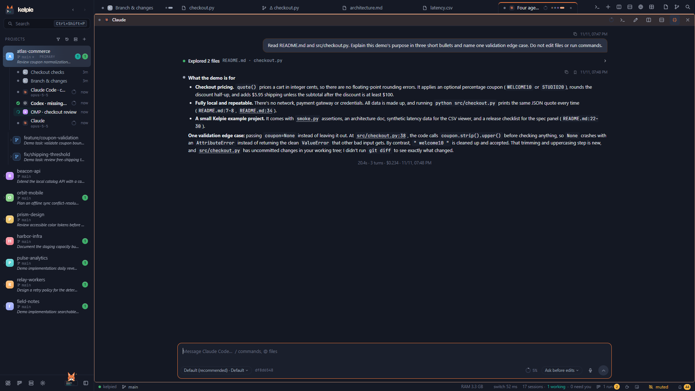</a><br><strong>Windows</strong><br><sub>Windows 10 1809 trở lên và Windows 11. Ảnh cho thấy câu trả lời thật của Claude Code trong chat view.</sub></td>
<td align="center" valign="top" width="25%"><a href="docs/screenshots/mac-hero.png">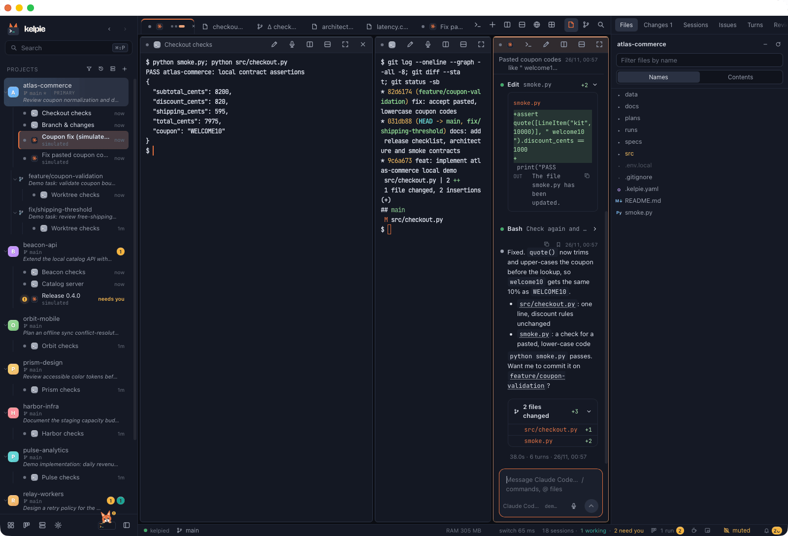</a><br><strong>macOS</strong><br><sub>macOS 12 trở lên. Hai shell và một cuộc chat nằm cạnh nhau (agent giả lập).</sub></td>
<td align="center" valign="top" width="25%"><a href="docs/screenshots/linux-hero.png">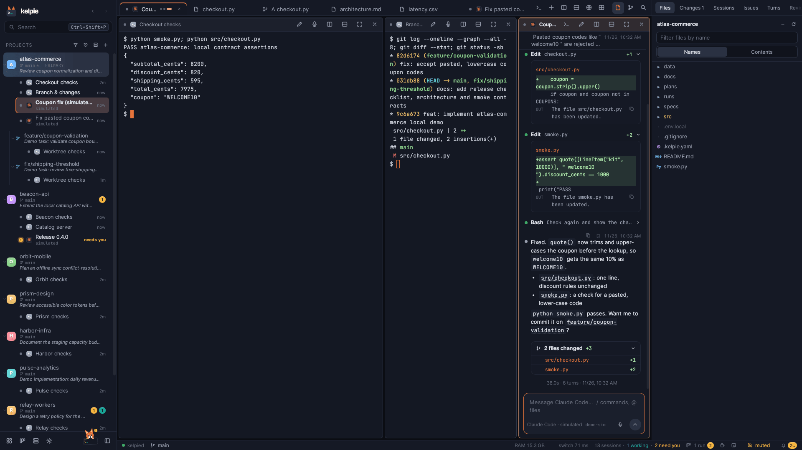</a><br><strong>Linux</strong><br><sub>x86-64 với glibc 2.35 trở lên, dạng AppImage hoặc .deb. Không gian làm việc giống hệt các nền tảng khác (agent giả lập).</sub></td>
<td align="center" valign="top" width="25%"><a href="docs/screenshots/phone-inbox-control.png">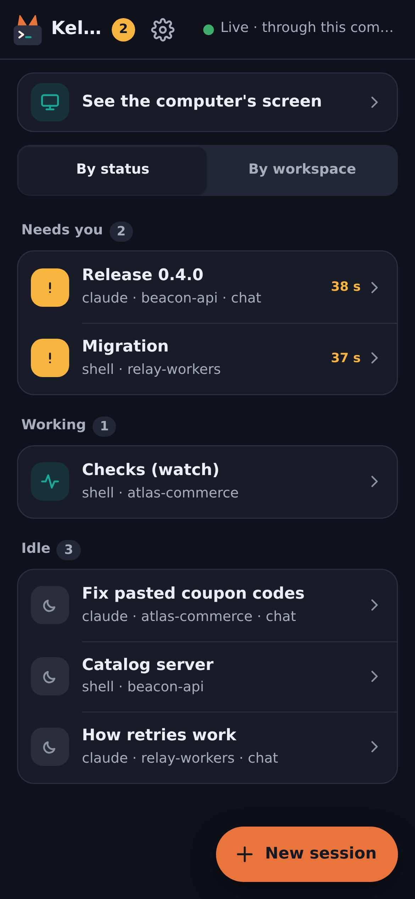</a><br><strong>Điện thoại</strong><br><sub>iPhone và Android. Mọi phiên được xếp theo trạng thái (agent giả lập).</sub></td>
</tr>
</table>

## Cập nhật không bao giờ làm gián đoạn agent

Daemon `kelpied` giữ mọi terminal và tiến trình agent, còn cửa sổ chỉ làm nhiệm vụ hiển thị. Khi Kelpie tìm thấy bản phát hành mới và bạn chọn **Install now** hoặc **Install when idle**, chỉ cửa sổ khởi động lại, trong khi daemon giữ mọi terminal và agent tiếp tục chạy. Sau khi mở lại, cửa sổ kết nối với đúng các màn hình cũ, vì vậy bạn không phải chờ agent làm xong rồi mới cập nhật. Ngoại lệ duy nhất là lần cập nhật đầu tiên từ một bản 0.1 đời đầu, khi daemon còn chạy từ thư mục cài đặt: lần cập nhật đó dừng các phiên một lần, báo trước cho bạn, và các agent tiếp tục sau đó.

Kelpie là công cụ cá nhân. Các phiên của bạn chạy trong `kelpied` ngay trên máy của bạn, Kelpie không cần tài khoản, và không có dịch vụ nào của Kelpie giữ công việc của bạn. Khi bạn thoát Kelpie, ứng dụng sẽ hỏi trước nếu vẫn còn việc đang chạy rồi mới dừng các phiên, và đến lần mở sau, các agent tiếp tục đúng cuộc hội thoại cũ. Nếu muốn automation, kết nối điện thoại hoặc việc sao chép tệp vẫn chạy khi cửa sổ đã đóng, bạn có thể [giữ daemon chạy nền](docs/user-guide.vi.md#cài-đặt-và-cập-nhật).

## Vì sao nên dùng Kelpie

- Kelpie khởi chạy chính các CLI agent mà bạn đã cài, với tài khoản, gói thuê bao và quy tắc cấp quyền của bạn, nên bạn không phải đổi công cụ hay tạo thêm tài khoản nào.
- Bảng điều khiển xếp mọi phiên vào các nhóm *Needs you*, *Working*, *Done* và *Failed*, nhờ đó bạn trả lời được một agent đang chờ mà không cần mở tab của nó.
- Mỗi việc làm song song có thể có Git worktree, phiên và ghi chú riêng, còn bảng công việc cho bạn thấy từng việc đang ở cột *Todo*, *In progress*, *Review* hay *Done*.
- Khi agent làm xong, bạn duyệt diff và ghi chú ngay trong Kelpie, sau đó nút **Finish** sẽ commit, gộp nhánh, chạy các bước kiểm tra bạn đã duyệt và dọn worktree.
- Ứng dụng điện thoại tuỳ chọn báo cho bạn khi có phiên cần bạn và cho phép bạn trả lời từ bất cứ đâu, với kết nối được mã hoá đầu cuối.

## Agent thật, câu trả lời thật

Kelpie khởi chạy mỗi CLI đúng như bản gốc, nên mỗi agent giữ nguyên giao diện của nó. Ba câu trả lời dưới đây, cũng như câu trả lời trong chat view ở phần trên, đều là câu trả lời thật của model, được tạo bằng tài khoản thật trên project thanh toán mẫu. Tệp [capture.json](docs/screenshots/capture.json) ghi rõ phần nào là dữ liệu mẫu.

<table>
<tr>
<td align="center" valign="top" width="33%"><a href="docs/screenshots/claude.png">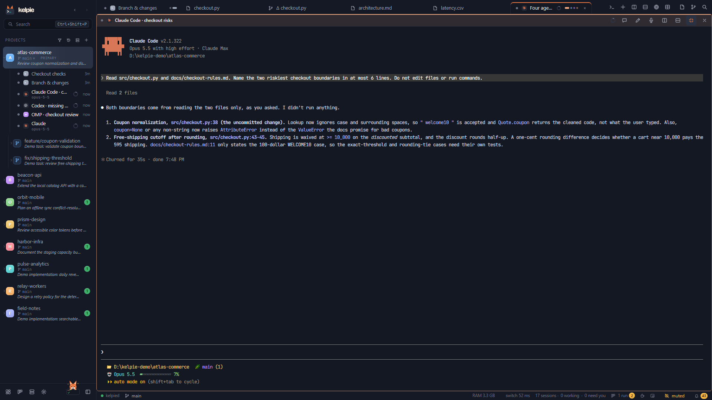</a><br><strong>Claude Code</strong><br><sub>Claude Code giữ nguyên giao diện terminal gốc và chỉ ra những ranh giới rủi ro nhất của phần thanh toán.</sub></td>
<td align="center" valign="top" width="33%"><a href="docs/screenshots/codex.png">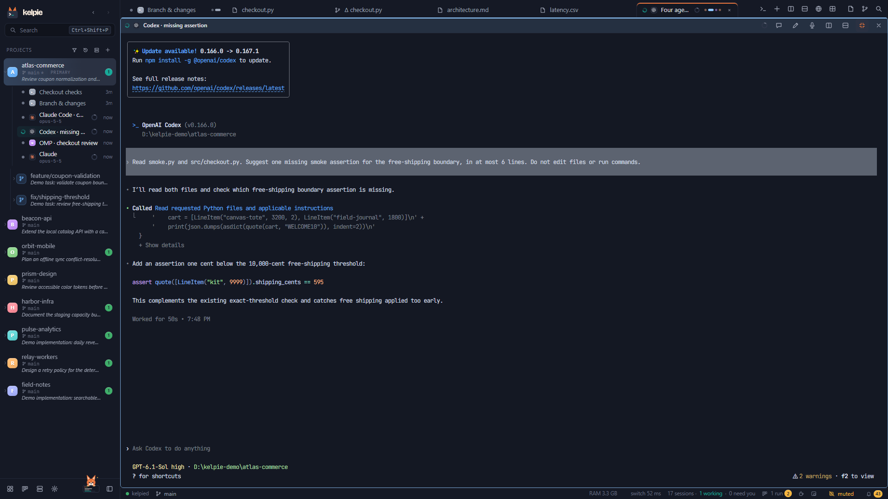</a><br><strong>Codex</strong><br><sub>Codex đọc các bước kiểm tra nhanh và gợi ý một assertion còn thiếu cho ngưỡng miễn phí vận chuyển.</sub></td>
<td align="center" valign="top" width="33%"><a href="docs/screenshots/omp.png">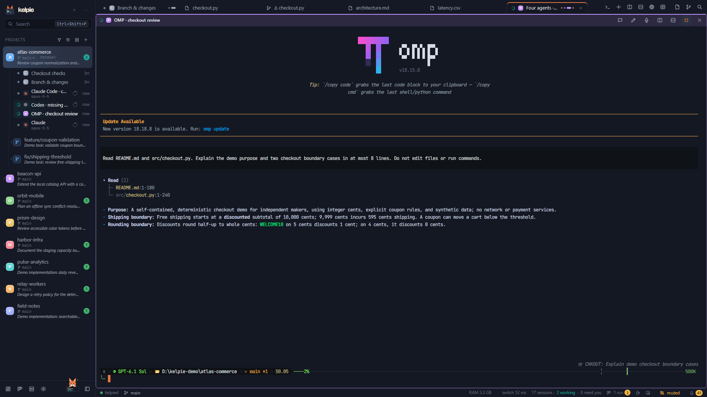</a><br><strong>OMP</strong><br><sub>OMP đọc mã thanh toán, sau đó giải thích quy tắc tính phí vận chuyển và cách làm tròn.</sub></td>
</tr>
</table>

## Kelpie có những gì

<table>
<tr>
<td align="center" valign="top" width="33%"><a href="docs/screenshots/dashboard.png">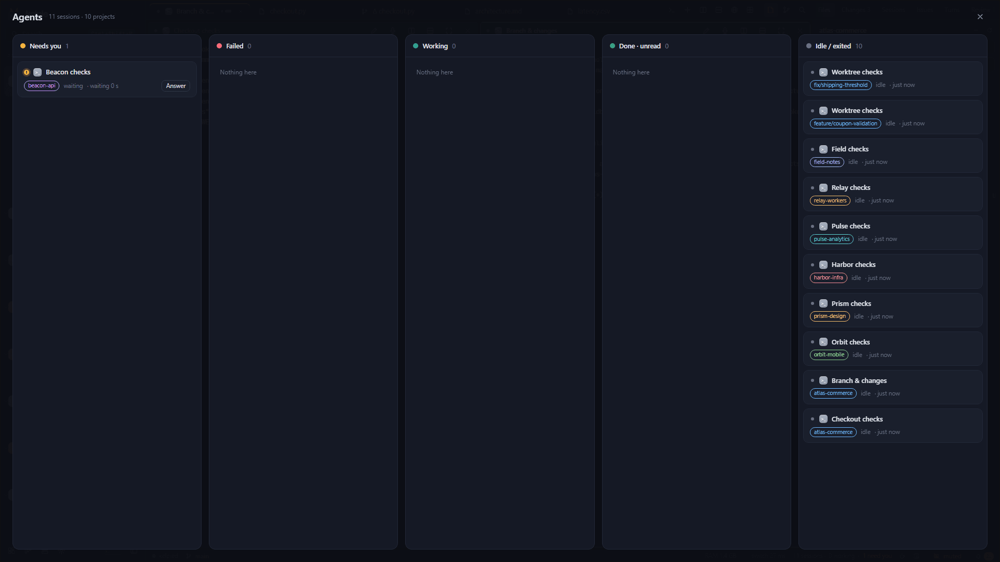</a><br><strong><a href="docs/user-guide.md#everyday-use">Biết phiên nào cần bạn</a></strong><br><sub>Bảng điều khiển xếp các phiên theo trạng thái, và bạn trả lời một câu hỏi đang chờ mà không cần mở tab.</sub></td>
<td align="center" valign="top" width="33%"><a href="docs/screenshots/board.png">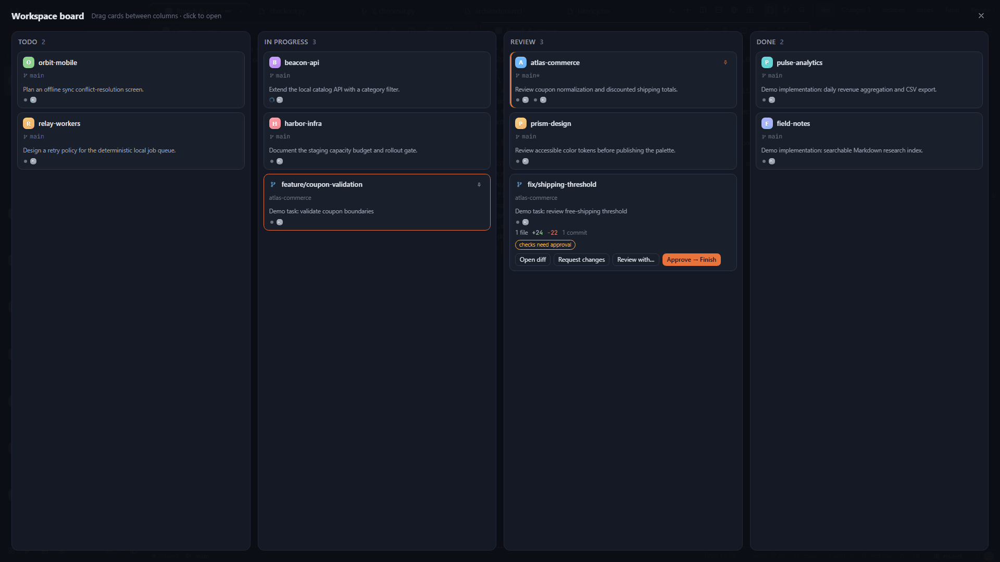</a><br><strong><a href="docs/user-guide.md#worktrees-and-the-workspace-board">Worktree và bảng công việc</a></strong><br><sub>Mỗi việc có Git worktree riêng, còn bảng công việc cho thấy việc đó đang ở Todo, In progress, Review hay Done.</sub></td>
<td align="center" valign="top" width="33%"><a href="docs/screenshots/review-notes.png">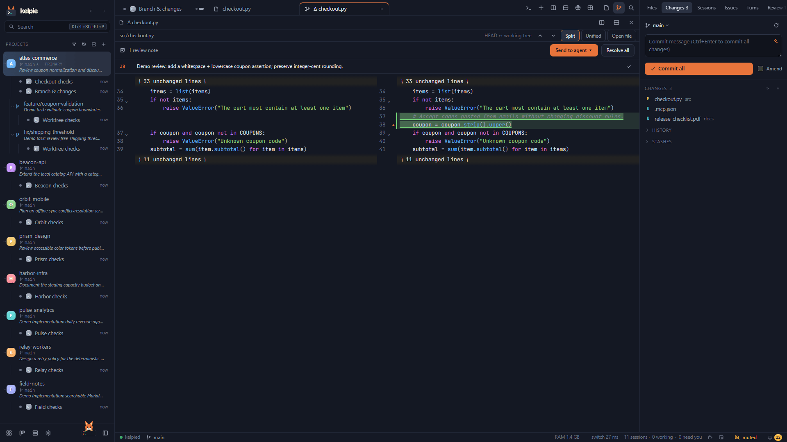</a><br><strong><a href="docs/user-guide.md#source-control-and-review">Ghi chú khi duyệt</a></strong><br><sub>Bạn ghi chú trên diff, rồi Kelpie gửi toàn bộ ghi chú cho agent trong một yêu cầu tập trung.</sub></td>
</tr>
<tr>
<td align="center" valign="top" width="33%"><a href="docs/screenshots/finish.png">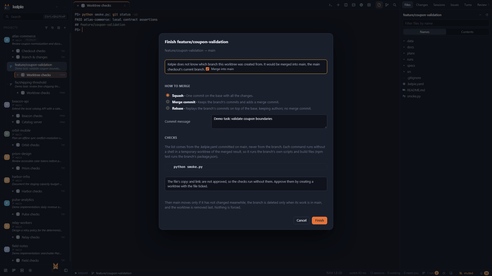</a><br><strong><a href="docs/user-guide.md#review-and-finish">Finish</a></strong><br><sub>Finish commit, gộp nhánh, chạy các bước kiểm tra bạn đã duyệt, và chỉ xoá worktree khi mọi bước khác đã thành công.</sub></td>
<td align="center" valign="top" width="33%"><a href="docs/screenshots/review-with.png">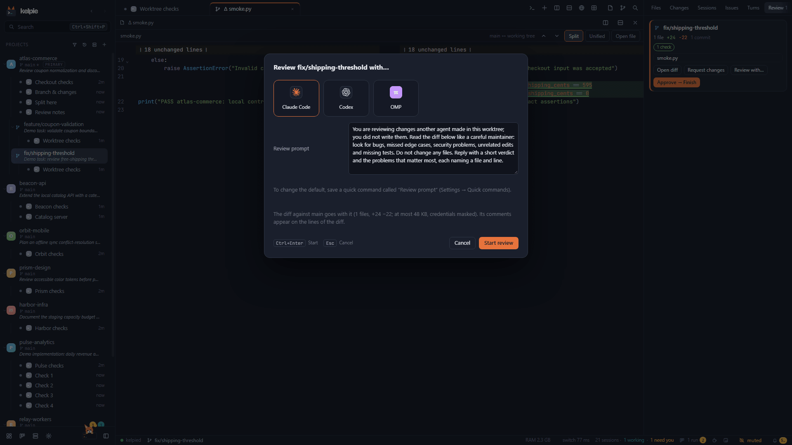</a><br><strong><a href="docs/user-guide.md#review-with-another-agent-and-best-of-several">Thêm một góc nhìn</a></strong><br><sub>Một agent của hãng khác xem xét cùng worktree đó và để lại ghi chú riêng.</sub></td>
<td align="center" valign="top" width="33%"><a href="docs/screenshots/sub-sessions.png">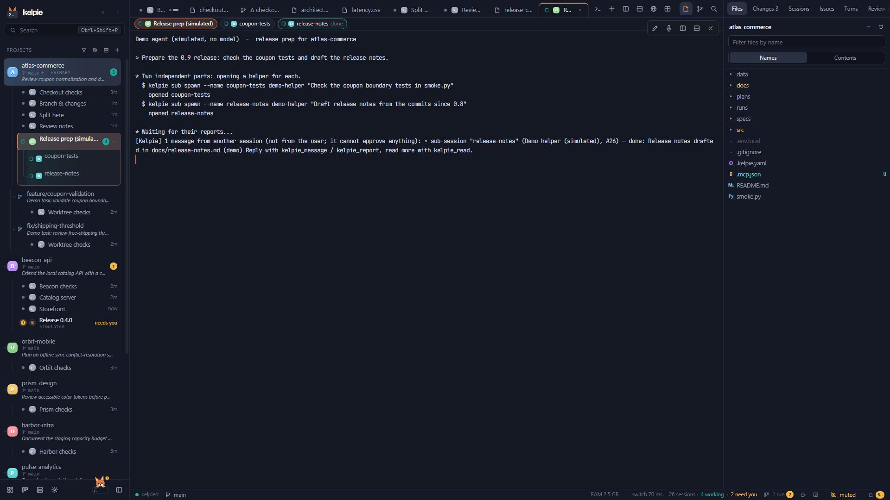</a><br><strong><a href="docs/user-guide.md#sub-sessions">Sub-session</a></strong><br><sub>Một agent mở thêm phiên agent khác, và bạn theo dõi, điều hướng hoặc đóng được các phiên đó (agent giả lập).</sub></td>
</tr>
<tr>
<td align="center" valign="top" width="33%"><a href="docs/screenshots/runs.png">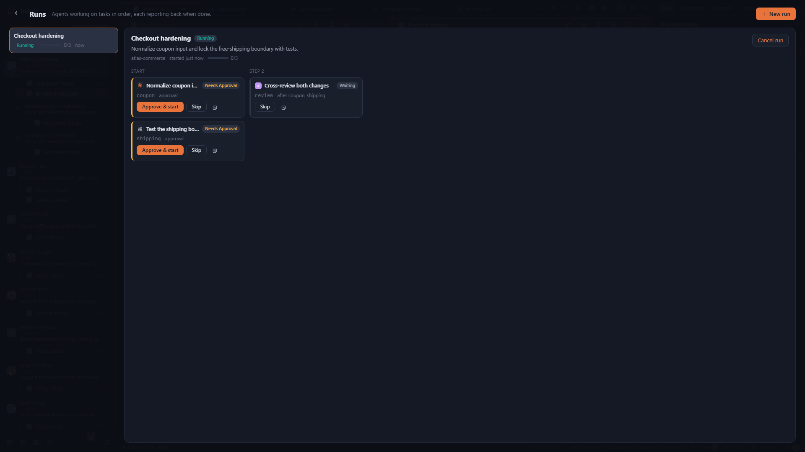</a><br><strong><a href="docs/user-guide.md#orchestration-runs">Run điều phối</a></strong><br><sub>Một run chia việc lớn thành các nhiệm vụ cho agent, kèm phụ thuộc và bước phê duyệt.</sub></td>
<td align="center" valign="top" width="33%"><a href="docs/screenshots/plan.png">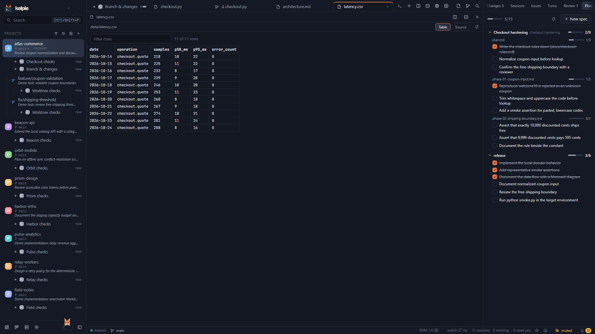</a><br><strong><a href="docs/user-guide.md#specs-and-tasks-the-plan-tab">Kế hoạch trong repository</a></strong><br><sub>Tab Plan đọc checklist Markdown, cho bạn tích ô và giao bất kỳ nhiệm vụ nào cho agent.</sub></td>
<td align="center" valign="top" width="33%"><a href="docs/screenshots/broadcast.png">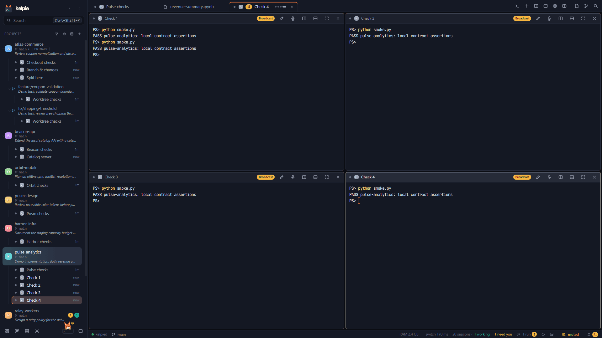</a><br><strong><a href="docs/user-guide.md#layouts">Lưới và gõ đồng loạt</a></strong><br><sub>Bạn xếp các phiên thành lưới tuỳ ý, và một dòng gõ vào sẽ đi tới mọi terminal của tab.</sub></td>
</tr>
<tr>
<td align="center" valign="top" width="33%"><a href="docs/screenshots/chatgpt.png">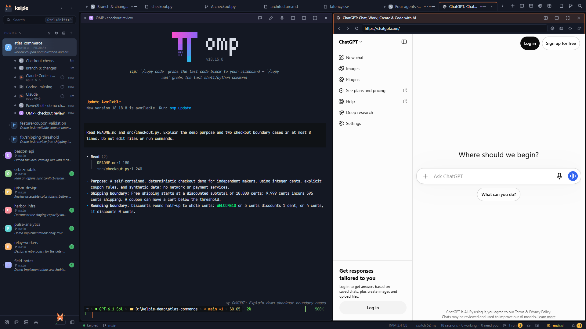</a><br><strong><a href="docs/user-guide.md#browser-panes-and-design-mode">Trình duyệt cạnh agent</a></strong><br><sub>Trang web ChatGPT thật ở trạng thái chưa đăng nhập nằm cạnh câu trả lời thật của OMP.</sub></td>
<td align="center" valign="top" width="33%"><a href="docs/screenshots/design-mode.png">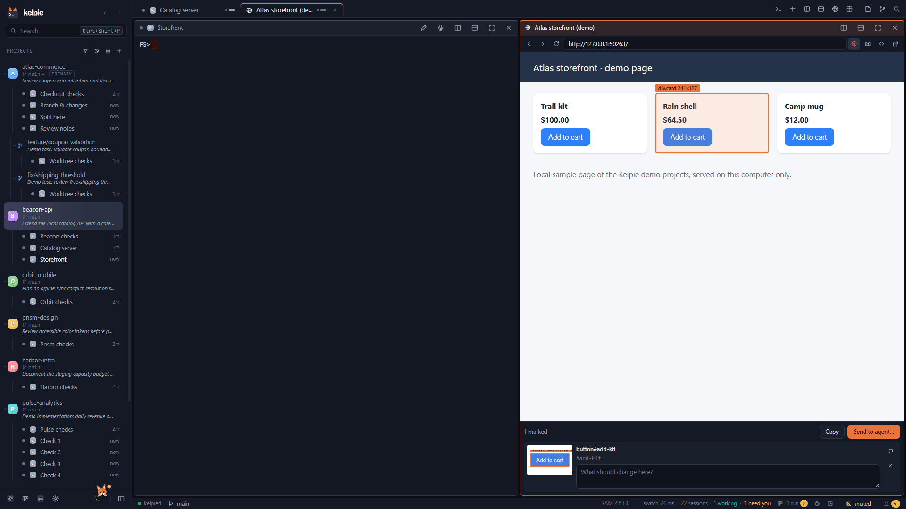</a><br><strong><a href="docs/user-guide.md#browser-panes-and-design-mode">Chế độ thiết kế</a></strong><br><sub>Bạn chọn một phần tử trên trang cục bộ rồi nói cho agent biết cần thay đổi gì.</sub></td>
<td align="center" valign="top" width="33%"><a href="docs/screenshots/processes.png">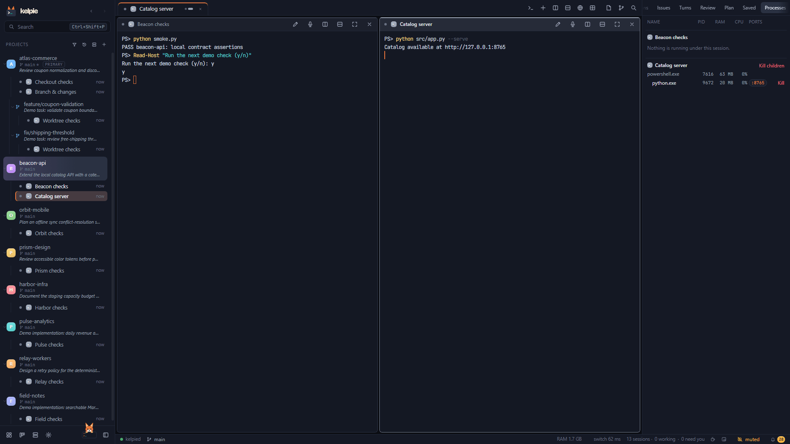</a><br><strong><a href="docs/user-guide.md#processes-ports-and-preview">Tiến trình và cổng</a></strong><br><sub>Panel này cho thấy chương trình, bộ nhớ, CPU và cổng của từng phiên, và Kelpie chỉ dừng một chương trình sau khi nói rõ những gì sẽ kết thúc.</sub></td>
</tr>
<tr>
<td align="center" valign="top" width="33%"><a href="docs/screenshots/hosts.png"></a><br><strong><a href="docs/user-guide.md#ssh-hosts">SSH hosts</a></strong><br><sub>Máy chủ, khoá, chuyển tiếp cổng và truyền tệp nằm ở một nơi, còn agent trên máy chủ chạy trong <code>tmux</code>.</sub></td>
<td align="center" valign="top" width="33%"><a href="docs/screenshots/powershell.png">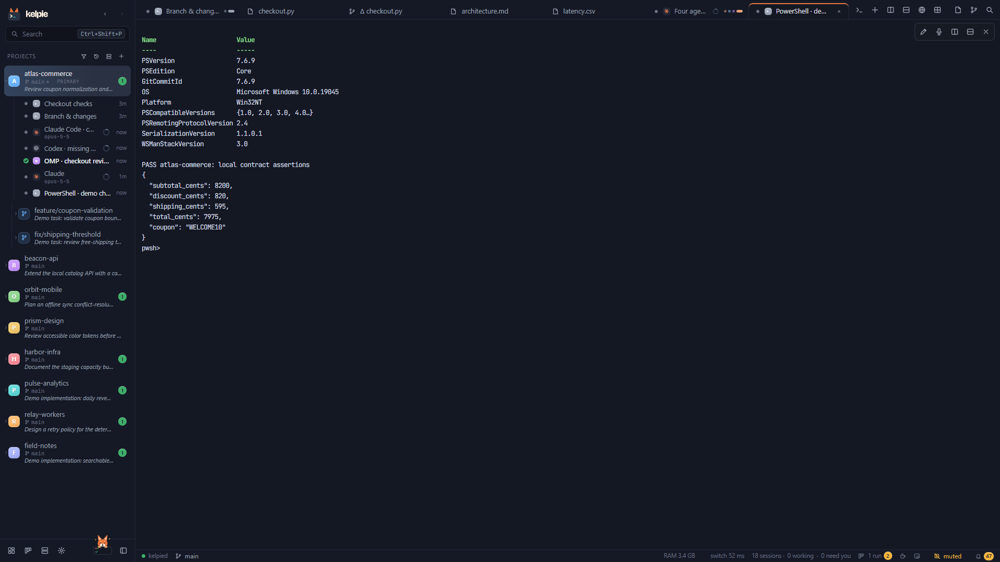</a><br><strong><a href="docs/user-guide.md#terminals">Shell cạnh agent</a></strong><br><sub>PowerShell, Bash hay zsh có chỗ đứng như một agent, và ở đây PowerShell 7 chạy các bước kiểm tra của bộ mẫu.</sub></td>
<td align="center" valign="top" width="33%"><a href="docs/screenshots/file-link.png">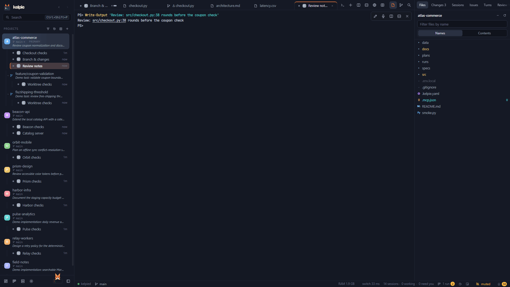</a><br><strong><a href="docs/user-guide.md#terminals">Liên kết tệp</a></strong><br><sub>Khi agent in ra một đường dẫn, bạn Ctrl+click để mở tệp ở đúng dòng đó.</sub></td>
</tr>
<tr>
<td align="center" valign="top" width="33%"><a href="docs/screenshots/usage.png">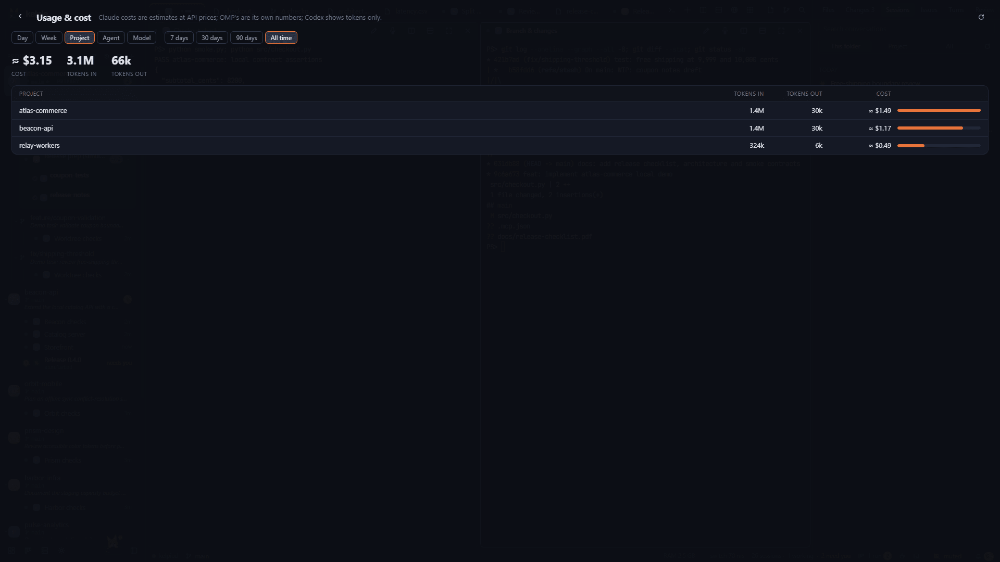</a><br><strong><a href="docs/user-guide.md#context-tokens-and-cost">Mức dùng và chi phí</a></strong><br><sub>Chi phí và token được thống kê theo ngày, project, agent hoặc model từ transcript của các agent (agent giả lập).</sub></td>
<td align="center" valign="top" width="33%"><a href="docs/screenshots/agent-setup.png">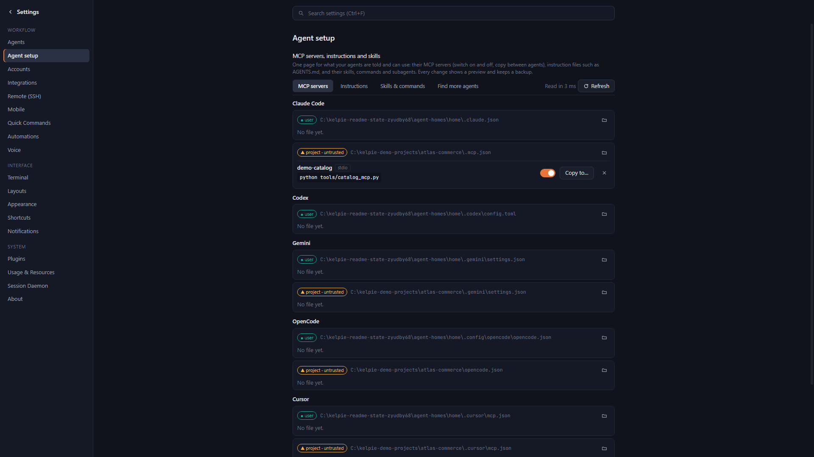</a><br><strong><a href="docs/user-guide.md#agent-setup">Agent setup</a></strong><br><sub>MCP server, tệp hướng dẫn và skill của mọi agent được quản lý ở cùng một nơi.</sub></td>
<td align="center" valign="top" width="33%"><a href="docs/screenshots/theme-editor.png">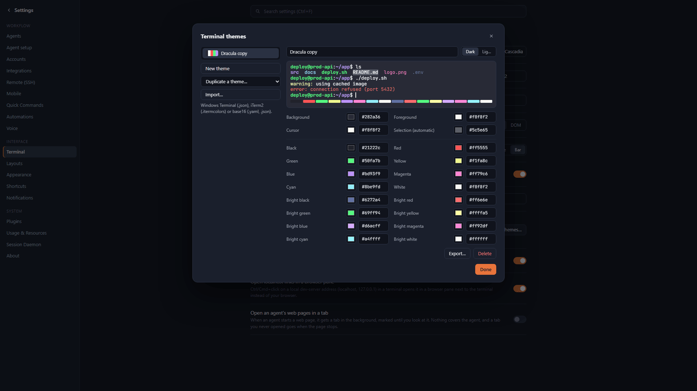</a><br><strong><a href="docs/user-guide.md#terminals">Tuỳ chỉnh theo ý bạn</a></strong><br><sub>Bạn tạo theme terminal riêng với bản xem trước trực tiếp, ghi lại phím tắt và chọn giao diện tiếng Anh hoặc tiếng Việt.</sub></td>
</tr>
</table>

[Danh sách đầy đủ tính năng](#danh-sách-đầy-đủ-tính-năng) ở phía dưới dẫn từng tính năng tới hướng dẫn sử dụng.

## Các phiên của bạn trên điện thoại

Truy cập từ điện thoại là tuỳ chọn và được tắt theo mặc định. Sau khi bạn ghép đôi, điện thoại liệt kê các phiên theo trạng thái, rung khi có phiên cần bạn, và cho phép bạn đọc, gõ, phê duyệt và khởi động agent, trong khi mọi dữ liệu đều được mã hoá đầu cuối. Bạn duyệt từng điện thoại trên máy tính bằng cách nhập mã mà điện thoại hiển thị, còn khoá ứng dụng trên điện thoại yêu cầu Face ID, vân tay hoặc mật mã máy. Nếu bạn cho phép, điện thoại còn xem và điều khiển được chính màn hình máy tính trên Windows và trên macOS 12.3 trở lên, và trong lúc đó máy tính luôn hiện một viền màu cam cùng một phím tắt để dừng. [Hướng dẫn truy cập từ điện thoại](docs/user-guide.md#phone-access) giải thích ba cách kết nối và điều mà mỗi cách phải tin tưởng.

<table>
<tr>
<td align="center" valign="top" width="25%"><a href="docs/screenshots/phone-safari-inbox.png">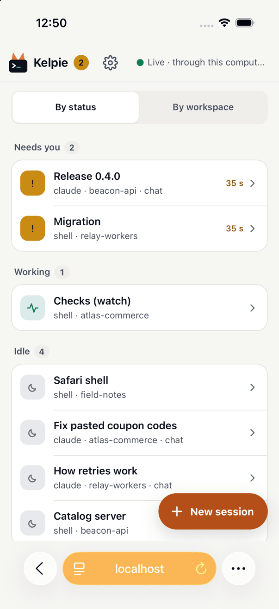</a><br><sub>Hộp thư trong Safari trên iPhone, với các phiên cần bạn đứng đầu (agent giả lập).</sub></td>
<td align="center" valign="top" width="25%"><a href="docs/screenshots/phone-chat-approval.png">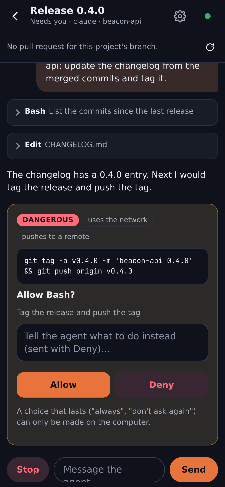</a><br><sub>Bạn cho phép hoặc từ chối lệnh của agent ngay trên điện thoại (agent giả lập).</sub></td>
<td align="center" valign="top" width="25%"><a href="docs/screenshots/phone-terminal-keys.png">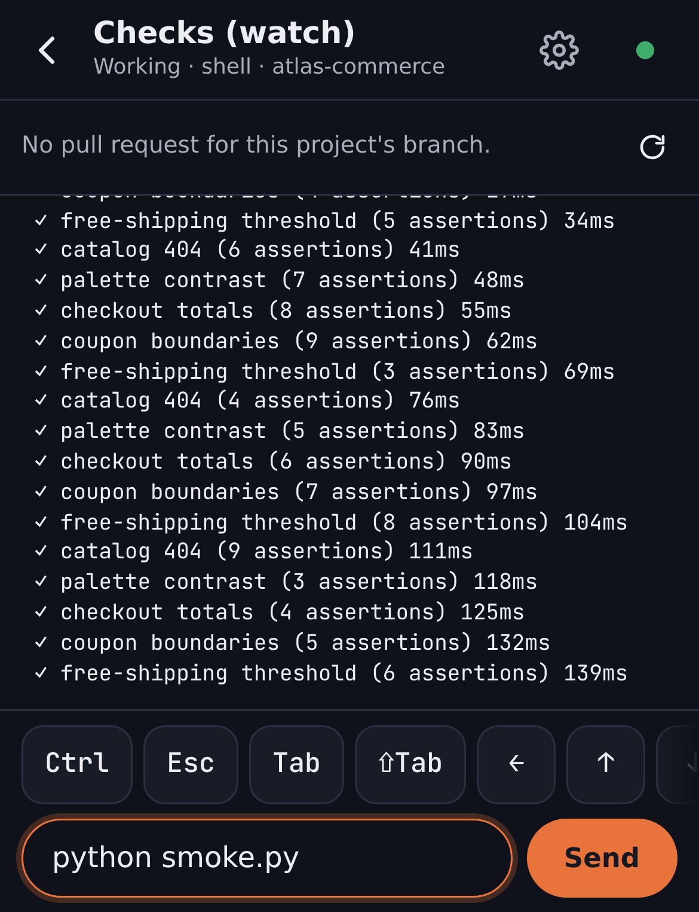</a><br><sub>Bạn gõ vào một phiên terminal, với thanh phím nằm phía trên bàn phím.</sub></td>
<td align="center" valign="top" width="25%"><a href="docs/screenshots/phone-screen-windows.png">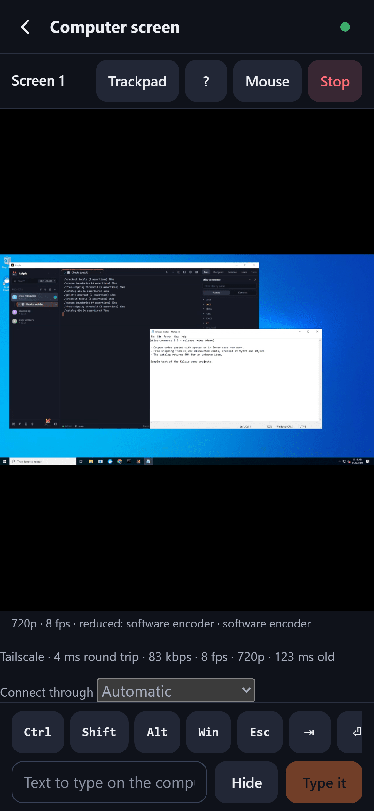</a><br><sub>Bạn xem và điều khiển màn hình Windows bằng trackpad và các phím bổ trợ.</sub></td>
</tr>
</table>

## Xem các clip ngắn

<table>
<tr>
<td align="center" valign="top" width="50%"><a href="docs/media/mac-phone-control.gif">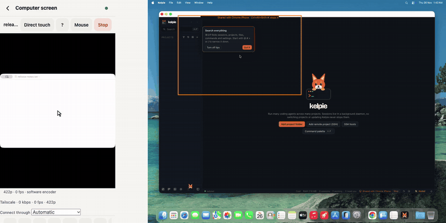</a><br><strong>Điện thoại điều khiển máy Mac</strong><br><sub>Từ điện thoại, bạn chạm vào TextEdit trên Mac, gõ một dòng rồi bấm ⌘S để lưu.</sub></td>
<td align="center" valign="top" width="50%"><a href="docs/media/clip-worktree-finish.gif">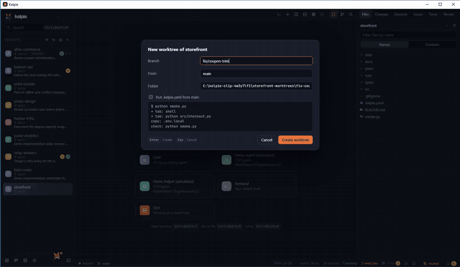</a><br><strong>Từ worktree tới main</strong><br><sub>Bạn tạo worktree mới, một shell commit thêm một bước kiểm tra trong đó, rồi Finish gộp nó vào main và worktree biến mất.</sub></td>
</tr>
</table>

## Thêm ảnh trên từng nền tảng

Mọi ảnh dưới đây đều được chụp từ ứng dụng thật với các project demo. Ảnh có ghi *agent giả lập* cho thấy những chương trình demo nhỏ chạy trên máy và nói theo định dạng của agent, nên ảnh đó không gọi model nào và không chứa câu trả lời thật của model. Tệp [README-media.json](docs/screenshots/README-media.json) ghi lại nền tảng, chú thích và cách tạo của từng ảnh.

<details>
<summary><strong>Windows</strong></summary>

<table>
<tr>
<td align="center" valign="top" width="33%"><a href="docs/screenshots/welcome.png">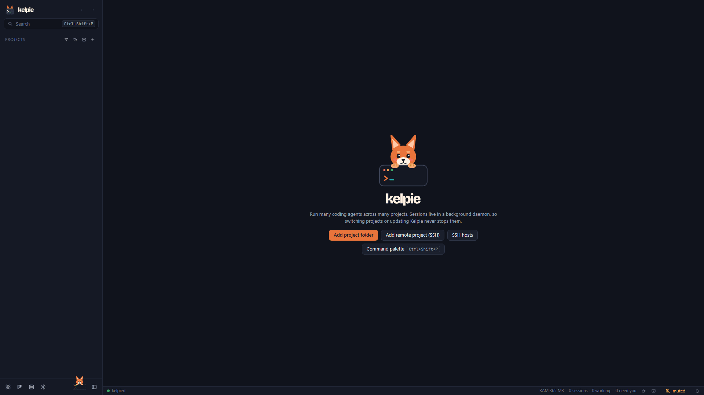</a><br><sub>Màn hình chào khi chưa thêm dự án nào.</sub></td>
<td align="center" valign="top" width="33%"><a href="docs/screenshots/search.png">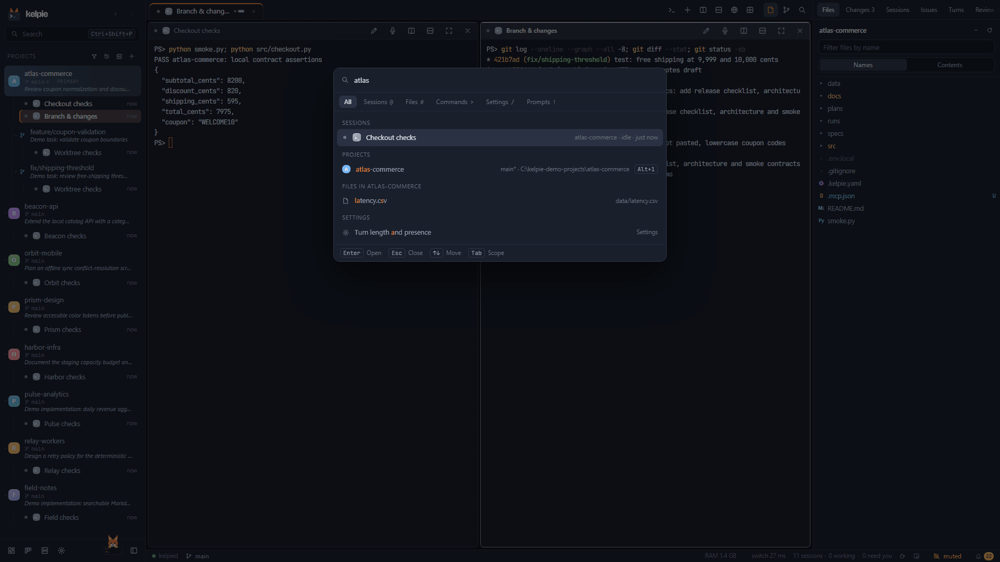</a><br><sub>Một ô tìm kiếm chung tìm được phiên, dự án, tệp và cài đặt.</sub></td>
<td align="center" valign="top" width="33%"><a href="docs/screenshots/changes.png">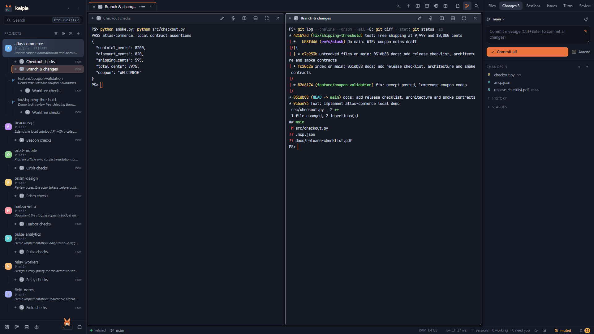</a><br><sub>Bảng Changes nằm cạnh hai shell, cho thấy nhánh, tệp đã đổi và nút Commit all.</sub></td>
</tr>
<tr>
<td align="center" valign="top" width="33%"><a href="docs/screenshots/editor.png"></a><br><sub>Trình soạn thảo mở mã checkout của dự án mẫu, bên cạnh là bảng Changes.</sub></td>
<td align="center" valign="top" width="33%"><a href="docs/screenshots/markdown.png">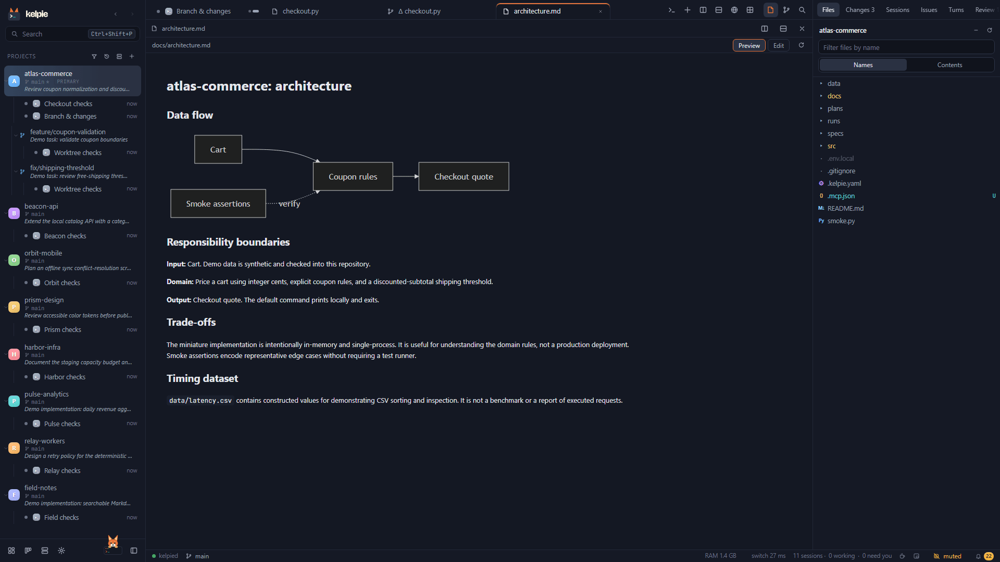</a><br><sub>Tệp Markdown có sơ đồ Mermaid được hiển thị ngay trong trình xem tệp.</sub></td>
<td align="center" valign="top" width="33%"><a href="docs/screenshots/csv.png">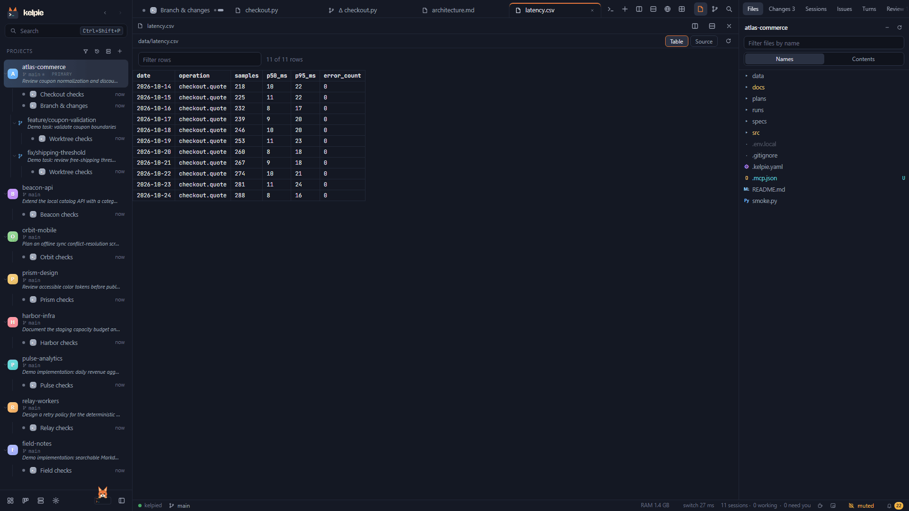</a><br><sub>Tệp CSV được hiển thị thành một bảng có thể sắp xếp.</sub></td>
</tr>
<tr>
<td align="center" valign="top" width="33%"><a href="docs/screenshots/new-session.png">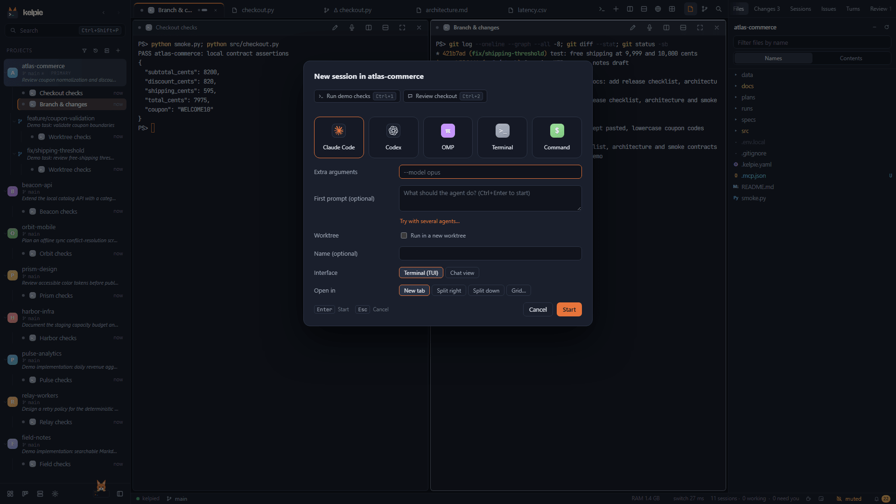</a><br><sub>Hộp mở phiên mới cho chọn agent, lời nhắn đầu tiên, worktree và nơi mở phiên.</sub></td>
<td align="center" valign="top" width="33%"><a href="docs/screenshots/layouts.png">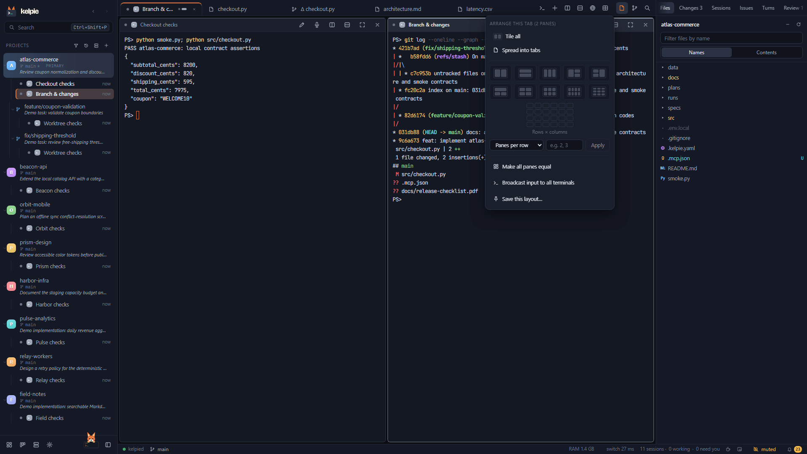</a><br><sub>Menu bố cục có sẵn các lưới và những bố cục đã lưu.</sub></td>
<td align="center" valign="top" width="33%"><a href="docs/screenshots/composer.png">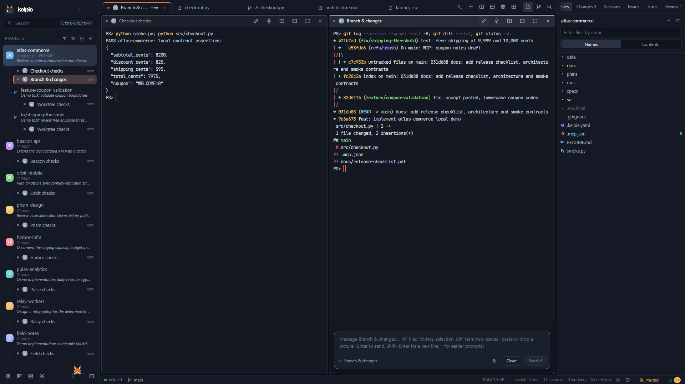</a><br><sub>Khung soạn nổi dùng để viết một lời nhắn dài hơn.</sub></td>
</tr>
<tr>
<td align="center" valign="top" width="33%"><a href="docs/screenshots/terminal-menu.png">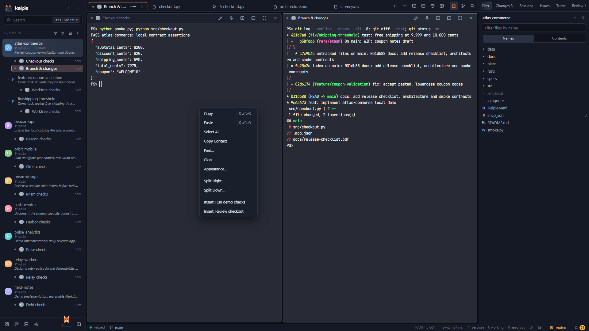</a><br><sub>Menu chuột phải của terminal có các lệnh chia khung, chuyển giao, đổi theme và nhiều lệnh khác.</sub></td>
<td align="center" valign="top" width="33%"><a href="docs/screenshots/floating.png">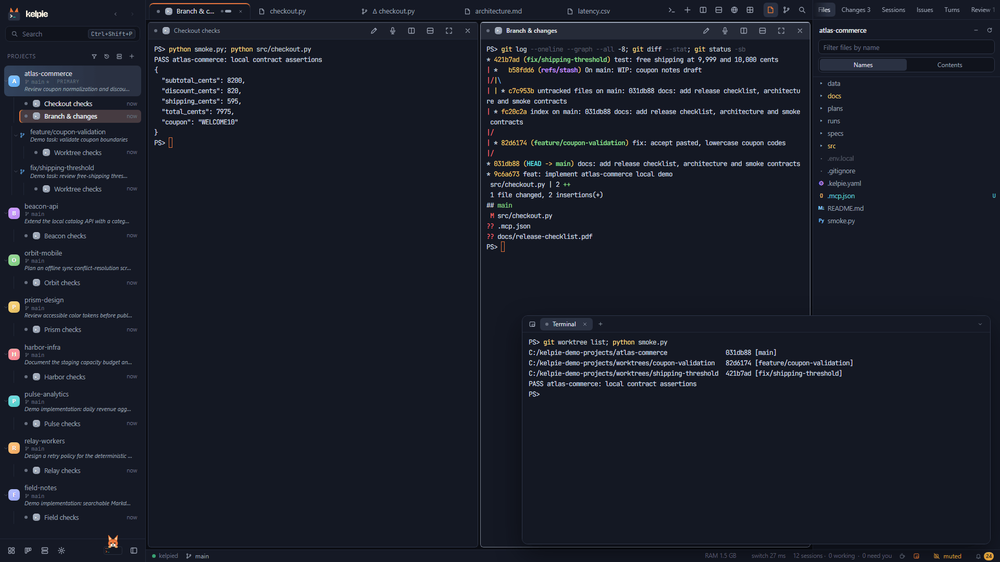</a><br><sub>Terminal nổi hiện ra phía trên không gian làm việc.</sub></td>
<td align="center" valign="top" width="33%"><a href="docs/screenshots/inbox.png">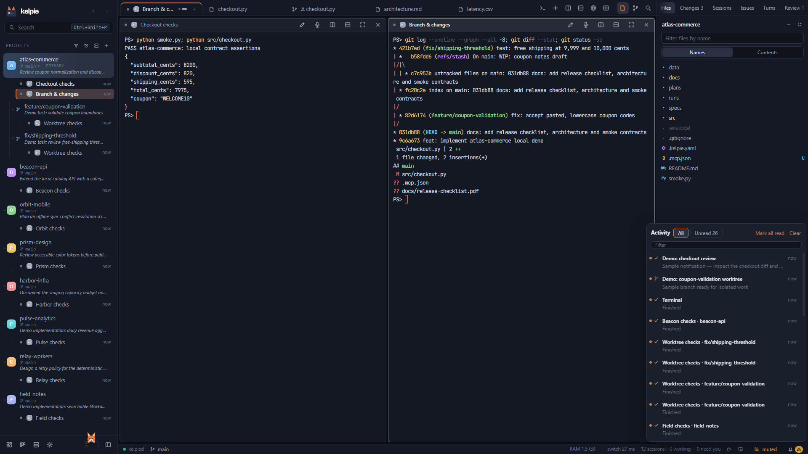</a><br><sub>Hộp Activity hiện các mục mẫu đã được ghi rõ là dữ liệu demo.</sub></td>
</tr>
<tr>
<td align="center" valign="top" width="33%"><a href="docs/screenshots/worktree-dialog.png">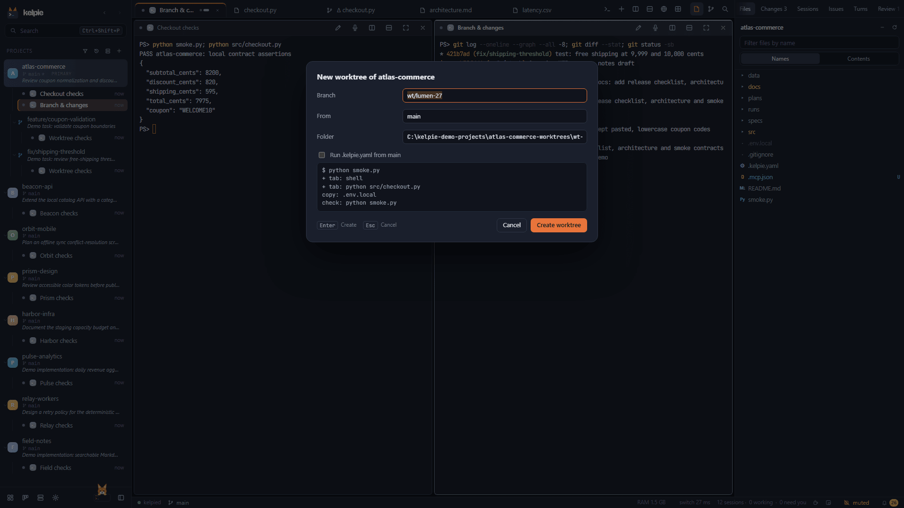</a><br><sub>Hộp tạo worktree mới đi kèm phần thiết lập từ tệp .kelpie.yaml của dự án.</sub></td>
<td align="center" valign="top" width="33%"><a href="docs/screenshots/automations.png">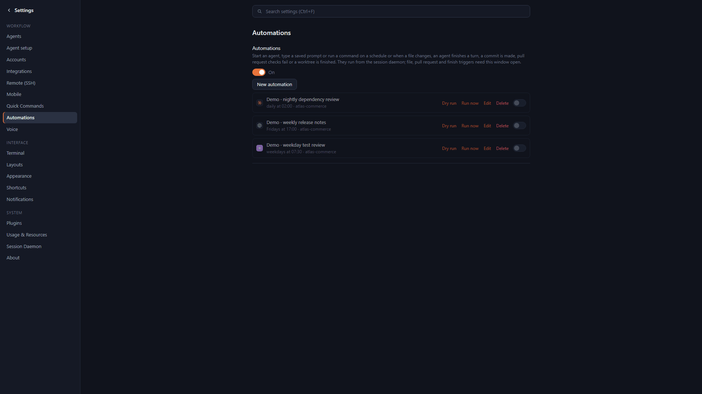</a><br><sub>Danh sách automation chạy theo lịch, đều là mẫu và đang tắt.</sub></td>
<td align="center" valign="top" width="33%"><a href="docs/screenshots/settings.png">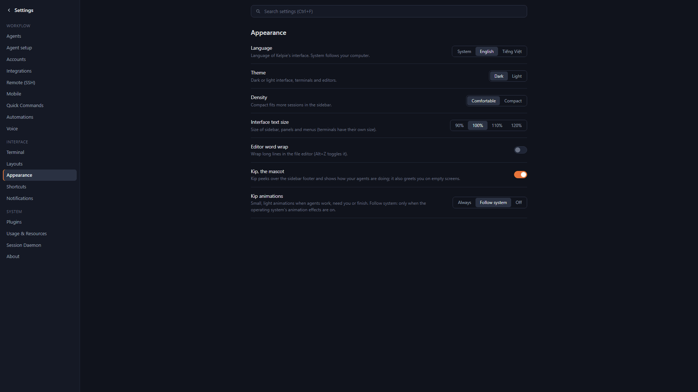</a><br><sub>Trang Settings → Appearance.</sub></td>
</tr>
<tr>
<td align="center" valign="top" width="33%"><a href="docs/screenshots/terminal-settings.png">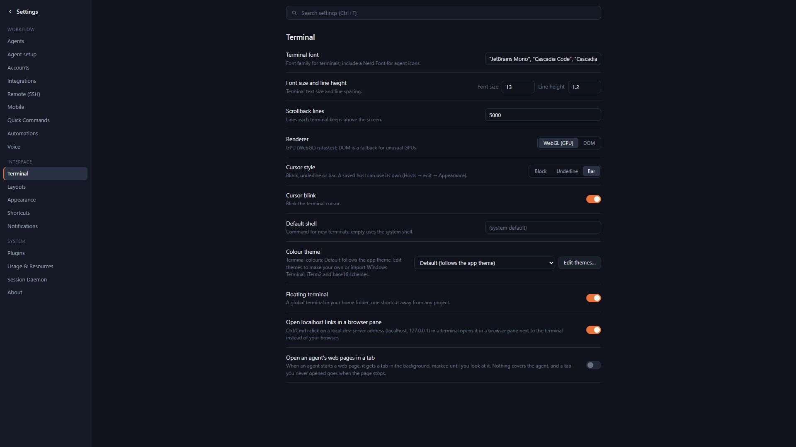</a><br><sub>Trang Settings → Terminal gồm phông chữ, bộ vẽ, con trỏ và bảng màu.</sub></td>
<td align="center" valign="top" width="33%"><a href="docs/screenshots/shortcuts.png">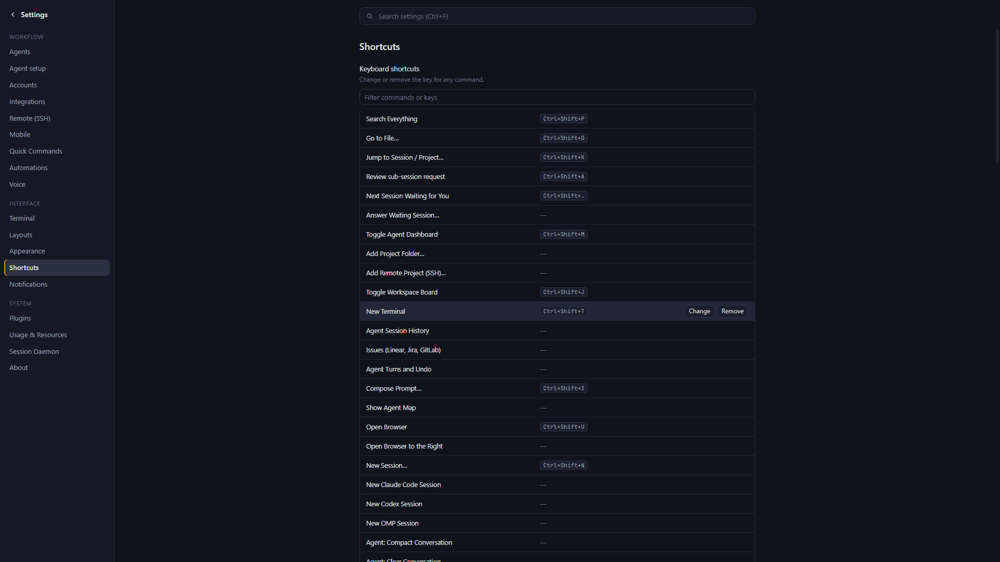</a><br><sub>Trang Settings → Shortcuts.</sub></td>
<td align="center" valign="top" width="33%"><a href="docs/screenshots/notebook.png">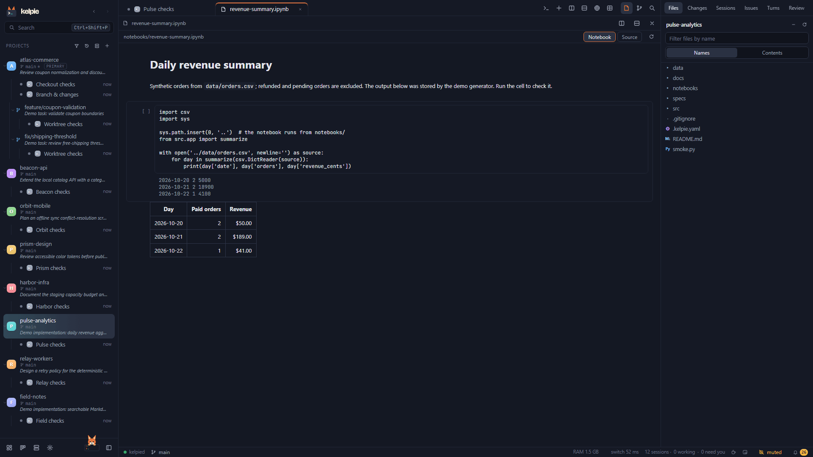</a><br><sub>Một notebook Jupyter được hiển thị cùng kết quả của nó.</sub></td>
</tr>
<tr>
<td align="center" valign="top" width="33%"><a href="docs/screenshots/try.png">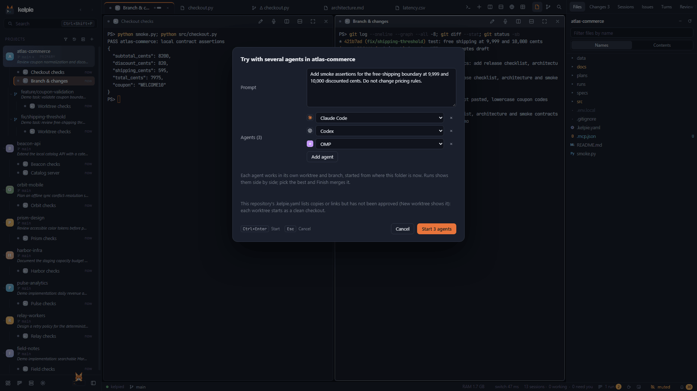</a><br><sub>Hộp Try with several agents giao một việc cho nhiều agent, mỗi agent làm trong worktree riêng.</sub></td>
<td align="center" valign="top" width="33%"><a href="docs/screenshots/plugins.png">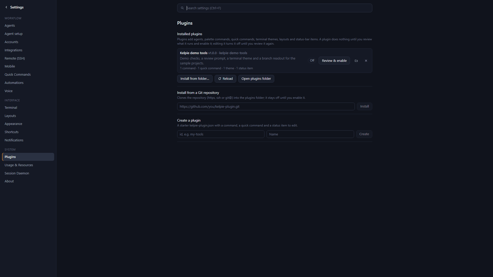</a><br><sub>Trang Settings → Plugins có plugin mẫu đang chờ được xem xét.</sub></td>
<td align="center" valign="top" width="33%"><a href="docs/screenshots/sidebar.png">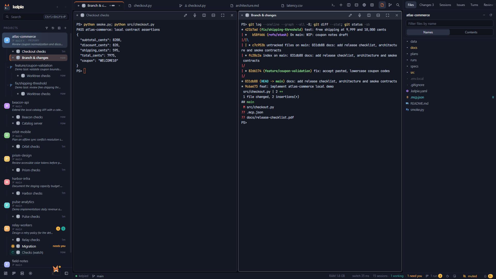</a><br><sub>Thanh bên cho thấy một phiên đang cần bạn, một phiên đang chạy, cùng nhánh, ghi chú và worktree của từng dự án (agent giả lập).</sub></td>
</tr>
<tr>
<td align="center" valign="top" width="33%"><a href="docs/screenshots/quick-answer.png"></a><br><sub>Bạn trả lời ngay trên bảng điều khiển: câu hỏi của phiên đang chờ hiện ra cùng các phím chọn, không cần rời bảng (agent giả lập).</sub></td>
<td align="center" valign="top" width="33%"><a href="docs/screenshots/split-picker.png"></a><br><sub>Phím Ctrl+Shift+D chia đôi khung, và khung trống hỏi bạn muốn chạy gì trong đó.</sub></td>
<td align="center" valign="top" width="33%"><a href="docs/screenshots/git-history.png"></a><br><sub>Bảng Changes mở phần History để xem các commit gần nhất của nhánh.</sub></td>
</tr>
<tr>
<td align="center" valign="top" width="33%"><a href="docs/screenshots/git-stashes.png"></a><br><sub>Bảng Changes mở phần Stashes, có một stash mẫu cùng hai nút Apply và Drop.</sub></td>
<td align="center" valign="top" width="33%"><a href="docs/screenshots/review-queue.png"></a><br><sub>Tab Review cho thấy một worktree đang chờ duyệt cùng diff của nó, nút Review with… và Approve → Finish.</sub></td>
<td align="center" valign="top" width="33%"><a href="docs/screenshots/automation-event.png"></a><br><sub>Một automation mới được kích hoạt bởi sự kiện khi một tệp Markdown trong docs/ thay đổi (chưa lưu).</sub></td>
</tr>
<tr>
<td align="center" valign="top" width="33%"><a href="docs/screenshots/host-edit.png"></a><br><sub>Ngăn chỉnh máy chủ có phần giao diện gồm màu nhãn, theme, phông chữ, con trỏ và bản xem trước.</sub></td>
<td align="center" valign="top" width="33%"><a href="docs/screenshots/notifications.png"></a><br><sub>Trang Settings → Notifications gồm thông báo trên máy, trên điện thoại, ntfy, Telegram và webhook.</sub></td>
<td align="center" valign="top" width="33%"><a href="docs/screenshots/mobile-settings.png"></a><br><sub>Trang Settings → Mobile khi đã bật truy cập từ điện thoại (không hiện mã ghép đôi).</sub></td>
</tr>
<tr>
<td align="center" valign="top" width="33%"><a href="docs/screenshots/voice.png"></a><br><sub>Trang Settings → Voice liệt kê các mô hình nhận giọng nói chạy ngay trên máy (máy thử không có micro).</sub></td>
<td align="center" valign="top" width="33%"><a href="docs/screenshots/settings-export.png"></a><br><sub>Phần xuất và nhập cài đặt cho chọn những mục muốn đưa vào.</sub></td>
<td align="center" valign="top" width="33%"><a href="docs/screenshots/chat-approval.png"></a><br><sub>Một cuộc chat đang chờ duyệt một lệnh có rủi ro với các lựa chọn Allow, Allow for session hoặc Deny (agent giả lập).</sub></td>
</tr>
<tr>
<td align="center" valign="top" width="33%"><a href="docs/screenshots/sub-sessions-ask.png"></a><br><sub>Một agent xin mở phiên con, và bạn chọn Allow once, Allow for this session, Always allow hoặc Deny (agent giả lập).</sub></td>
<td align="center" valign="top" width="33%"><a href="docs/screenshots/owed-checks.png"></a><br><sub>Hộp Activity hiện báo cáo của một phiên con và bước kiểm tra mà nó không tự chạy được (agent giả lập).</sub></td>
<td align="center" valign="top" width="33%"><a href="docs/screenshots/past-conversations.png"></a><br><sub>Tab Sessions liệt kê các cuộc trò chuyện cũ với Claude Code và Codex của dự án này (agent giả lập).</sub></td>
</tr>
<tr>
<td align="center" valign="top" width="33%"><a href="docs/media/clip-phone-answer.gif"></a><br><sub>Clip: một menu demo (không phải agent) đang chờ, điện thoại trả lời bằng một chạm, và khung trên máy tính chạy tiếp.</sub></td>
<td align="center" valign="top" width="33%"><a href="docs/screenshots/light.png"></a><br><sub>Không gian nhiều khung với theme sáng.</sub></td>
<td align="center" valign="top" width="33%"><a href="docs/screenshots/vietnamese.png"></a><br><sub>Không gian nhiều khung với giao diện tiếng Việt.</sub></td>
</tr>
<tr>
<td align="center" valign="top" width="33%"><a href="docs/screenshots/agents.png"></a><br><sub>Settings → Agents với các agent đã cài và các agent có sẵn.</sub></td>
</tr>
</table>

</details>

<details>
<summary><strong>macOS</strong></summary>

<table>
<tr>
<td align="center" valign="top" width="33%"><a href="docs/screenshots/mac-workspace.png"></a><br><sub>Một tab có hai phiên shell và bảng Files.</sub></td>
<td align="center" valign="top" width="33%"><a href="docs/screenshots/mac-welcome.png"></a><br><sub>Màn hình chào khi chưa thêm dự án nào.</sub></td>
<td align="center" valign="top" width="33%"><a href="docs/screenshots/mac-chat.png"></a><br><sub>Chế độ chat hiện các lệnh công cụ của agent, các chỗ sửa và những tệp đã đổi (agent giả lập).</sub></td>
</tr>
<tr>
<td align="center" valign="top" width="33%"><a href="docs/screenshots/mac-chat-approval.png"></a><br><sub>Một cuộc chat đang chờ duyệt một lệnh có rủi ro: Allow, Allow for session hoặc Deny (agent giả lập).</sub></td>
<td align="center" valign="top" width="33%"><a href="docs/screenshots/mac-dashboard-agents.png"></a><br><sub>Bảng điều khiển agent cho thấy phiên nào cần bạn, phiên nào đang chạy và phiên nào đang rảnh (agent giả lập).</sub></td>
<td align="center" valign="top" width="33%"><a href="docs/screenshots/mac-search.png"></a><br><sub>Ô tìm kiếm chung tìm được phiên, dự án, tệp và cài đặt.</sub></td>
</tr>
<tr>
<td align="center" valign="top" width="33%"><a href="docs/screenshots/mac-new-session.png"></a><br><sub>Hộp thoại phiên mới với danh sách agent, lệnh nhanh và nơi mở phiên.</sub></td>
<td align="center" valign="top" width="33%"><a href="docs/screenshots/mac-changes.png"></a><br><sub>Bảng Changes hiện nhánh, ô thông điệp commit và các tệp đã đổi.</sub></td>
<td align="center" valign="top" width="33%"><a href="docs/screenshots/mac-editor.png"></a><br><sub>Trình soạn thảo có sẵn mở một tệp mã nguồn mẫu.</sub></td>
</tr>
<tr>
<td align="center" valign="top" width="33%"><a href="docs/screenshots/mac-review-notes.png"></a><br><sub>Một ghi chú review gắn vào một dòng của diff, sẵn sàng gửi cho agent.</sub></td>
<td align="center" valign="top" width="33%"><a href="docs/screenshots/mac-markdown.png"></a><br><sub>Tệp Markdown có sơ đồ Mermaid được hiển thị.</sub></td>
<td align="center" valign="top" width="33%"><a href="docs/screenshots/mac-csv.png"></a><br><sub>Tệp CSV hiện thành bảng có thể sắp xếp.</sub></td>
</tr>
<tr>
<td align="center" valign="top" width="33%"><a href="docs/screenshots/mac-notebook.png"></a><br><sub>Một notebook Jupyter cùng kết quả của nó.</sub></td>
<td align="center" valign="top" width="33%"><a href="docs/screenshots/mac-plan.png"></a><br><sub>Tab Plan với các spec của dự án và danh sách việc.</sub></td>
<td align="center" valign="top" width="33%"><a href="docs/screenshots/mac-board.png"></a><br><sub>Bảng workspace xếp dự án và worktree theo từng giai đoạn.</sub></td>
</tr>
<tr>
<td align="center" valign="top" width="33%"><a href="docs/screenshots/mac-layouts.png"></a><br><sub>Menu bố cục với các lưới dựng sẵn, Tile all và Broadcast input.</sub></td>
<td align="center" valign="top" width="33%"><a href="docs/screenshots/mac-composer.png"></a><br><sub>Khung soạn nổi để viết prompt dài.</sub></td>
<td align="center" valign="top" width="33%"><a href="docs/screenshots/mac-terminal-menu.png"></a><br><sub>Menu ngữ cảnh của một terminal.</sub></td>
</tr>
<tr>
<td align="center" valign="top" width="33%"><a href="docs/screenshots/mac-floating.png"></a><br><sub>Terminal nổi phía trên workspace.</sub></td>
<td align="center" valign="top" width="33%"><a href="docs/screenshots/mac-inbox.png"></a><br><sub>Hộp hoạt động với các mẫu được ghi rõ là demo.</sub></td>
<td align="center" valign="top" width="33%"><a href="docs/screenshots/mac-worktree-dialog.png"></a><br><sub>Hộp thoại tạo worktree cùng tệp .kelpie.yaml của dự án.</sub></td>
</tr>
<tr>
<td align="center" valign="top" width="33%"><a href="docs/screenshots/mac-finish.png"></a><br><sub>Hộp thoại Finish cho chọn cách merge và các bước kiểm tra sẽ chạy.</sub></td>
<td align="center" valign="top" width="33%"><a href="docs/screenshots/mac-try.png"></a><br><sub>Try with several agents giao một việc cho nhiều agent, mỗi agent một worktree.</sub></td>
<td align="center" valign="top" width="33%"><a href="docs/screenshots/mac-runs.png"></a><br><sub>Một lượt chạy đang chờ duyệt các việc đầu tiên.</sub></td>
</tr>
<tr>
<td align="center" valign="top" width="33%"><a href="docs/screenshots/mac-processes.png"></a><br><sub>Bảng Processes hiện cổng của máy chủ mẫu.</sub></td>
<td align="center" valign="top" width="33%"><a href="docs/screenshots/mac-hosts.png"></a><br><sub>Danh sách máy SSH dùng địa chỉ tài liệu và không hề kết nối.</sub></td>
<td align="center" valign="top" width="33%"><a href="docs/screenshots/mac-automations.png"></a><br><sub>Các tự động hóa theo lịch, là mẫu đang tắt.</sub></td>
</tr>
<tr>
<td align="center" valign="top" width="33%"><a href="docs/screenshots/mac-plugins.png"></a><br><sub>Trang Plugins với plugin mẫu đang chờ duyệt.</sub></td>
<td align="center" valign="top" width="33%"><a href="docs/screenshots/mac-settings.png"></a><br><sub>Cài đặt → Giao diện.</sub></td>
<td align="center" valign="top" width="33%"><a href="docs/screenshots/mac-terminal-settings.png"></a><br><sub>Cài đặt → Terminal.</sub></td>
</tr>
<tr>
<td align="center" valign="top" width="33%"><a href="docs/screenshots/mac-shortcuts.png"></a><br><sub>Cài đặt → Phím tắt với các phím của Mac.</sub></td>
<td align="center" valign="top" width="33%"><a href="docs/screenshots/mac-settings-mobile.png"></a><br><sub>Cài đặt → Di động khi bật truy cập từ điện thoại, không hiện mã ghép đôi.</sub></td>
<td align="center" valign="top" width="33%"><a href="docs/screenshots/mac-mobile-permissions.png"></a><br><sub>Hai dòng quyền Screen Recording và Accessibility của Mac trong Cài đặt → Di động.</sub></td>
</tr>
<tr>
<td align="center" valign="top" width="33%"><a href="docs/screenshots/mac-settings-notifications.png"></a><br><sub>Cài đặt → Thông báo gồm thông báo trên máy và các kênh gửi tới điện thoại.</sub></td>
<td align="center" valign="top" width="33%"><a href="docs/screenshots/mac-settings-commands.png"></a><br><sub>Cài đặt → Lệnh nhanh.</sub></td>
<td align="center" valign="top" width="33%"><a href="docs/screenshots/mac-settings-daemon.png"></a><br><sub>Cài đặt → Session Daemon cho biết điều gì xảy ra khi đóng Kelpie, cùng chức năng xuất và nhập.</sub></td>
</tr>
<tr>
<td align="center" valign="top" width="33%"><a href="docs/screenshots/mac-settings-about.png"></a><br><sub>Cài đặt → Giới thiệu trên macOS.</sub></td>
<td align="center" valign="top" width="33%"><a href="docs/screenshots/mac-light.png"></a><br><sub>Giao diện sáng.</sub></td>
<td align="center" valign="top" width="33%"><a href="docs/screenshots/mac-vietnamese.png"></a><br><sub>Ứng dụng hiển thị bằng tiếng Việt.</sub></td>
</tr>
<tr>
<td align="center" valign="top" width="33%"><a href="docs/screenshots/mac-screen-from-phone.png"></a><br><sub>Điện thoại xem một cửa sổ TextEdit trên Mac, kèm thanh phím ⌘ ⌥ ⌃ ⇧.</sub></td>
</tr>
</table>

</details>

<details>
<summary><strong>Linux (Ubuntu 22.04)</strong></summary>

<table>
<tr>
<td align="center" valign="top" width="33%"><a href="docs/screenshots/linux-workspace.png"></a><br><sub>Một tab có hai phiên shell và bảng Files.</sub></td>
<td align="center" valign="top" width="33%"><a href="docs/screenshots/linux-welcome.png"></a><br><sub>Màn hình chào khi chưa thêm dự án nào.</sub></td>
<td align="center" valign="top" width="33%"><a href="docs/screenshots/linux-chat.png"></a><br><sub>Chế độ chat hiện các lệnh công cụ của agent, các chỗ sửa và những tệp đã đổi (agent giả lập).</sub></td>
</tr>
<tr>
<td align="center" valign="top" width="33%"><a href="docs/screenshots/linux-chat-approval.png"></a><br><sub>Một cuộc chat đang chờ duyệt một lệnh có rủi ro: Allow, Allow for session hoặc Deny (agent giả lập).</sub></td>
<td align="center" valign="top" width="33%"><a href="docs/screenshots/linux-dashboard-agents.png"></a><br><sub>Bảng điều khiển agent cho thấy phiên nào cần bạn, phiên nào đang chạy và phiên nào đang rảnh (agent giả lập).</sub></td>
<td align="center" valign="top" width="33%"><a href="docs/screenshots/linux-search.png"></a><br><sub>Ô tìm kiếm chung tìm được phiên, dự án, tệp và cài đặt.</sub></td>
</tr>
<tr>
<td align="center" valign="top" width="33%"><a href="docs/screenshots/linux-new-session.png"></a><br><sub>Hộp thoại phiên mới với danh sách agent, lệnh nhanh và nơi mở phiên.</sub></td>
<td align="center" valign="top" width="33%"><a href="docs/screenshots/linux-changes.png"></a><br><sub>Bảng Changes hiện nhánh, ô thông điệp commit và các tệp đã đổi.</sub></td>
<td align="center" valign="top" width="33%"><a href="docs/screenshots/linux-editor.png"></a><br><sub>Trình soạn thảo có sẵn mở một tệp mã nguồn mẫu.</sub></td>
</tr>
<tr>
<td align="center" valign="top" width="33%"><a href="docs/screenshots/linux-review-notes.png"></a><br><sub>Một ghi chú review gắn vào một dòng của diff, sẵn sàng gửi cho agent.</sub></td>
<td align="center" valign="top" width="33%"><a href="docs/screenshots/linux-markdown.png"></a><br><sub>Tệp Markdown có sơ đồ Mermaid được hiển thị.</sub></td>
<td align="center" valign="top" width="33%"><a href="docs/screenshots/linux-notebook.png"></a><br><sub>Một notebook Jupyter cùng kết quả của nó.</sub></td>
</tr>
<tr>
<td align="center" valign="top" width="33%"><a href="docs/screenshots/linux-plan.png"></a><br><sub>Tab Plan với các spec của dự án và danh sách việc.</sub></td>
<td align="center" valign="top" width="33%"><a href="docs/screenshots/linux-board.png"></a><br><sub>Bảng workspace xếp dự án và worktree theo từng giai đoạn.</sub></td>
<td align="center" valign="top" width="33%"><a href="docs/screenshots/linux-layouts.png"></a><br><sub>Menu bố cục với các lưới dựng sẵn, Tile all và Broadcast input.</sub></td>
</tr>
<tr>
<td align="center" valign="top" width="33%"><a href="docs/screenshots/linux-floating.png"></a><br><sub>Terminal nổi phía trên workspace.</sub></td>
<td align="center" valign="top" width="33%"><a href="docs/screenshots/linux-inbox.png"></a><br><sub>Hộp hoạt động với các mẫu được ghi rõ là demo.</sub></td>
<td align="center" valign="top" width="33%"><a href="docs/screenshots/linux-worktree-dialog.png"></a><br><sub>Hộp thoại tạo worktree cùng tệp .kelpie.yaml của dự án.</sub></td>
</tr>
<tr>
<td align="center" valign="top" width="33%"><a href="docs/screenshots/linux-finish.png"></a><br><sub>Hộp thoại Finish cho chọn cách merge và các bước kiểm tra sẽ chạy.</sub></td>
<td align="center" valign="top" width="33%"><a href="docs/screenshots/linux-try.png"></a><br><sub>Try with several agents giao một việc cho nhiều agent, mỗi agent một worktree.</sub></td>
<td align="center" valign="top" width="33%"><a href="docs/screenshots/linux-runs.png"></a><br><sub>Một lượt chạy đang chờ duyệt các việc đầu tiên.</sub></td>
</tr>
<tr>
<td align="center" valign="top" width="33%"><a href="docs/screenshots/linux-processes.png"></a><br><sub>Bảng Processes hiện cổng của máy chủ mẫu.</sub></td>
<td align="center" valign="top" width="33%"><a href="docs/screenshots/linux-hosts.png"></a><br><sub>Danh sách máy SSH dùng địa chỉ tài liệu và không hề kết nối.</sub></td>
<td align="center" valign="top" width="33%"><a href="docs/screenshots/linux-automations.png"></a><br><sub>Các tự động hóa theo lịch, là mẫu đang tắt.</sub></td>
</tr>
<tr>
<td align="center" valign="top" width="33%"><a href="docs/screenshots/linux-plugins.png"></a><br><sub>Trang Plugins với plugin mẫu đang chờ duyệt.</sub></td>
<td align="center" valign="top" width="33%"><a href="docs/screenshots/linux-settings.png"></a><br><sub>Cài đặt → Giao diện.</sub></td>
<td align="center" valign="top" width="33%"><a href="docs/screenshots/linux-settings-mobile.png"></a><br><sub>Cài đặt → Di động khi bật truy cập từ điện thoại, không hiện mã ghép đôi.</sub></td>
</tr>
<tr>
<td align="center" valign="top" width="33%"><a href="docs/screenshots/linux-settings-notifications.png"></a><br><sub>Cài đặt → Thông báo gồm thông báo trên máy và các kênh gửi tới điện thoại.</sub></td>
<td align="center" valign="top" width="33%"><a href="docs/screenshots/linux-settings-daemon.png"></a><br><sub>Cài đặt → Session Daemon cho biết điều gì xảy ra khi đóng Kelpie, cùng chức năng xuất và nhập.</sub></td>
<td align="center" valign="top" width="33%"><a href="docs/screenshots/linux-light.png"></a><br><sub>Giao diện sáng.</sub></td>
</tr>
<tr>
<td align="center" valign="top" width="33%"><a href="docs/screenshots/linux-vietnamese.png"></a><br><sub>Ứng dụng hiển thị bằng tiếng Việt.</sub></td>
<td align="center" valign="top" width="33%"><a href="docs/screenshots/linux-agents.png"></a><br><sub>Cài đặt → Agent: các CLI agent mà Kelpie biết và cách khởi động từng cái.</sub></td>
<td align="center" valign="top" width="33%"><a href="docs/screenshots/linux-settings-about.png"></a><br><sub>Cài đặt → Giới thiệu trên Linux.</sub></td>
</tr>
<tr>
<td align="center" valign="top" width="33%"><a href="docs/screenshots/linux-terminal-settings.png"></a><br><sub>Cài đặt → Terminal.</sub></td>
<td align="center" valign="top" width="33%"><a href="docs/screenshots/linux-settings-commands.png"></a><br><sub>Cài đặt → Lệnh nhanh.</sub></td>
<td align="center" valign="top" width="33%"><a href="docs/screenshots/linux-composer.png"></a><br><sub>Khung soạn nổi để viết prompt dài.</sub></td>
</tr>
<tr>
<td align="center" valign="top" width="33%"><a href="docs/screenshots/linux-csv.png"></a><br><sub>Tệp CSV hiện thành bảng có thể sắp xếp.</sub></td>
<td align="center" valign="top" width="33%"><a href="docs/screenshots/linux-terminal-menu.png"></a><br><sub>Menu ngữ cảnh của một terminal.</sub></td>
<td align="center" valign="top" width="33%"><a href="docs/screenshots/linux-shortcuts.png"></a><br><sub>Cài đặt → Phím tắt với các phím trên Linux.</sub></td>
</tr>
<tr>
<td align="center" valign="top" width="33%"><a href="docs/screenshots/linux-dashboard.png"></a><br><sub>Bảng điều khiển agent có một shell đang chờ trả lời, nút Answer nằm sẵn bên cạnh.</sub></td>
</tr>
</table>

</details>

<details>
<summary><strong>Điện thoại: Safari trên iPhone</strong></summary>

<table>
<tr>
<td align="center" valign="top" width="25%"><a href="docs/screenshots/phone-safari-first.png"></a><br><sub>Trang điện thoại trong Safari trước khi ghép đôi.</sub></td>
<td align="center" valign="top" width="25%"><a href="docs/screenshots/phone-safari-pair-code.png"></a><br><sub>Mã ghép đôi để gõ vào máy tính.</sub></td>
<td align="center" valign="top" width="25%"><a href="docs/screenshots/phone-safari-lock-setup.png"></a><br><sub>Thiết lập khóa ứng dụng.</sub></td>
<td align="center" valign="top" width="25%"><a href="docs/screenshots/phone-safari-passkey-sheet.png"></a><br><sub>Safari lưu passkey cho khóa ứng dụng bằng Face ID.</sub></td>
</tr>
<tr>
<td align="center" valign="top" width="25%"><a href="docs/screenshots/phone-safari-inbox-workspace.png"></a><br><sub>Hộp phiên xếp theo dự án (agent giả lập).</sub></td>
<td align="center" valign="top" width="25%"><a href="docs/screenshots/phone-safari-terminal.png"></a><br><sub>Một phiên terminal trên điện thoại cùng thanh phím (agent giả lập).</sub></td>
<td align="center" valign="top" width="25%"><a href="docs/screenshots/phone-safari-approval.png"></a><br><sub>Trả lời một câu hỏi dạng menu ngay trên điện thoại (agent giả lập).</sub></td>
<td align="center" valign="top" width="25%"><a href="docs/screenshots/phone-safari-chat-approval.png"></a><br><sub>Duyệt lệnh của agent từ điện thoại, kèm mức rủi ro (agent giả lập).</sub></td>
</tr>
<tr>
<td align="center" valign="top" width="25%"><a href="docs/screenshots/phone-safari-chat.png"></a><br><sub>Một cuộc chat đã xong trên điện thoại (agent giả lập).</sub></td>
<td align="center" valign="top" width="25%"><a href="docs/screenshots/phone-safari-new-session.png"></a><br><sub>Bắt đầu một phiên mới từ điện thoại (agent giả lập).</sub></td>
<td align="center" valign="top" width="25%"><a href="docs/screenshots/phone-safari-settings.png"></a><br><sub>Phần cài đặt trên điện thoại gồm khóa ứng dụng và cảnh báo.</sub></td>
<td align="center" valign="top" width="25%"><a href="docs/screenshots/phone-safari-locked.png"></a><br><sub>Trang bị khóa cho đến khi xác thực Face ID.</sub></td>
</tr>
<tr>
<td align="center" valign="top" width="25%"><a href="docs/screenshots/phone-safari-unlock-sheet.png"></a><br><sub>Mở khóa bằng passkey.</sub></td>
<td align="center" valign="top" width="25%"><a href="docs/screenshots/phone-safari-inbox-dark.png"></a><br><sub>Hộp phiên ở chế độ tối (agent giả lập).</sub></td>
<td align="center" valign="top" width="25%"><a href="docs/screenshots/phone-safari-chat-approval-dark.png"></a><br><sub>Một yêu cầu duyệt ở chế độ tối (agent giả lập).</sub></td>
<td align="center" valign="top" width="25%"><a href="docs/screenshots/phone-safari-terminal-dark.png"></a><br><sub>Một phiên terminal ở chế độ tối (agent giả lập).</sub></td>
</tr>
<tr>
<td align="center" valign="top" width="25%"><a href="docs/screenshots/phone-safari-first-vi.png"></a><br><sub>Trang điện thoại bằng tiếng Việt trước khi ghép đôi.</sub></td>
<td align="center" valign="top" width="25%"><a href="docs/screenshots/phone-safari-pair-code-vi.png"></a><br><sub>Mã ghép đôi, hiển thị bằng tiếng Việt.</sub></td>
<td align="center" valign="top" width="25%"><a href="docs/screenshots/phone-safari-lock-setup-vi.png"></a><br><sub>Thiết lập khóa ứng dụng bằng tiếng Việt.</sub></td>
<td align="center" valign="top" width="25%"><a href="docs/screenshots/phone-safari-passkey-sheet-vi.png"></a><br><sub>Lưu passkey trên trang tiếng Việt.</sub></td>
</tr>
<tr>
<td align="center" valign="top" width="25%"><a href="docs/screenshots/phone-safari-inbox-vi.png"></a><br><sub>Hộp phiên bằng tiếng Việt (agent giả lập).</sub></td>
<td align="center" valign="top" width="25%"><a href="docs/screenshots/phone-safari-settings-vi.png"></a><br><sub>Phần cài đặt trên điện thoại bằng tiếng Việt.</sub></td>
</tr>
</table>

</details>

<details>
<summary><strong>Điện thoại: Chromium ở cỡ iPhone và Android</strong></summary>

<table>
<tr>
<td align="center" valign="top" width="25%"><a href="docs/screenshots/phone-pair-scan.png"></a><br><sub>Việc ghép đôi bắt đầu bằng cách quét mã mà máy tính hiện ra, hoặc dán đường liên kết của nó.</sub></td>
<td align="center" valign="top" width="25%"><a href="docs/screenshots/phone-pair-name.png"></a><br><sub>Điện thoại tự đặt tên trước khi máy tính chấp thuận nó.</sub></td>
<td align="center" valign="top" width="25%"><a href="docs/screenshots/phone-chat-tools.png"></a><br><sub>Cuộc chat trên điện thoại liệt kê từng công cụ mà agent đã chạy và những gì nó đã sửa (agent giả lập).</sub></td>
<td align="center" valign="top" width="25%"><a href="docs/screenshots/phone-chat-keyboard.png"></a><br><sub>Nhắn lại cho agent trong lúc nó đang chờ duyệt (agent giả lập).</sub></td>
</tr>
<tr>
<td align="center" valign="top" width="25%"><a href="docs/screenshots/phone-connection.png"></a><br><sub>Bảng kết nối cho biết điện thoại đến máy tính bằng đường nào và đường liên kết còn mới tới đâu.</sub></td>
<td align="center" valign="top" width="25%"><a href="docs/screenshots/phone-settings-2.png"></a><br><sub>Cài đặt trên điện thoại gồm giao diện, ngôn ngữ, cỡ chữ và cách hộp phiên sắp xếp.</sub></td>
<td align="center" valign="top" width="25%"><a href="docs/screenshots/phone-settings-3.png"></a><br><sub>Chọn và sắp xếp các phím trên thanh phím.</sub></td>
<td align="center" valign="top" width="25%"><a href="docs/screenshots/phone-offline.png"></a><br><sub>Khi máy tính không còn kết nối, điện thoại báo điều đó và giữ lại những gì nó thấy lần cuối (agent giả lập).</sub></td>
</tr>
<tr>
<td align="center" valign="top" width="25%"><a href="docs/screenshots/phone-chat-approval-vi.png"></a><br><sub>Một yêu cầu duyệt trên trang tiếng Việt (agent giả lập).</sub></td>
<td align="center" valign="top" width="25%"><a href="docs/screenshots/phone-chat-tools-vi-light.png"></a><br><sub>Một cuộc chat trên trang tiếng Việt ở chế độ sáng (agent giả lập).</sub></td>
<td align="center" valign="top" width="25%"><a href="docs/screenshots/phone-connection-vi.png"></a><br><sub>Bảng kết nối bằng tiếng Việt.</sub></td>
<td align="center" valign="top" width="25%"><a href="docs/screenshots/phone-offline-vi.png"></a><br><sub>Hộp phiên khi mất kết nối, bằng tiếng Việt (agent giả lập).</sub></td>
</tr>
<tr>
<td align="center" valign="top" width="25%"><a href="docs/screenshots/phone-android-inbox.png"></a><br><sub>Hộp phiên trong Chrome trên một điện thoại cỡ Android (Pixel 7) (agent giả lập).</sub></td>
<td align="center" valign="top" width="25%"><a href="docs/screenshots/phone-android-terminal.png"></a><br><sub>Một phiên terminal trên điện thoại cỡ Android.</sub></td>
<td align="center" valign="top" width="25%"><a href="docs/screenshots/phone-android-approval.png"></a><br><sub>Trả lời một câu hỏi dạng menu trên điện thoại cỡ Android.</sub></td>
<td align="center" valign="top" width="25%"><a href="docs/screenshots/phone-android-inbox-vi-light.png"></a><br><sub>Hộp phiên bằng tiếng Việt ở chế độ sáng, trên điện thoại cỡ Android (agent giả lập).</sub></td>
</tr>
<tr>
<td align="center" valign="top" width="25%"><a href="docs/screenshots/phone-pull-checks-running.png"></a><br><sub>Pull request của project trên điện thoại: một bước kiểm tra bắt buộc vẫn đang chạy, nên chưa merge được (agent và GitHub giả lập).</sub></td>
<td align="center" valign="top" width="25%"><a href="docs/screenshots/phone-pull-line.png"></a><br><sub>Mọi bước kiểm tra đã đạt, nên pull request của phiên có thể được merge từ điện thoại (agent và GitHub giả lập).</sub></td>
<td align="center" valign="top" width="25%"><a href="docs/screenshots/phone-merge-sheet.png"></a><br><sub>Bảng merge ghi rõ kho mã, pull request, commit đầu nhánh và cách merge (agent và GitHub giả lập).</sub></td>
<td align="center" valign="top" width="25%"><a href="docs/screenshots/phone-merge-passkey.png"></a><br><sub>Passkey ký đúng lệnh merge này, và máy tính chỉ merge đúng lệnh đó (agent và GitHub giả lập).</sub></td>
</tr>
<tr>
<td align="center" valign="top" width="25%"><a href="docs/screenshots/phone-merged.png"></a><br><sub>Pull request đã được merge từ điện thoại, còn worktree và các phiên của nó vẫn ở trên máy tính (agent và GitHub giả lập).</sub></td>
<td align="center" valign="top" width="25%"><a href="docs/screenshots/phone-pull-line-vi.png"></a><br><sub>Một pull request sẵn sàng để merge, trên trang tiếng Việt với giao diện tối (agent và GitHub giả lập).</sub></td>
<td align="center" valign="top" width="25%"><a href="docs/screenshots/phone-merge-sheet-vi.png"></a><br><sub>Bảng merge bằng tiếng Việt (agent và GitHub giả lập).</sub></td>
<td align="center" valign="top" width="25%"><a href="docs/screenshots/phone-merged-vi.png"></a><br><sub>Đã merge, trên trang tiếng Việt (agent và GitHub giả lập).</sub></td>
</tr>
</table>

</details>

## Danh sách đầy đủ tính năng

<details>
<summary><strong>Mọi tính năng, kèm liên kết tới hướng dẫn sử dụng</strong></summary>

Các liên kết dẫn tới [hướng dẫn tiếng Anh](docs/user-guide.md), nơi mô tả đầy đủ mọi chi tiết, còn [hướng dẫn tiếng Việt](docs/user-guide.vi.md) tóm tắt cùng các nhóm tính năng theo từng việc.

**Không gian làm việc**
- Thanh bên hiển thị [project và worktree](docs/user-guide.md#everyday-use), kèm trạng thái, tiêu đề việc, model và lần hoạt động cuối của từng phiên.
- [Tab, khung, lưới và bố cục đã lưu](docs/user-guide.md#layouts) cho phép bạn sắp xếp bao nhiêu phiên tuỳ ý, còn *Broadcast input* gõ cùng lúc vào mọi terminal của một tab.
- [Ô tìm kiếm chung](docs/user-guide.md#everyday-use) tìm được phiên, project, tệp, lệnh, cài đặt và các yêu cầu bạn đã gửi trước đó.
- Bạn có thể tìm và tiếp tục [các cuộc hội thoại cũ](docs/user-guide.md#past-conversations) của Claude Code, Codex và OMP trong terminal hoặc chat view.

**Agent**
- Kelpie nhận diện [23 CLI agent](docs/user-guide.md#agents), trong đó có Claude Code, Codex, OMP, Gemini, Cursor, OpenCode và GitHub Copilot, và có thể thêm agent từ registry Agent Client Protocol.
- [Chat view](docs/user-guide.md#everyday-use) tiếp tục cùng cuộc hội thoại với thẻ công cụ, phê duyệt, bản đồ agent, câu trả lời đã lưu và hình ảnh.
- Bạn có thể dùng song song [nhiều tài khoản](docs/user-guide.md#several-claude-code--codex-accounts) Claude Code hoặc Codex, và một phiên có thể chuyển sang tài khoản khác khi chạm giới hạn sử dụng.
- [Sub-session](docs/user-guide.md#sub-sessions) cho phép một agent mở phiên agent khác khi được bạn đồng ý và trong giới hạn bạn đặt, và báo cáo của agent có thể liệt kê những bước kiểm tra mà nó còn nợ bạn.
- Các thao tác [hand-off, hibernation, compact và restart](docs/user-guide.md#agents) giúp những cuộc hội thoại dài vẫn chạy ổn định.

**Theo dõi và chi phí**
- [Bảng điều khiển và tính năng trả lời nhanh](docs/user-guide.md#everyday-use) cho thấy mọi phiên đang chờ bạn, trong đó phiên chờ lâu nhất đứng đầu.
- [Activity và thông báo](docs/user-guide.md#activity-and-notifications) gửi tới máy tính, ntfy, Telegram hoặc một webhook.
- Mỗi phiên hiển thị [context, token và chi phí](docs/user-guide.md#context-tokens-and-cost), kèm một trang thống kê và giới hạn chi phí tuỳ chọn.

**Duyệt mã và Git**
- [Panel Changes](docs/user-guide.md#source-control-and-review) push, pull, đổi nhánh, hiển thị lịch sử và stash, soạn thông điệp commit và mở pull request.
- [Ghi chú trên diff, hàng chờ duyệt và Finish](docs/user-guide.md#review-and-finish) đưa một worktree từ trạng thái "xong" tới trạng thái "đã gộp".
- [Duyệt chéo bằng agent khác và chọn kết quả tốt nhất](docs/user-guide.md#review-with-another-agent-and-best-of-several) giúp bạn so sánh các lần làm độc lập.
- [Lượt và hoàn tác](docs/user-guide.md#turns-and-undo) khôi phục những gì một lượt của agent đã thay đổi, sau khi cho bạn xem trước.

**Kế hoạch và tự động hoá**
- [Run](docs/user-guide.md#orchestration-runs) khởi động các nhiệm vụ của agent theo đúng thứ tự phụ thuộc.
- [Tab Plan](docs/user-guide.md#specs-and-tasks-the-plan-tab) đọc, tích và giao cho agent các checklist trong repository của bạn.
- [Automation](docs/user-guide.md#automations) khởi động agent hoặc lệnh đã duyệt theo lịch, hoặc khi một tệp, commit, bước kiểm tra hay worktree thay đổi.
- [Issue tracker](docs/user-guide.md#issue-trackers-and-gitlab) kết nối Linear, Jira và GitLab với phiên và worktree mới.

**Tệp, trình duyệt và tiến trình**
- [Trình soạn thảo và trình xem tệp](docs/user-guide.md#files) mở mã nguồn, Markdown, Mermaid, CSV, PDF và notebook Jupyter.
- [Liên kết tệp](docs/user-guide.md#terminals) biến các đường dẫn mà agent in ra, như `src/a.ts:42`, thành liên kết: `Ctrl+click` mở tệp ở đúng dòng đó, còn nhấp chuột phải cho phép sao chép đường dẫn.
- [Khung trình duyệt](docs/user-guide.md#browser-panes-and-design-mode) có công cụ cho nhà phát triển và chế độ thiết kế để gửi phần tử đã chọn cho agent.
- [Panel Processes](docs/user-guide.md#processes-ports-and-preview) liệt kê chương trình và cổng của từng phiên, và dừng chúng một cách an toàn.

**Làm việc từ xa và điện thoại**
- [Project từ xa](docs/user-guide.md#remote-projects-ssh), [trang SSH hosts](docs/user-guide.md#ssh-hosts) và [khung SSH trong mọi project](docs/user-guide.md#ssh-panes-in-any-project) đưa máy chủ vào cùng không gian làm việc.
- Phần [giữ phiên chạy trên máy chủ](docs/user-guide.md#keeping-sessions-running-on-a-server) giải thích cách thiết lập `tmux`.
- [Truy cập từ điện thoại](docs/user-guide.md#phone-access) ghép đôi điện thoại qua relay của Kelpie, Tailscale hoặc mạng nội bộ, đồng thời giải thích cách xem và điều khiển màn hình máy tính từ điện thoại cùng hai quyền mà máy Mac yêu cầu.

**Thiết lập cá nhân**
- [Agent setup](docs/user-guide.md#agent-setup) quản lý MCP server, tệp hướng dẫn và skill của mọi agent ở cùng một nơi.
- [Plugin](docs/user-guide.md#plugins), [quick command](docs/user-guide.md#quick-commands) và [composer](docs/user-guide.md#composer) mở rộng những gì bạn có thể khởi chạy và gửi đi.
- [Đọc chính tả](docs/user-guide.md#voice-dictation) nhận dạng giọng nói ngay trên máy, nên không có dữ liệu nào được gửi ra ngoài.
- [Xuất và nhập cài đặt](docs/user-guide.md#export-and-import-settings) chuyển thiết lập sang máy khác mà không mang theo bí mật.
- Mọi [phím tắt](docs/user-guide.md#keyboard-shortcuts) đều có thể thay đổi.

</details>

## Bắt đầu trong ba bước

1. **[Tải Kelpie](https://github.com/baopeak/kelpie/releases).** Trên Windows, bạn chạy bộ cài; trên macOS, bạn kéo ứng dụng vào Applications; còn trên Linux, bạn dùng gói AppImage hoặc `.deb`.
2. **Cài và đăng nhập các CLI agent bạn muốn dùng.** Kelpie tìm các CLI này qua `PATH` hoặc qua login shell, và trang Settings → Agents cho biết Kelpie đã tìm thấy những agent nào.
3. **Thêm một thư mục project và mở một phiên.** Bạn đặt một shell cạnh agent, giao việc cho agent và theo dõi kết quả ngay trên màn hình.

Kelpie hỗ trợ Windows 10 1809 trở lên và Windows 11, macOS 12 trở lên, cùng Linux x86-64 với glibc 2.35 trở lên; trong đó Windows là nền tảng được kiểm thử thực tế nhiều nhất. Tính năng điều khiển màn hình máy tính từ điện thoại chạy trên Windows và trên macOS 12.3 trở lên. GitHub CLI (`gh`) là tuỳ chọn và cần thiết cho các tính năng pull request. Để làm việc trên máy chủ, Kelpie dùng OpenSSH của bạn, và `tmux` giúp phiên trên máy chủ tồn tại lâu dài.

## Dùng thử bộ demo

Bộ demo tạo **tám project Git nhỏ, hai worktree và một plugin mẫu** trong thư mục bạn chọn. Mỗi project chạy bằng thư viện chuẩn của Python và có sẵn bước kiểm tra nhanh, tài liệu kiến trúc Markdown với sơ đồ Mermaid, một bộ dữ liệu CSV tổng hợp và một checklist phát hành. Các project này chỉ minh hoạ nghiệp vụ, không phải ứng dụng thật.

| Project | Vai trò trong câu chuyện |
|---|---|
| `atlas-commerce` | Project này tính báo giá đơn hàng, chuẩn hoá mã giảm giá và xác định ngưỡng miễn phí vận chuyển. Nó có `.kelpie.yaml` đầy đủ, một kế hoạch hai phase, một tệp run, hai worktree (một worktree đã có commit hoàn chỉnh) và một thay đổi chưa commit để duyệt. |
| `beacon-api` | Project này cung cấp một catalog sản phẩm có lọc theo danh mục, kèm một server cục bộ tuỳ chọn ở cổng 8765. |
| `orbit-mobile` | Project này đồng bộ ghi chú ngoại tuyến và báo khi có xung đột. |
| `prism-design` | Project này quản lý token màu và kiểm tra độ tương phản. |
| `harbor-infra` | Project này lập kế hoạch dung lượng và triển khai cho môi trường staging. |
| `pulse-analytics` | Project này tổng hợp doanh thu theo ngày, xuất CSV và có một notebook. |
| `relay-workers` | Project này mô phỏng một hàng đợi job xác định và kế hoạch thử lại. |
| `field-notes` | Project này lập chỉ mục cho ghi chú nghiên cứu Markdown và cho phép tìm kiếm. |

Bạn tạo bộ demo vào một thư mục mới, trống và nằm ngoài repository này:

```bash
python scripts/e2e/readme_demo.py ../kelpie-demo-projects
python ../kelpie-demo-projects/atlas-commerce/smoke.py
```

Sau đó, bạn thêm các thư mục vào Kelpie và làm theo **[kịch bản demo](docs/demo-scripts.vi.md)**. Kịch bản gồm phần giới thiệu ba phút, phần trình diễn mười lăm phút và các cảnh tuỳ chọn; mỗi cảnh ghi rõ các bước thao tác, lời dẫn và kết quả người xem cần thấy.

<details>
<summary><strong>Chụp lại ảnh màn hình</strong></summary>

Mọi ảnh đều do một script tạo ra bằng cách điều khiển ứng dụng thật trên bộ demo, với thư mục dữ liệu và endpoint daemon riêng, nên script không bao giờ đụng tới phiên, khoá hay cài đặt của bạn. Tệp [README-media.json](docs/screenshots/README-media.json) ghi rõ script và máy đã tạo ra từng ảnh:

- Trên Windows, [readme_shots.py](scripts/e2e/readme_shots.py) chụp các cảnh chính (tuỳ chọn `--extra` chụp các cảnh mới hơn, còn `--clip-finish` quay clip worktree), và [readme_phone_win.py](scripts/e2e/readme_phone_win.py) chụp màn hình máy tính nhìn từ điện thoại.
- Trên macOS, [mac_shots.py](scripts/e2e/mac_shots.py) chụp ứng dụng, còn [screen_mac.py](scripts/e2e/screen_mac.py) chụp màn hình máy Mac nhìn từ điện thoại.
- Ảnh Linux và ảnh điện thoại trong Chromium do [linux_shots.py](scripts/e2e/linux_shots.py) và [phone_tour.py](scripts/e2e/phone_tour.py) tạo ra trên một runner Ubuntu của GitHub, thông qua [workflow readme-media](.github/workflows/readme-media.yml).
- Ảnh điện thoại trong Safari do [phone_safari_sim.py](scripts/e2e/phone_safari_sim.py) `--tour` tạo ra trong iOS Simulator.

Script cho Windows điều khiển ứng dụng qua WebDriver. Để chạy script, bạn cần bản build của ứng dụng và daemon, `tauri-driver`, và một `msedgedriver` khớp với phiên bản WebView2 đã cài:

```bash
cd app && pnpm tauri build --debug --no-bundle && cd .. && cargo build -p kelpied
python -X utf8 scripts/e2e/readme_shots.py docs/screenshots ../kelpie-demo-projects \
  --app target/debug/kelpie.exe --native-driver /path/to/msedgedriver.exe \
  --agents --browser
```

Ảnh được chụp ở độ phân giải Full HD (1920 × 1080). Tuỳ chọn `--agents` khởi động Claude Code, Codex và OMP trong terminal cùng Claude Code trong chat view, giao cho mỗi agent một việc chỉ đọc và gọi model thật bằng tài khoản của bạn; nếu muốn chụp mà không dùng agent, bạn bỏ `--agents` và `--browser`. Khi Claude Code và Codex hỏi có tin tưởng thư mục demo không, script sẽ trả lời đồng ý. Giống như mọi phiên khác của bạn, các agent vẫn lưu transcript của những lượt demo này trong thư mục riêng của chúng. Trang ChatGPT ở trạng thái chưa đăng nhập, còn các máy chủ SSH dùng địa chỉ dành cho tài liệu nên không bao giờ được kết nối. Cuối cùng, script ghi tệp [capture.json](docs/screenshots/capture.json) với phiên bản ứng dụng, danh sách ảnh và mọi bước kiểm tra đã chạy.

</details>

## Cách Kelpie hoạt động

Kelpie tách cửa sổ khỏi công việc. Giao diện SolidJS chỉ lo hiển thị không gian làm việc, còn daemon Rust `kelpied` sở hữu terminal, tiến trình agent, automation, run và kết nối điện thoại. Hai phần này giao tiếp với nhau qua named pipe hoặc Unix socket trên máy.

Một terminal không hiện trên màn hình thì không cần được vẽ. Khi bạn quay lại terminal đó, cửa sổ nhận phần output còn thiếu hoặc một ảnh chụp trạng thái, nên agent không phải làm lại từ đầu. Nhờ sự tách biệt này, một bản cập nhật có thể khởi động lại cửa sổ trong khi mọi agent vẫn làm việc, và không gian làm việc vẫn phản hồi nhanh khi số phiên tăng lên. Tuy vậy, mỗi agent vẫn dùng bộ nhớ, CPU và token, nên việc chạy thêm agent không bao giờ miễn phí.

Tài liệu [kiến trúc](docs/architecture.md) mô tả quyền sở hữu tiến trình, giao thức truyền và cơ chế khôi phục, còn [quy trình đo hiệu năng](scripts/perf/README.md) mô tả phương pháp đo và ngân sách hiệu năng.

## Công cụ của bạn, dữ liệu của bạn, quyết định của bạn

- Kelpie lưu phiên, bố cục và cài đặt ngay trên máy của bạn và không gửi dữ liệu sử dụng (telemetry) đi đâu, còn các CLI agent vẫn liên hệ nhà cung cấp model theo tài khoản và chính sách riêng của chúng.
- Mọi kết nối ra ngoài đều phải do bạn thiết lập, gồm máy chủ từ xa, issue tracker, kênh thông báo và truy cập từ điện thoại; riêng truy cập từ điện thoại được tắt theo mặc định.
- Kết nối với điện thoại được mã hoá đầu cuối, và bạn duyệt từng điện thoại trên máy tính bằng cách nhập mã mà điện thoại hiển thị rồi xác thực bằng Windows Hello hoặc Touch ID. Relay kết nối điện thoại qua internet chỉ chuyển tiếp các khung dữ liệu đã mã hoá, nhưng relay vẫn thấy siêu dữ liệu kết nối, và mã của ứng dụng điện thoại được tải từ chính relay đó. [Hướng dẫn truy cập từ điện thoại](docs/user-guide.md#phone-access) giải thích mô hình tin cậy này, phương án dùng Tailscale và cách kiểm tra những gì relay phục vụ.
- Token tích hợp, mật khẩu SSH và token thông báo được lưu trong kho thông tin xác thực của hệ điều hành. Tuy nhiên, biến môi trường bạn nhập trong cài đặt agent được lưu dưới dạng văn bản thường, vì vậy bạn không nên đặt bí mật ở đó hoặc trong project demo.
- Lệnh cài đặt worktree, bước kiểm tra khi Finish, lệnh automation, plugin và quyền của agent đều cần bạn đồng ý. Kelpie giúp sắp xếp công việc, nhưng việc đánh giá kết quả của agent vẫn là trách nhiệm của bạn.

Nếu bạn nâng cấp từ phiên bản mang tên cũ Erka, hãy thoát Erka trước khi mở Kelpie; các tệp `.erka.yaml` hiện có vẫn tiếp tục hoạt động.

## Build từ mã nguồn

Để build Kelpie, bạn cần Rust stable, Node.js 22 trở lên, pnpm 11 và bộ công cụ build gốc của nền tảng: MSVC trên Windows, công cụ của Apple trên macOS, và các gói WebKitGTK được liệt kê trong [hướng dẫn tiếng Anh](docs/user-guide.md#build-from-source) trên Linux.

```bash
# Cài các gói phụ thuộc của frontend
cd app && pnpm install --frozen-lockfile && cd ..

# Shell 1: daemon phát triển tách biệt
bash scripts/dev-daemon.sh run

# Shell 2: ứng dụng desktop kết nối tới daemon đó
cd app && KELPIE_ENDPOINT=kelpie-dev pnpm tauri dev
```

Trong PowerShell, bạn đặt `$env:KELPIE_ENDPOINT = 'kelpie-dev'` trước lệnh chạy ứng dụng desktop. Nếu chỉ chạy Vite, bạn sẽ không dùng được các API desktop gốc.

Để build bộ cài, bạn dùng [script phát hành](scripts/build-release.sh):

```bash
KELPIE_KEEP_VERSION=1 bash scripts/build-release.sh --bundles nsis
# macOS: --bundles app,dmg    Linux: --bundles appimage,deb
```

Nếu không đặt `KELPIE_KEEP_VERSION=1`, script phát hành sẽ tăng số phiên bản patch. Ngoài ra, script còn build các sidecar gốc, nên đây không phải lệnh để kiểm tra nhanh.

### Kiểm thử và xác minh trên ứng dụng thật

```bash
# Giao thức Rust, daemon và backend desktop
cargo test -p kelpie-proto -p kelpied -p kelpie

# Frontend, chạy trong thư mục app/
pnpm build
pnpm test
pnpm i18n:check
```

CI chạy bộ test Rust trên cả Windows và macOS, vì một lần chạy đạt trên một nền tảng không thay thế được kiểm thử trên nền tảng kia. Lệnh `cargo test --workspace` còn kiểm thử thêm trình hỗ trợ nhận dạng giọng nói. Các kịch bản chạy trên ứng dụng thật nằm trong [scripts/e2e](scripts/e2e); bạn nên đọc điều kiện tiên quyết của từng kịch bản trước khi chạy, vì một số kịch bản dùng agent đã đăng nhập, máy chủ thử nghiệm hoặc lượt gọi model có tính phí. Ngoài ra, bạn nên giữ daemon thử nghiệm tách biệt khỏi các phiên làm việc của mình.

Trang điện thoại có các kịch bản riêng. Các script `mobile*.py`, `phone_*.py`, `takeover.py` và `screen*.py` điều khiển trang trong một Chromium cỡ điện thoại với passkey ảo. [phone_safari_sim.py](scripts/e2e/phone_safari_sim.py) điều khiển trang trong Mobile Safari trên iOS Simulator, với passkey được bảo vệ bằng Face ID của simulator. [screen_mac.py](scripts/e2e/screen_mac.py) kiểm tra việc xem và điều khiển màn hình máy Mac từ trang điện thoại.

### Điều khiển Kelpie bằng script

Agent và script trên máy có thể xem phiên và báo tiến độ qua `kelpied`:

```bash
kelpied terminal list
kelpied terminal read 3 --lines 80
kelpied worktree set --comment "checkout ready for review" --status review
kelpied run create runs/checkout-hardening.json
kelpied sub spawn codex "check the catalog filter" --worktree
```

Lệnh chạy trong phạm vi một phiên và lệnh quản trị chỉ dành cho người dùng có quyền khác nhau. Vì vậy, bạn nên đọc phần [tự động hoá và CLI](docs/user-guide.md#automation) trước khi viết script điều khiển các phiên khác.

## Tìm hiểu thêm

- [Hướng dẫn sử dụng tiếng Việt](docs/user-guide.vi.md) và [hướng dẫn tiếng Anh](docs/user-guide.md) mô tả công việc hằng ngày, worktree, chat, máy chủ từ xa, điện thoại, giọng nói và các tích hợp.
- [Kịch bản demo](docs/demo-scripts.vi.md) giúp bạn trình bày Kelpie bằng bộ demo.
- [Kiến trúc](docs/architecture.md) giải thích quyền sở hữu tiến trình, bảo mật, giao thức truyền, cơ chế phát lại và khôi phục.
- [Plugin](docs/plugins.md) mô tả tiện ích mở rộng dạng khai báo và cách duyệt chúng.
- [Tự host relay](docs/relay-self-host.md) và [giao thức liên kết](docs/link-protocol.md) mô tả kết nối điện thoại.
- [Văn phong](docs/writing-style.md) quy định cách viết tài liệu và giao diện bằng tiếng Việt và tiếng Anh.
- [Thương hiệu](docs/brand.md) giới thiệu bộ nhận diện và Kip.
- [Hiệu năng](scripts/perf/README.md) ghi lại các phép đo có thể lặp lại thay cho con số quảng cáo.

## Giấy phép và ghi nhận

Kelpie được phát hành theo [giấy phép MIT](LICENSE). Các tệp nhị phân ConPTY cho Windows đi kèm thuộc về Microsoft và cũng theo giấy phép MIT; bạn có thể xem [ghi chú ConPTY](docs/third-party-conpty.md).

Claude, Codex, Gemini, Cursor, OpenCode, GitHub Copilot và logo của chúng là nhãn hiệu của các chủ sở hữu tương ứng. Kelpie khởi chạy các công cụ này, nhưng Kelpie không liên kết với các chủ sở hữu đó và không được họ bảo trợ. Bạn có thể xem thêm [ghi nhận logo agent](docs/third-party-agent-logos.md).
