<p align="center">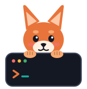</p>

<h1 align="center">Kelpie</h1>

<p align="center"><strong>Kelpie đặt mọi coding agent bạn dùng cạnh nhau trên một màn hình, để không việc nào bị bỏ sót.</strong></p>

<p align="center">
  <a href="https://github.com/baopeak/kelpie/releases"></a>
  
  <a href="LICENSE"></a>
</p>

<p align="center">
  <a href="https://github.com/baopeak/kelpie/releases"><strong>Tải Kelpie</strong></a> ·
  <a href="#xem-kelpie-hoạt-động">Xem Kelpie hoạt động</a> ·
  <a href="#dùng-thử-bộ-demo">Dùng thử bộ demo</a> ·
  <a href="docs/user-guide.vi.md">Hướng dẫn sử dụng</a> ·
  <a href="README.md">English</a>
</p>


Việc mở một agent để giao việc thường rất đơn giản. Tuy nhiên, khi bạn chạy cùng lúc bốn agent trên ba nhánh Git và hai cửa sổ terminal, bạn sẽ khó nhớ agent nào đang chờ mình trả lời và thư mục làm việc nào thuộc về công việc nào. Kelpie giải quyết vấn đề này bằng cách gom mọi thứ vào một màn hình duy nhất. Trên màn hình đó, Claude Code, Codex, OMP và hai mươi CLI agent khác chạy bên cạnh shell của bạn; phiên nào cần bạn trả lời sẽ được đánh dấu nổi bật, còn công việc nào đã hoàn thành sẽ được đưa vào hàng chờ duyệt. Ngoài ra, vì các phiên chạy trong một tiến trình nền riêng biệt, **việc cập nhật Kelpie không bao giờ làm gián đoạn một agent đang làm dở công việc**.

## Vì sao nên dùng Kelpie

- Kelpie khởi chạy chính các CLI agent mà bạn đã cài, với tài khoản, gói thuê bao và quy tắc cấp quyền của bạn, nên bạn không phải đổi công cụ hay tạo thêm tài khoản nào.
- Bảng điều khiển xếp mọi phiên vào các nhóm *Needs you*, *Working*, *Done* và *Failed*, nhờ đó bạn trả lời được một agent đang chờ mà không cần mở tab của nó.
- Mỗi việc làm song song có thể có Git worktree, phiên và ghi chú riêng, còn bảng công việc cho bạn thấy từng việc đang ở cột *Todo*, *In progress*, *Review* hay *Done*.
- Khi agent làm xong, bạn duyệt diff và ghi chú ngay trong Kelpie, sau đó nút **Finish** sẽ commit, gộp nhánh, chạy các bước kiểm tra bạn đã duyệt và dọn worktree.
- Daemon `kelpied` giữ mọi tiến trình, vì vậy khi Kelpie cài bản cập nhật, chỉ cửa sổ khởi động lại trong khi các agent vẫn tiếp tục làm việc.

## Kelpie có những gì

| Nhóm tính năng | Mô tả |
|---|---|
| **Không gian nhiều agent** | Bạn sắp xếp phiên thành tab, khung chia đôi, lưới mẫu tới 3×3 hoặc lưới tuỳ ý, rồi lưu bố cục để dùng lại. Ô tìm kiếm chung tìm được phiên, tệp, lệnh và cài đặt. |
| **Terminal hoặc chat** | Agent được hỗ trợ có thể chuyển qua lại giữa giao diện terminal của nó và chat view của Kelpie mà vẫn giữ cùng một cuộc hội thoại. |
| **Báo đúng lúc** | Bảng điều khiển, thông báo trên máy tính, điện thoại, ntfy, Telegram hoặc webhook cho bạn biết khi một phiên đang chờ, đã xong hoặc bị lỗi. |
| **Worktree và bảng công việc** | Worktree mới có thể tự chạy lệnh cài đặt, sao chép tệp `.env` và dùng chung thư mục theo `.kelpie.yaml`, và mọi worktree đều hiện trên bảng công việc. |
| **Duyệt và gộp** | Bạn ghi chú trên diff, nhờ một agent của hãng khác xem xét lại, hoàn tác từng lượt của agent, mở pull request qua `gh` hoặc merge request trên GitLab, rồi gộp nhánh với các bước kiểm tra bảo vệ. |
| **Điều phối** | Một run chia việc lớn thành các nhiệm vụ có phụ thuộc và cần phê duyệt. Tính năng *Try with several agents* giao một yêu cầu cho tối đa năm agent để so sánh kết quả, còn agent có thể mở **sub-session** mà bạn theo dõi và đóng được. |
| **Kế hoạch trong repository** | Tab Plan đọc các checklist Markdown trong `plans/`, `specs/`, `.kiro/specs/` và `docs/plans/`, cho phép bạn tích ô và giao từng nhiệm vụ cho agent. |
| **Tệp, trình duyệt và tiến trình** | Trình soạn thảo hiển thị Markdown, Mermaid, CSV, PDF và notebook. Khung trình duyệt có chế độ thiết kế, còn panel Processes cho thấy chương trình và cổng của từng phiên. |
| **Làm việc từ xa** | Kelpie mở project qua SSH, quản lý máy chủ, khoá, chuyển tiếp cổng và truyền tệp, đồng thời chạy agent trên máy chủ trong `tmux` để phiên không mất khi rớt mạng. |
| **Điện thoại** | Ứng dụng điện thoại tuỳ chọn được mã hoá đầu cuối, liệt kê các phiên, rung khi có phiên cần bạn và cho phép bạn trả lời. |
| **Tuỳ chỉnh** | Bạn quản lý MCP server và tệp hướng dẫn cho agent, cài plugin, tạo quick command và automation, đổi phím tắt và theme, đọc chính tả không cần mạng, và chọn giao diện tiếng Anh hoặc tiếng Việt. |

## Xem Kelpie hoạt động

Phần dưới đây theo chân một thay đổi nhỏ ở phần thanh toán của một cửa hàng mẫu trong suốt một ngày làm việc. Các project và dữ liệu kế hoạch là dữ liệu mẫu, còn kết quả của shell và mọi câu trả lời của agent đều là kết quả chạy thật với tài khoản thật. Tệp [capture.json](docs/screenshots/capture.json) ghi rõ phần nào là dữ liệu mẫu.

### Cho mỗi việc một chỗ riêng

Khi bắt đầu, bạn mở project, khởi động một agent và đặt một shell bên cạnh, nhờ đó lời giải thích, kết quả kiểm thử và nhánh Git hiện cùng lúc trên màn hình. Nếu việc lớn dần, bạn chia thêm khung hoặc xếp tab thành lưới. Còn khi một chi tiết cần toàn bộ sự chú ý, bạn phóng to khung đó mà các khung bên cạnh vẫn tiếp tục chạy.

Ảnh đầu trang cho thấy bốn agent cùng xem xét một phần thanh toán bằng ba CLI khác nhau. Claude Code, Codex và OMP chạy trong giao diện terminal của chính chúng, trong khi một phiên Claude Code thứ hai chạy trong chat view của Kelpie. Kelpie khởi chạy mỗi CLI đúng như bản gốc, vì vậy một phiên PowerShell hay Bash bình thường cũng có chỗ đứng như một agent.

<details>
<summary><strong>Các phiên trong ảnh: Claude Code, Codex, OMP, Claude Code chat và PowerShell</strong></summary>

**Claude Code** giữ nguyên giao diện terminal gốc và chỉ ra hai ranh giới rủi ro nhất của phần thanh toán.

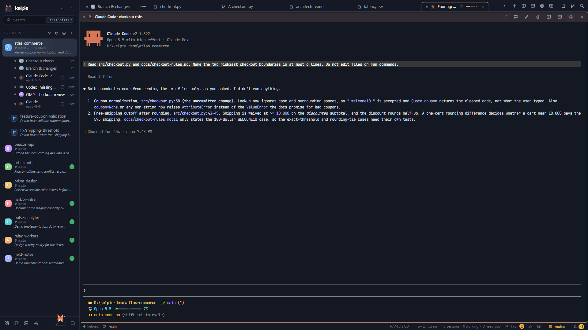

**Codex** đọc các bước kiểm tra nhanh và gợi ý một assertion còn thiếu cho ngưỡng miễn phí vận chuyển.

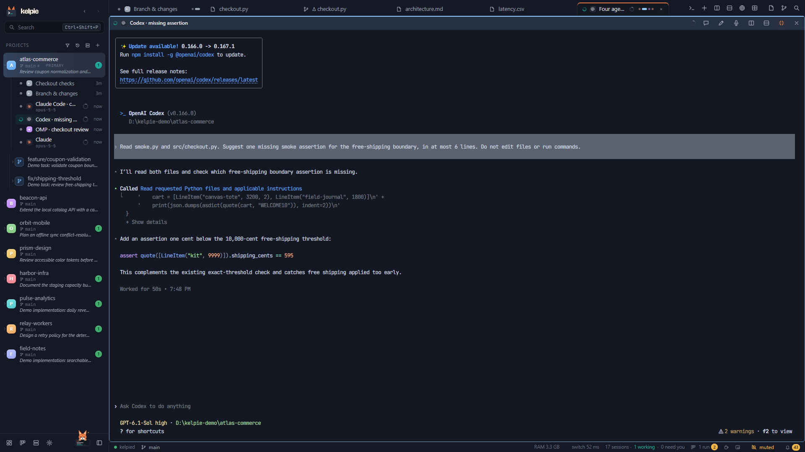

**OMP** đọc mã thanh toán, sau đó giải thích quy tắc tính phí vận chuyển và cách làm tròn.

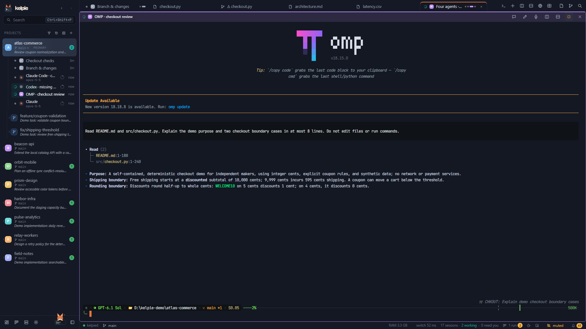

**Claude Code trong chat view** trả lời cùng loại câu hỏi dưới dạng hội thoại, kèm các dòng công cụ và nút chọn model. [Phần chat view](#đọc-kết-quả-ở-dạng-phù-hợp-nhất) cho thấy rõ hơn giao diện này.

**PowerShell 7** chạy các bước kiểm tra của bộ mẫu và in ra một báo giá đơn hàng thật.

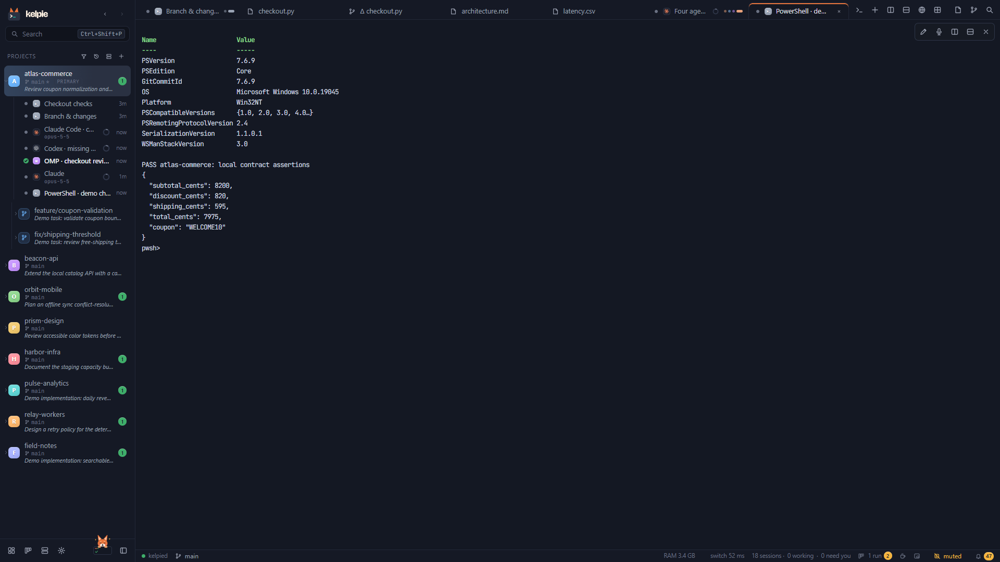

</details>

<details>
<summary><strong>Bắt đầu từ màn hình chào, chọn agent và chọn bố cục</strong></summary>

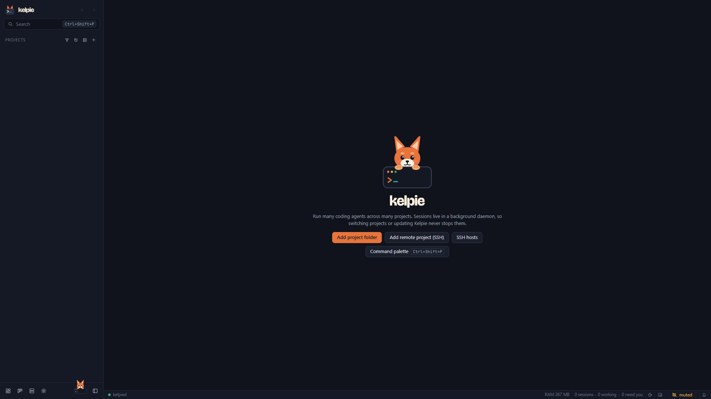

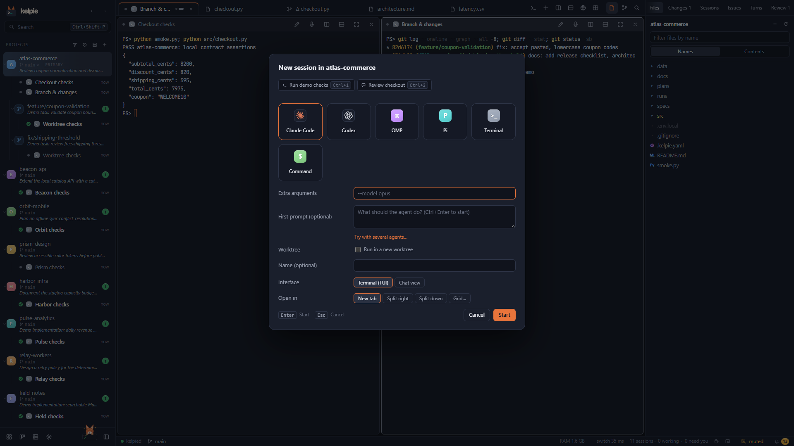

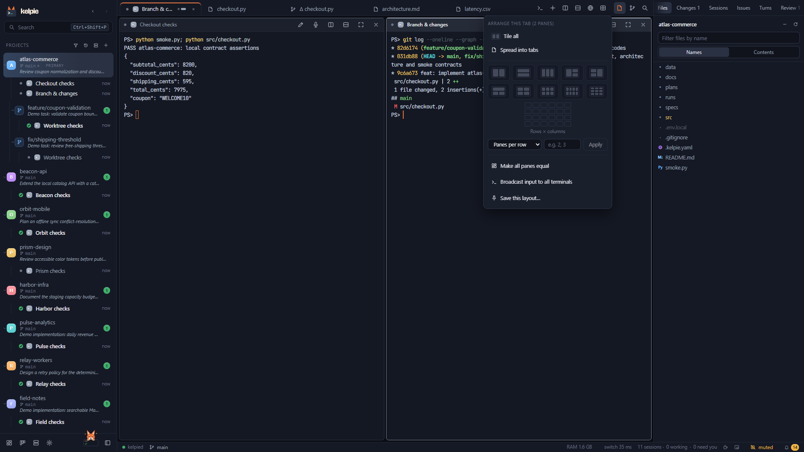

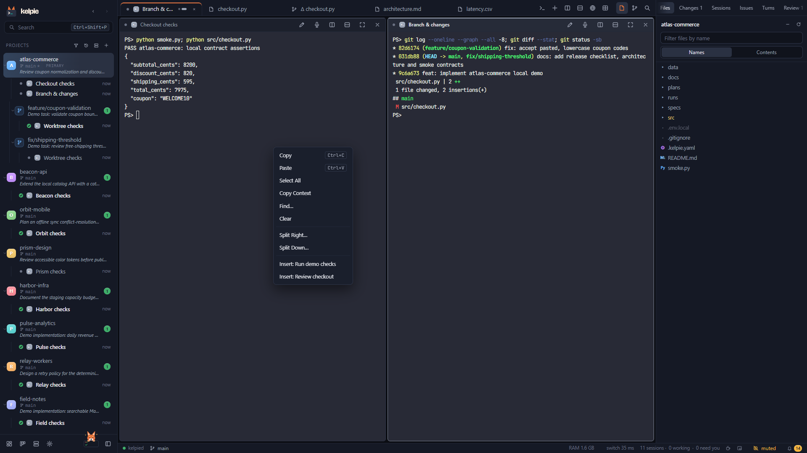

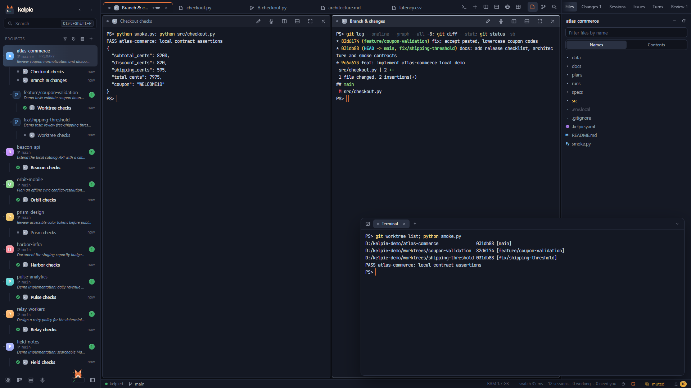

</details>

### Để mỗi việc đi một hướng riêng

Thay đổi ở phần thanh toán dần tách thành hai câu hỏi: mã giảm giá cần được chuẩn hoá như thế nào, và ngưỡng miễn phí vận chuyển bắt đầu từ đâu. Hai câu hỏi này thuộc cùng một project, nhưng chúng không cần dùng chung một thư mục làm việc.

Vì vậy, bạn tạo một Git worktree cho mỗi việc. Kelpie đặt các worktree dưới project cha và cho mỗi worktree một nhóm phiên riêng cùng một ghi chú giải thích công việc. Từ các thư mục đó, bảng công việc dựng nên một bức tranh dễ đọc: **Todo → In progress → Review → Done**.

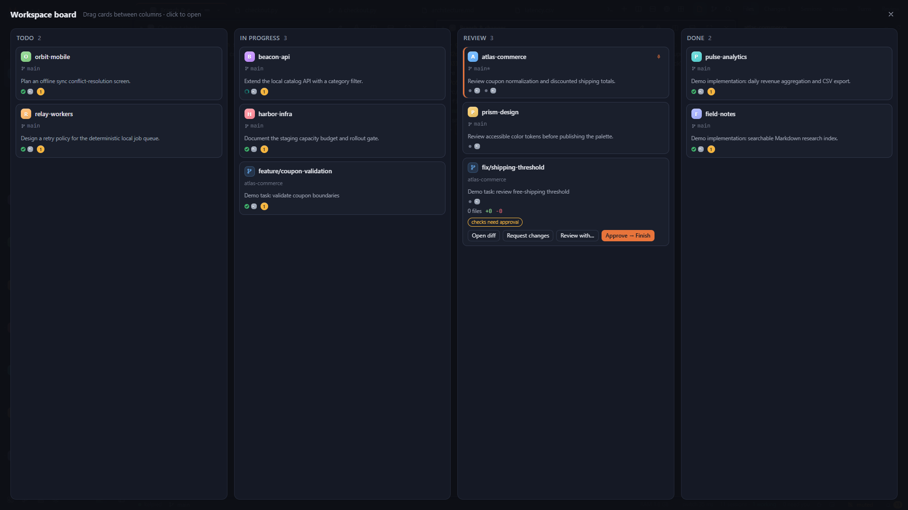

<details>
<summary><strong>Từ worktree mới tới kế hoạch và run</strong></summary>

Hộp thoại tạo worktree hiển thị phần cài đặt trong `.kelpie.yaml` của repository, và Kelpie chỉ chạy phần đó sau khi bạn duyệt đúng tệp đó.

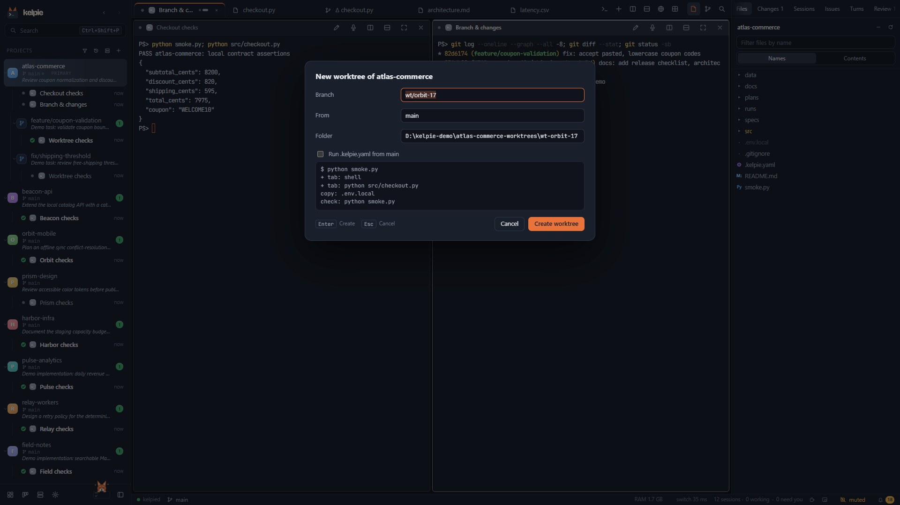

Tab Plan đọc checklist từ các tệp Markdown trong repository. Khi bạn tích một nhiệm vụ, tệp trên đĩa chỉ thay đổi đúng một ký tự.

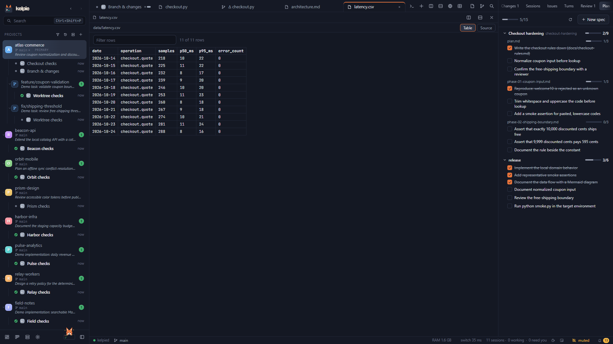

Một run chia việc lớn thành các nhiệm vụ cho agent. Trong run dưới đây, hai nhiệm vụ đang chờ bạn phê duyệt và mỗi nhiệm vụ sẽ có worktree riêng khi bắt đầu, còn nhiệm vụ duyệt chéo phải chờ cả hai nhiệm vụ đầu hoàn thành.

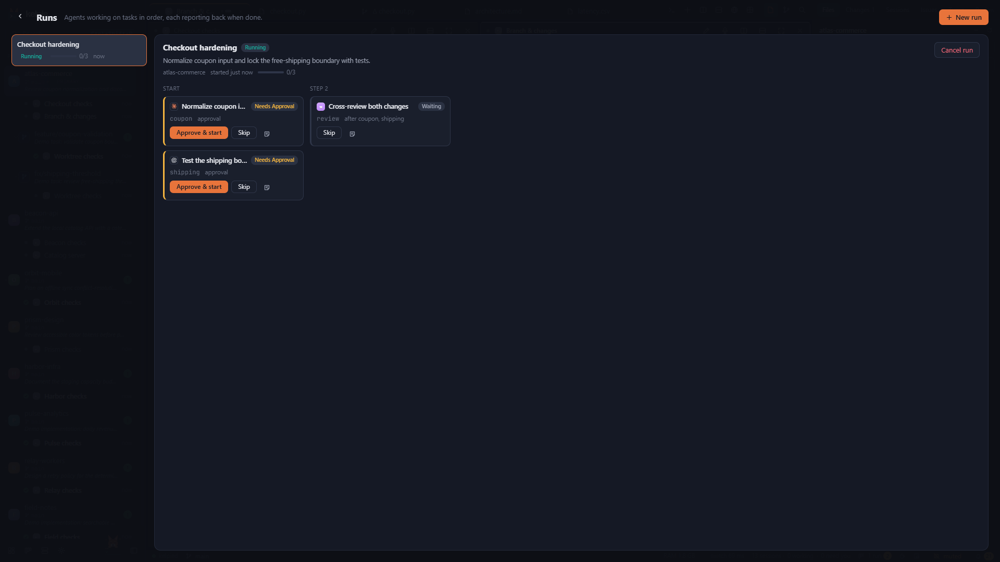

</details>

### Biết phiên nào đang cần bạn

Trong lúc các agent làm việc, bạn có thể chuyển sang việc khác. Khi một phiên đặt câu hỏi, phiên đó chuyển vào nhóm *Needs you* trên bảng điều khiển, dòng của nó trên thanh bên đổi sang màu hổ phách và chuông trên thanh trạng thái hiện thêm một chấm. Từ bảng điều khiển, bạn trả lời được câu hỏi đó mà không cần mở tab, còn phím `Ctrl+Shift+.` đưa bạn tới phiên tiếp theo đang chờ.

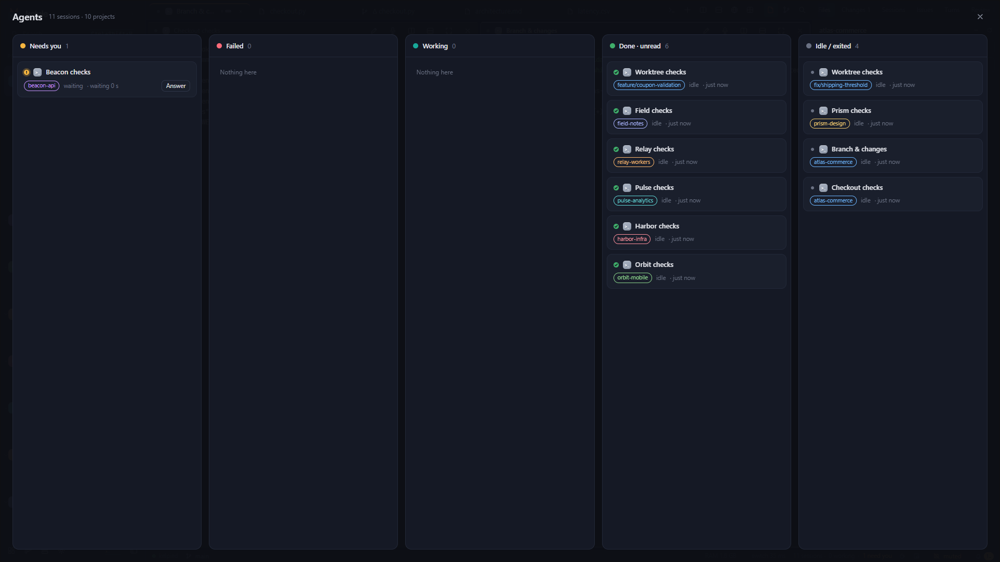

<details>
<summary><strong>Hộp Activity, automation và điện thoại</strong></summary>

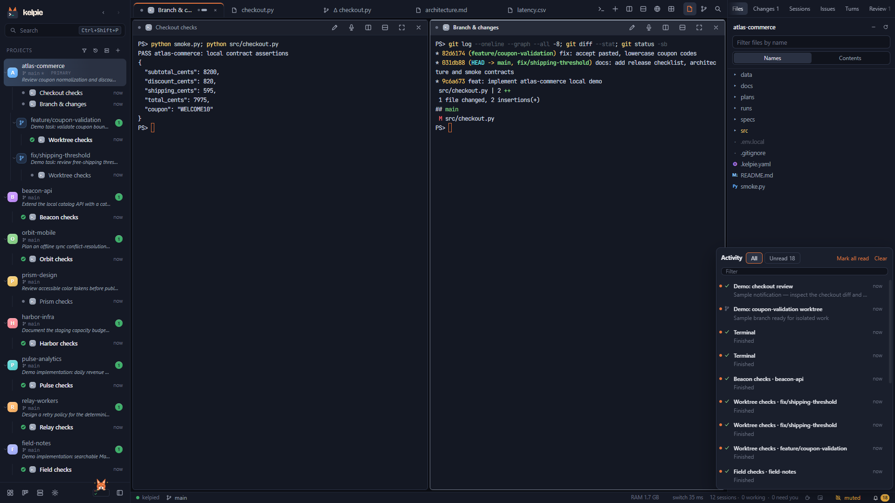

Các automation mẫu dưới đây đều đang tắt, nên chúng không thể bất ngờ gọi một model có tính phí.

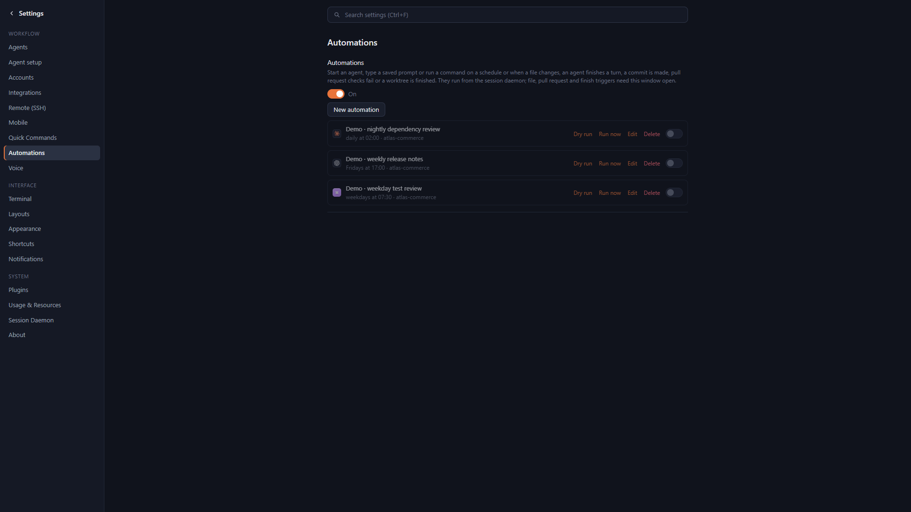

Ngoài ra, bạn có thể [ghép đôi một điện thoại](docs/user-guide.vi.md#điện-thoại). Sau khi ghép đôi, điện thoại liệt kê các phiên, rung khi có phiên cần bạn, hiển thị màn hình của phiên và gửi câu trả lời nếu bạn cho phép.

</details>

### Duyệt kết quả thay vì chỉ đọc chữ "xong"

Khi agent báo đã làm xong, đó là lúc bạn bắt đầu duyệt chứ không phải lý do để bỏ qua bước này.

Bạn mở diff, xem từng dòng đã đổi và để lại ghi chú ở đúng chỗ cần hỏi. Sau đó, Kelpie gửi toàn bộ ghi chú cho agent trong một yêu cầu tập trung. Nếu muốn có thêm góc nhìn, bạn nhờ một agent của hãng khác xem xét cùng worktree đó và để lại ghi chú riêng trên diff.

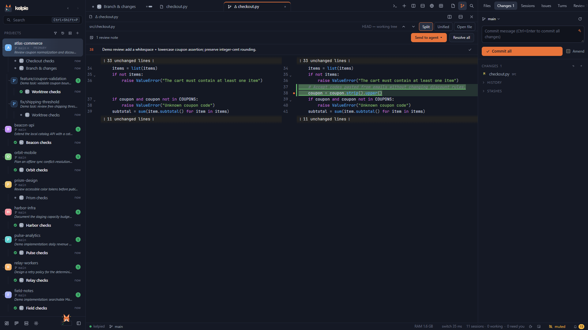

Khi công việc đã sẵn sàng, nút **Finish** commit phần còn lại, gộp nhánh theo cách bạn chọn và chạy các bước kiểm tra trong `.kelpie.yaml` mà bạn đã duyệt. Worktree chỉ bị xoá sau khi mọi bước khác thành công, và Finish không bao giờ ép buộc thao tác nào bằng `force`.

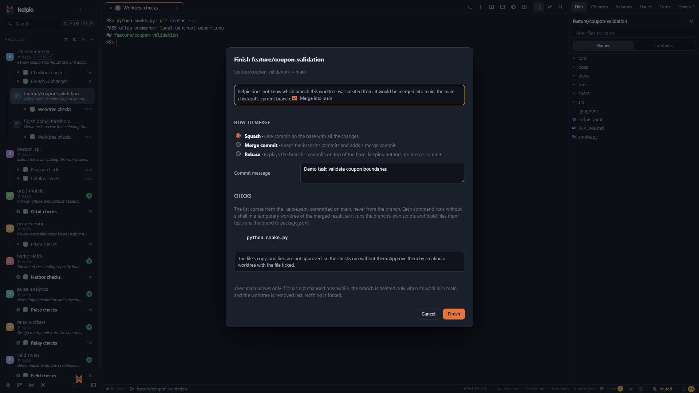

<details>
<summary><strong>Xem thay đổi, soạn yêu cầu tiếp theo và thử nhiều agent</strong></summary>

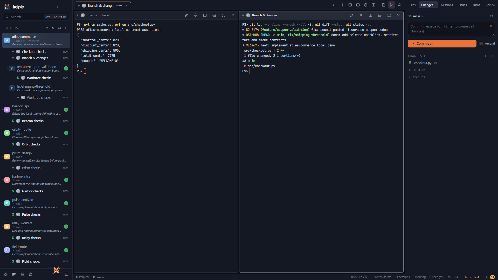

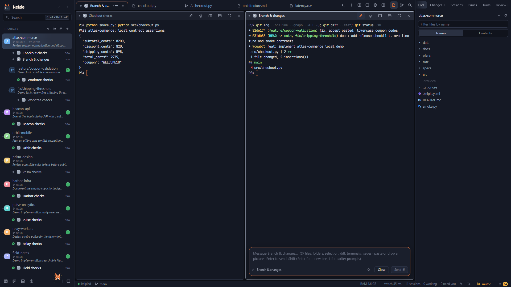

Tính năng *Try with several agents* giao cùng một yêu cầu cho hai tới năm agent, mỗi agent làm trong một worktree riêng. Sau đó, màn hình Compare đặt thời gian, chi phí, số dòng thay đổi và kết quả kiểm tra của các agent cạnh nhau để bạn chọn.

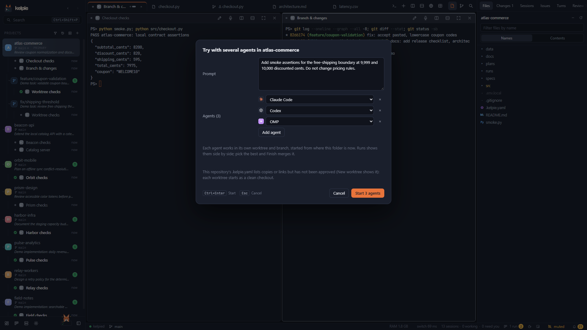

</details>

### Đọc kết quả ở dạng phù hợp nhất

Có lúc bạn muốn làm việc trong giao diện terminal của agent, nhưng cũng có lúc bạn muốn đọc kết quả như một cuộc trò chuyện, với Markdown được hiển thị, hoạt động công cụ và nút chọn model. Agent được hỗ trợ có thể chuyển sang chat view của Kelpie rồi quay lại terminal trong cùng cuộc hội thoại, và Kelpie bảo đảm chỉ một giao diện ghi vào cuộc hội thoại đó tại mỗi thời điểm.

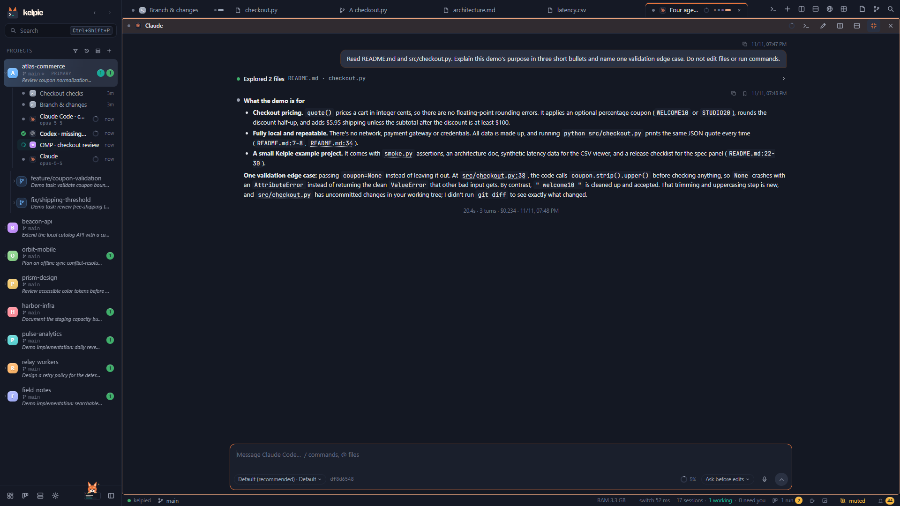

<details>
<summary><strong>Mã nguồn, sơ đồ, dữ liệu, notebook và tìm kiếm</strong></summary>

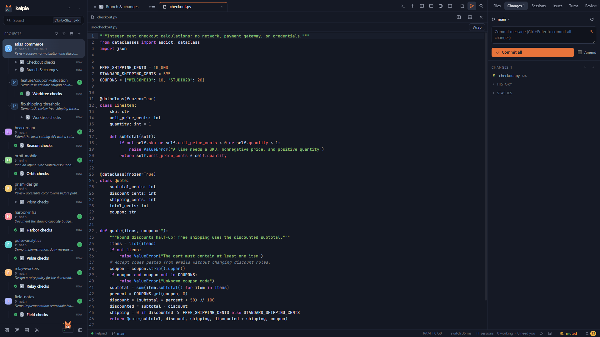

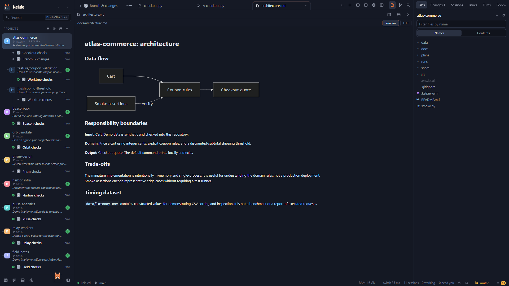

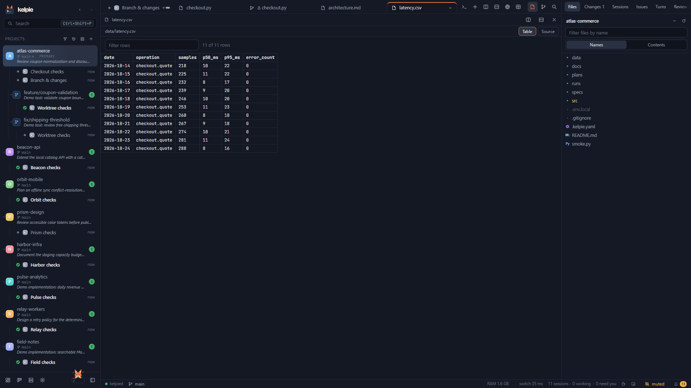

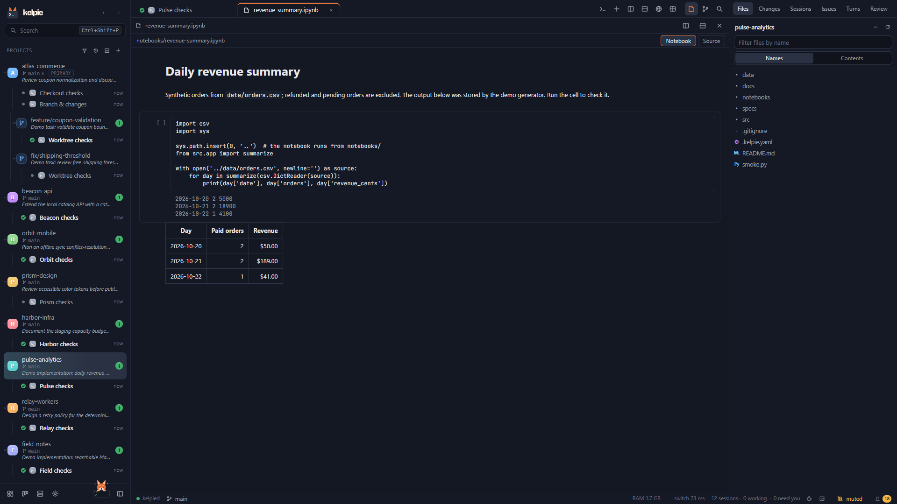

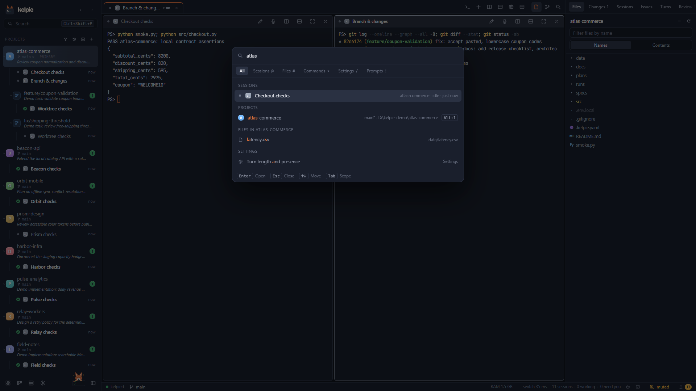

</details>

### Đưa trình duyệt và máy chủ về cùng một chỗ

Câu hỏi tiếp theo có thể nằm trên một trang web. Thay vì mở một ứng dụng khác che khuất không gian làm việc, bạn mở trang đó ngay cạnh agent. Trong ảnh dưới, trang web ChatGPT và CLI của OMP là hai khung riêng trong Kelpie; trang web đó là trang thật ở trạng thái chưa đăng nhập, không phải một client model đi kèm.

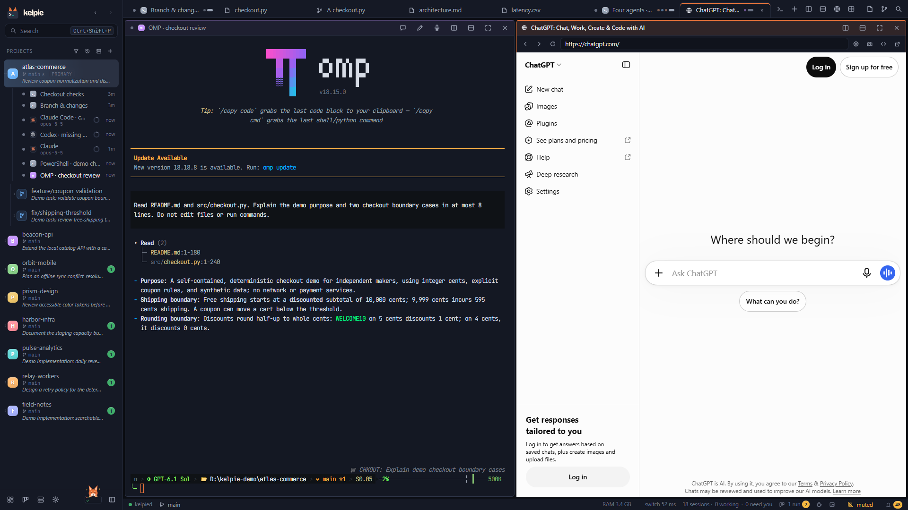

Khi agent khởi động một dev server, Kelpie mở trang web của server đó trong một tab nền riêng. Panel **Processes** cho thấy mỗi phiên đang chạy những chương trình nào, kèm PID, bộ nhớ, CPU và cổng, và Kelpie chỉ dừng một chương trình sau khi nói rõ những gì sẽ kết thúc.

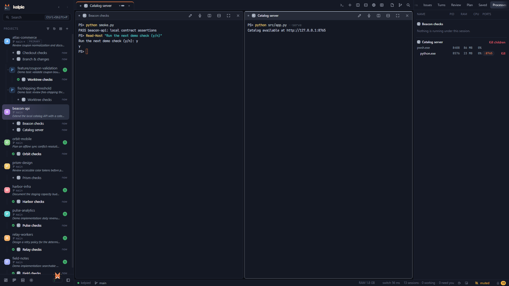

Khi công việc chuyển lên máy chủ, trang **SSH hosts** giữ danh sách máy chủ, khoá, quy tắc chuyển tiếp cổng và việc truyền tệp ở cùng một nơi. Agent trên máy chủ chạy trong `tmux`, nên phiên vẫn tiếp tục khi kết nối bị rớt.

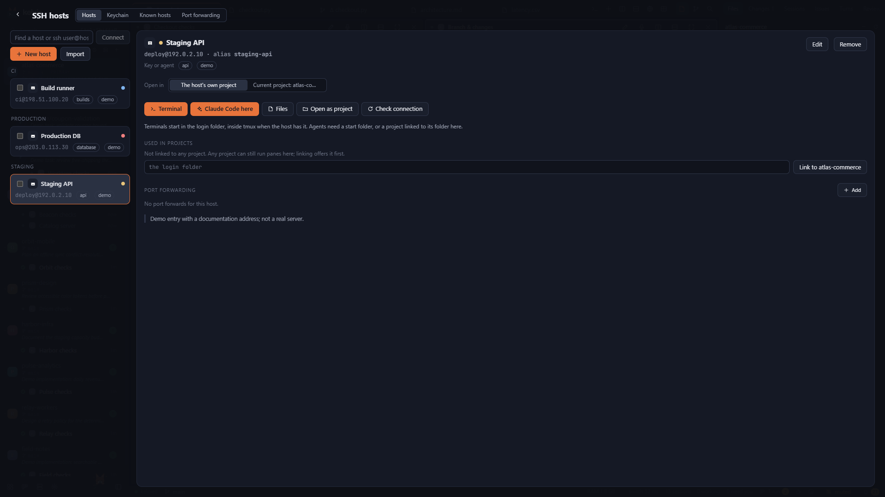

### Cập nhật mà không dừng công việc

Kelpie tự kiểm tra bản phát hành mới ở chế độ nền. Khi bạn chọn **Install now** hoặc **Install when idle**, chỉ cửa sổ khởi động lại, trong khi daemon giữ mọi terminal và agent tiếp tục chạy. Sau khi mở lại, cửa sổ kết nối với đúng các màn hình cũ, vì vậy bạn không phải chờ agent làm xong rồi mới cập nhật. Ngoại lệ duy nhất là lần cập nhật đầu tiên từ một bản 0.1 đời đầu, khi daemon còn chạy từ thư mục cài đặt: lần cập nhật đó dừng các phiên một lần, báo trước cho bạn, và các agent tiếp tục sau đó.

Khi bạn thoát Kelpie, ứng dụng sẽ hỏi trước nếu vẫn còn việc đang chạy rồi mới dừng các phiên. Đến lần mở sau, các agent tiếp tục đúng cuộc hội thoại cũ. Nếu muốn automation, kết nối điện thoại hoặc việc sao chép tệp vẫn chạy khi cửa sổ đã đóng, bạn có thể [giữ daemon chạy nền](docs/user-guide.vi.md#cài-đặt-và-cập-nhật).

### Tuỳ chỉnh Kelpie theo cách bạn làm việc

Vì bạn sẽ làm việc nhiều giờ trong Kelpie, ứng dụng cho phép bạn chọn giao diện tối hoặc sáng, chỉnh font và màu terminal, đổi mật độ hiển thị và cỡ chữ, cũng như ghi lại phím tắt hợp với bàn phím của mình. Giao diện có sẵn bằng tiếng Anh và tiếng Việt.

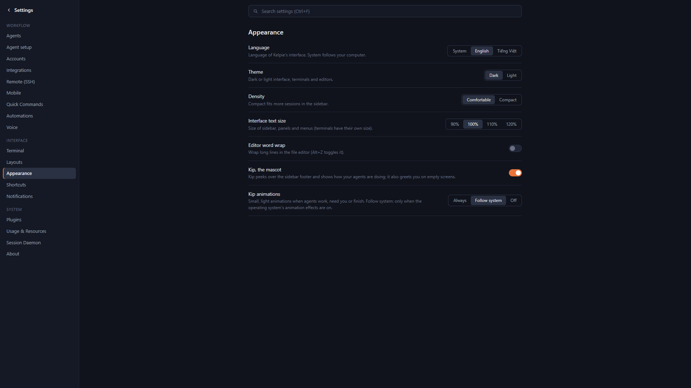

<details>
<summary><strong>Font, agent, plugin, phím tắt, theme sáng và giao diện tiếng Việt</strong></summary>

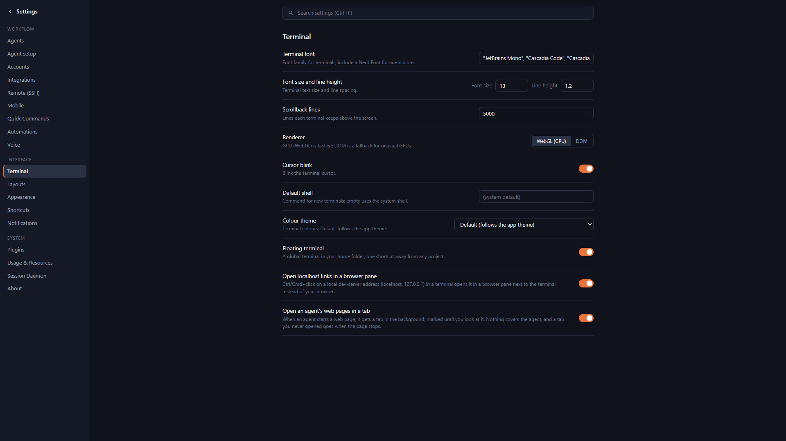

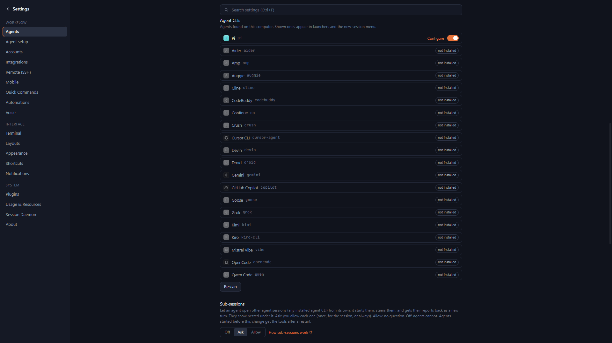

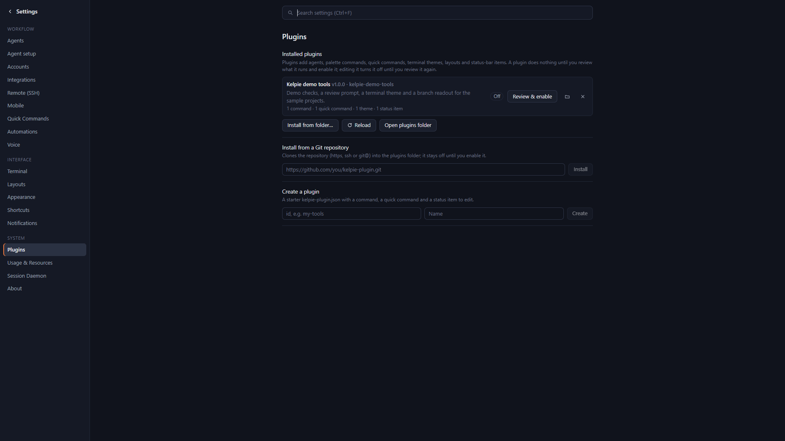

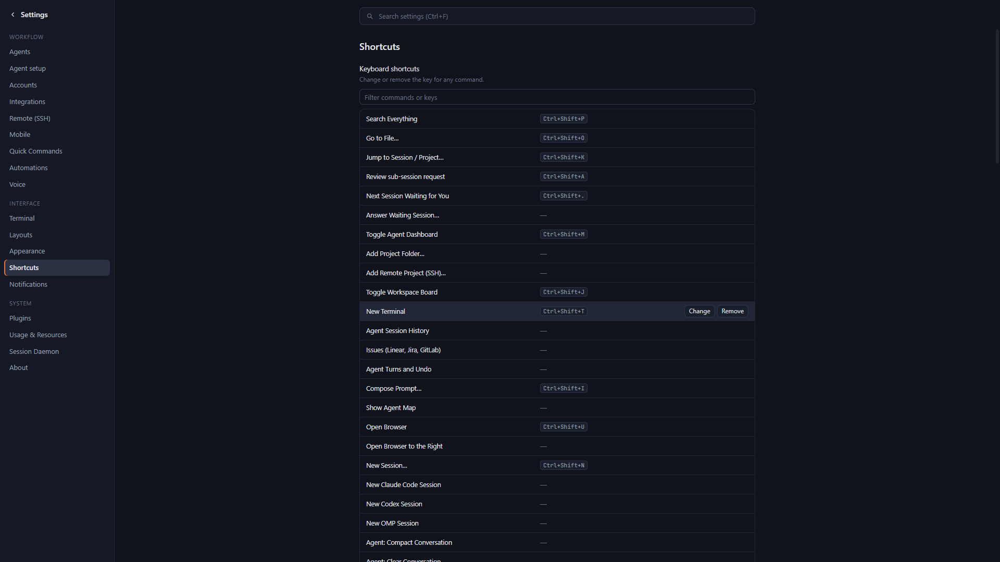

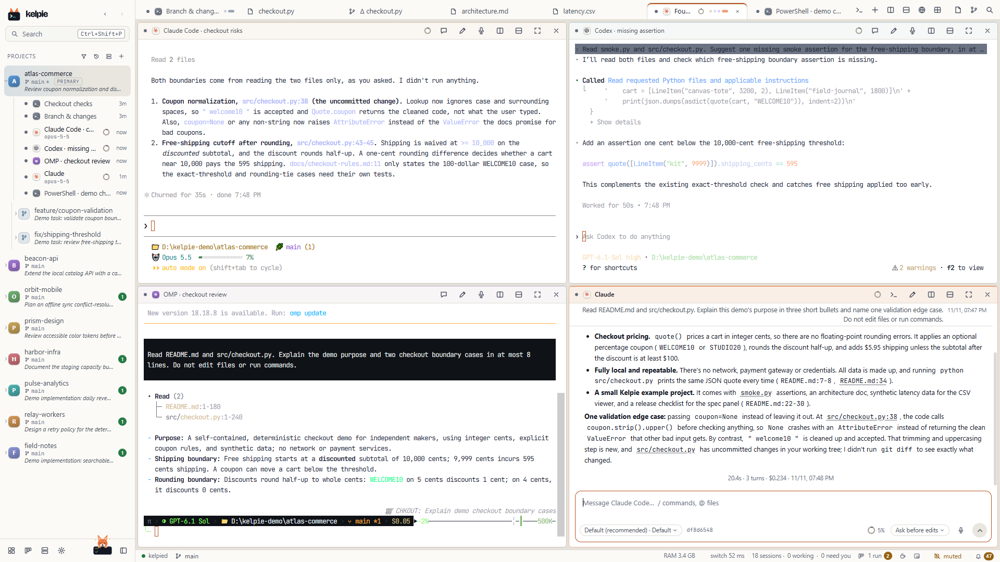

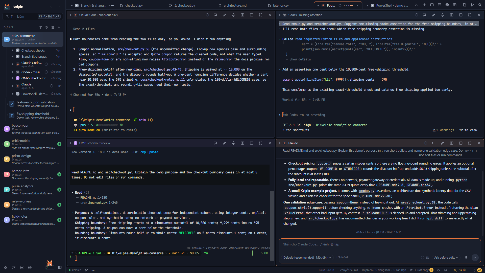

</details>

## Danh sách đầy đủ tính năng

<details>
<summary><strong>Mọi tính năng, kèm liên kết tới hướng dẫn sử dụng</strong></summary>

Các liên kết dẫn tới [hướng dẫn tiếng Anh](docs/user-guide.md), nơi mô tả đầy đủ mọi chi tiết, còn [hướng dẫn tiếng Việt](docs/user-guide.vi.md) tóm tắt cùng các nhóm tính năng theo từng việc.

**Không gian làm việc**
- Thanh bên hiển thị [project và worktree](docs/user-guide.md#everyday-use), kèm trạng thái, tiêu đề việc, model và lần hoạt động cuối của từng phiên.
- [Tab, khung, lưới và bố cục đã lưu](docs/user-guide.md#layouts) cho phép bạn sắp xếp bao nhiêu phiên tuỳ ý, còn *Broadcast input* gõ cùng lúc vào mọi terminal của một tab.
- [Ô tìm kiếm chung](docs/user-guide.md#everyday-use) tìm được phiên, project, tệp, lệnh, cài đặt và các yêu cầu bạn đã gửi trước đó.
- Bạn có thể tìm và tiếp tục [các cuộc hội thoại cũ](docs/user-guide.md#past-conversations) của Claude Code, Codex và OMP trong terminal hoặc chat view.

**Agent**
- Kelpie nhận diện [23 CLI agent](docs/user-guide.md#agents), trong đó có Claude Code, Codex, OMP, Gemini, Cursor, OpenCode và GitHub Copilot, và có thể thêm agent từ registry Agent Client Protocol.
- [Chat view](docs/user-guide.md#everyday-use) tiếp tục cùng cuộc hội thoại với thẻ công cụ, phê duyệt, bản đồ agent, câu trả lời đã lưu và hình ảnh.
- Bạn có thể dùng song song [nhiều tài khoản](docs/user-guide.md#several-claude-code--codex-accounts) Claude Code hoặc Codex, và một phiên có thể chuyển sang tài khoản khác khi chạm giới hạn sử dụng.
- [Sub-session](docs/user-guide.md#sub-sessions) cho phép một agent mở phiên agent khác khi được bạn đồng ý và trong giới hạn bạn đặt.
- Các thao tác [hand-off, hibernation, compact và restart](docs/user-guide.md#agents) giúp những cuộc hội thoại dài vẫn chạy ổn định.

**Theo dõi và chi phí**
- [Bảng điều khiển và tính năng trả lời nhanh](docs/user-guide.md#everyday-use) cho thấy mọi phiên đang chờ bạn, trong đó phiên chờ lâu nhất đứng đầu.
- [Activity và thông báo](docs/user-guide.md#activity-and-notifications) gửi tới máy tính, ntfy, Telegram hoặc một webhook.
- Mỗi phiên hiển thị [context, token và chi phí](docs/user-guide.md#context-tokens-and-cost), kèm một trang thống kê và giới hạn chi phí tuỳ chọn.

**Duyệt mã và Git**
- [Panel Changes](docs/user-guide.md#source-control-and-review) push, pull, đổi nhánh, hiển thị lịch sử và stash, soạn thông điệp commit và mở pull request.
- [Ghi chú trên diff, hàng chờ duyệt và Finish](docs/user-guide.md#review-and-finish) đưa một worktree từ trạng thái "xong" tới trạng thái "đã gộp".
- [Duyệt chéo bằng agent khác và chọn kết quả tốt nhất](docs/user-guide.md#review-with-another-agent-and-best-of-several) giúp bạn so sánh các lần làm độc lập.
- [Lượt và hoàn tác](docs/user-guide.md#turns-and-undo) khôi phục những gì một lượt của agent đã thay đổi, sau khi cho bạn xem trước.

**Kế hoạch và tự động hoá**
- [Run](docs/user-guide.md#orchestration-runs) khởi động các nhiệm vụ của agent theo đúng thứ tự phụ thuộc.
- [Tab Plan](docs/user-guide.md#specs-and-tasks-the-plan-tab) đọc, tích và giao cho agent các checklist trong repository của bạn.
- [Automation](docs/user-guide.md#automations) khởi động agent hoặc lệnh đã duyệt theo lịch, hoặc khi một tệp, commit, bước kiểm tra hay worktree thay đổi.
- [Issue tracker](docs/user-guide.md#issue-trackers-and-gitlab) kết nối Linear, Jira và GitLab với phiên và worktree mới.

**Tệp, trình duyệt và tiến trình**
- [Trình soạn thảo và trình xem tệp](docs/user-guide.md#files) mở mã nguồn, Markdown, Mermaid, CSV, PDF và notebook Jupyter.
- [Liên kết tệp](docs/user-guide.md#terminals) biến các đường dẫn mà agent in ra, như `src/a.ts:42`, thành liên kết: `Ctrl+click` mở tệp ở đúng dòng đó, còn nhấp chuột phải cho phép sao chép đường dẫn.
- [Khung trình duyệt](docs/user-guide.md#browser-panes-and-design-mode) có công cụ cho nhà phát triển và chế độ thiết kế để gửi phần tử đã chọn cho agent.
- [Panel Processes](docs/user-guide.md#processes-ports-and-preview) liệt kê chương trình và cổng của từng phiên, và dừng chúng một cách an toàn.

**Làm việc từ xa và điện thoại**
- [Project từ xa](docs/user-guide.md#remote-projects-ssh), [trang SSH hosts](docs/user-guide.md#ssh-hosts) và [khung SSH trong mọi project](docs/user-guide.md#ssh-panes-in-any-project) đưa máy chủ vào cùng không gian làm việc.
- Phần [giữ phiên chạy trên máy chủ](docs/user-guide.md#keeping-sessions-running-on-a-server) giải thích cách thiết lập `tmux`.
- [Truy cập từ điện thoại](docs/user-guide.md#phone-access) ghép đôi điện thoại qua relay của Kelpie, Tailscale hoặc mạng nội bộ.

**Thiết lập cá nhân**
- [Agent setup](docs/user-guide.md#agent-setup) quản lý MCP server, tệp hướng dẫn và skill của mọi agent ở cùng một nơi.
- [Plugin](docs/user-guide.md#plugins), [quick command](docs/user-guide.md#quick-commands) và [composer](docs/user-guide.md#composer) mở rộng những gì bạn có thể khởi chạy và gửi đi.
- [Đọc chính tả](docs/user-guide.md#voice-dictation) nhận dạng giọng nói ngay trên máy, nên không có dữ liệu nào được gửi ra ngoài.
- [Xuất và nhập cài đặt](docs/user-guide.md#export-and-import-settings) chuyển thiết lập sang máy khác mà không mang theo bí mật.
- Mọi [phím tắt](docs/user-guide.md#keyboard-shortcuts) đều có thể thay đổi.

</details>

## Bắt đầu trong ba bước

1. **[Tải Kelpie](https://github.com/baopeak/kelpie/releases).** Trên Windows, bạn chạy bộ cài; trên macOS, bạn kéo ứng dụng vào Applications; còn trên Linux, bạn dùng gói AppImage hoặc `.deb`.
2. **Cài và đăng nhập các CLI agent bạn muốn dùng.** Kelpie tìm các CLI này qua `PATH` hoặc qua login shell, và trang Settings → Agents cho biết Kelpie đã tìm thấy những agent nào.
3. **Thêm một thư mục project và mở một phiên.** Bạn đặt một shell cạnh agent, giao việc cho agent và theo dõi kết quả ngay trên màn hình.

Kelpie hỗ trợ Windows 10 1809 trở lên và Windows 11, macOS 12 trở lên, cùng Linux x86-64 với glibc 2.35 trở lên; trong đó Windows là nền tảng được kiểm thử thực tế nhiều nhất. GitHub CLI (`gh`) là tuỳ chọn và cần thiết cho các tính năng pull request. Để làm việc trên máy chủ, Kelpie dùng OpenSSH của bạn, và `tmux` giúp phiên trên máy chủ tồn tại lâu dài.

## Dùng thử bộ demo

Bộ demo tạo **tám project Git nhỏ, hai worktree và một plugin mẫu** trong thư mục bạn chọn. Mỗi project chạy bằng thư viện chuẩn của Python và có sẵn bước kiểm tra nhanh, tài liệu kiến trúc Markdown với sơ đồ Mermaid, một bộ dữ liệu CSV tổng hợp và một checklist phát hành. Các project này chỉ minh hoạ nghiệp vụ, không phải ứng dụng thật.

| Project | Vai trò trong câu chuyện |
|---|---|
| `atlas-commerce` | Project này tính báo giá đơn hàng, chuẩn hoá mã giảm giá và xác định ngưỡng miễn phí vận chuyển. Nó có `.kelpie.yaml` đầy đủ, một kế hoạch hai phase, một tệp run, hai worktree (một worktree đã có commit hoàn chỉnh) và một thay đổi chưa commit để duyệt. |
| `beacon-api` | Project này cung cấp một catalog sản phẩm có lọc theo danh mục, kèm một server cục bộ tuỳ chọn ở cổng 8765. |
| `orbit-mobile` | Project này đồng bộ ghi chú ngoại tuyến và báo khi có xung đột. |
| `prism-design` | Project này quản lý token màu và kiểm tra độ tương phản. |
| `harbor-infra` | Project này lập kế hoạch dung lượng và triển khai cho môi trường staging. |
| `pulse-analytics` | Project này tổng hợp doanh thu theo ngày, xuất CSV và có một notebook. |
| `relay-workers` | Project này mô phỏng một hàng đợi job xác định và kế hoạch thử lại. |
| `field-notes` | Project này lập chỉ mục cho ghi chú nghiên cứu Markdown và cho phép tìm kiếm. |

Bạn tạo bộ demo vào một thư mục mới, trống và nằm ngoài repository này:

```bash
python scripts/e2e/readme_demo.py ../kelpie-demo-projects
python ../kelpie-demo-projects/atlas-commerce/smoke.py
```

Sau đó, bạn thêm các thư mục vào Kelpie và làm theo **[kịch bản demo](docs/demo-scripts.vi.md)**. Kịch bản gồm phần giới thiệu ba phút, phần trình diễn mười lăm phút và các cảnh tuỳ chọn; mỗi cảnh ghi rõ các bước thao tác, lời dẫn và kết quả người xem cần thấy.

<details>
<summary><strong>Chụp lại ảnh màn hình</strong></summary>

[Script chụp ảnh](scripts/e2e/readme_shots.py) điều khiển ứng dụng thật qua WebDriver. Để chạy script, bạn cần bản build của ứng dụng và daemon, `tauri-driver`, và một `msedgedriver` khớp với phiên bản WebView2 đã cài:

```bash
cd app && pnpm tauri build --debug --no-bundle && cd .. && cargo build -p kelpied
python -X utf8 scripts/e2e/readme_shots.py docs/screenshots ../kelpie-demo-projects \
  --app target/debug/kelpie.exe --native-driver /path/to/msedgedriver.exe \
  --agents --browser
```

Script dùng thư mục dữ liệu, endpoint daemon và thư mục SSH trống của riêng nó, nên không bao giờ đụng tới phiên, khoá hay cài đặt của bạn. Ảnh được chụp ở độ phân giải Full HD (1920 × 1080). Tuỳ chọn `--agents` khởi động Claude Code, Codex và OMP trong terminal cùng Claude Code trong chat view, giao cho mỗi agent một việc chỉ đọc và gọi model thật bằng tài khoản của bạn; nếu muốn chụp mà không dùng agent, bạn bỏ `--agents` và `--browser`. Khi Claude Code và Codex hỏi có tin tưởng thư mục demo không, script sẽ trả lời đồng ý. Giống như mọi phiên khác của bạn, các agent vẫn lưu transcript của những lượt demo này trong thư mục riêng của chúng. Trang ChatGPT ở trạng thái chưa đăng nhập, còn các máy chủ SSH dùng địa chỉ dành cho tài liệu nên không bao giờ được kết nối. Cuối cùng, script ghi tệp [capture.json](docs/screenshots/capture.json) với phiên bản ứng dụng, danh sách ảnh và mọi bước kiểm tra đã chạy.

</details>

## Cách Kelpie hoạt động

Kelpie tách cửa sổ khỏi công việc. Giao diện SolidJS chỉ lo hiển thị không gian làm việc, còn daemon Rust `kelpied` sở hữu terminal, tiến trình agent, automation, run và kết nối điện thoại. Hai phần này giao tiếp với nhau qua named pipe hoặc Unix socket trên máy.

Một terminal không hiện trên màn hình thì không cần được vẽ. Khi bạn quay lại terminal đó, cửa sổ nhận phần output còn thiếu hoặc một ảnh chụp trạng thái, nên agent không phải làm lại từ đầu. Nhờ sự tách biệt này, một bản cập nhật có thể khởi động lại cửa sổ trong khi mọi agent vẫn làm việc, và không gian làm việc vẫn phản hồi nhanh khi số phiên tăng lên. Tuy vậy, mỗi agent vẫn dùng bộ nhớ, CPU và token, nên việc chạy thêm agent không bao giờ miễn phí.

Tài liệu [kiến trúc](docs/architecture.md) mô tả quyền sở hữu tiến trình, giao thức truyền và cơ chế khôi phục, còn [quy trình đo hiệu năng](scripts/perf/README.md) mô tả phương pháp đo và ngân sách hiệu năng.

## Công cụ của bạn, dữ liệu của bạn, quyết định của bạn

- Kelpie lưu phiên, bố cục và cài đặt ngay trên máy của bạn và không gửi dữ liệu sử dụng (telemetry) đi đâu, còn các CLI agent vẫn liên hệ nhà cung cấp model theo tài khoản và chính sách riêng của chúng.
- Mọi kết nối ra ngoài đều phải do bạn thiết lập, gồm máy chủ từ xa, issue tracker, kênh thông báo và truy cập từ điện thoại; riêng truy cập từ điện thoại được tắt theo mặc định.
- Kết nối với điện thoại được mã hoá đầu cuối, và bạn duyệt từng điện thoại trên máy tính bằng cách nhập mã mà điện thoại hiển thị rồi xác thực bằng Windows Hello hoặc Touch ID. Relay kết nối điện thoại qua internet chỉ chuyển tiếp các khung dữ liệu đã mã hoá, nhưng relay vẫn thấy siêu dữ liệu kết nối, và mã của ứng dụng điện thoại được tải từ chính relay đó. [Hướng dẫn truy cập từ điện thoại](docs/user-guide.md#phone-access) giải thích mô hình tin cậy này, phương án dùng Tailscale và cách kiểm tra những gì relay phục vụ.
- Token tích hợp, mật khẩu SSH và token thông báo được lưu trong kho thông tin xác thực của hệ điều hành. Tuy nhiên, biến môi trường bạn nhập trong cài đặt agent được lưu dưới dạng văn bản thường, vì vậy bạn không nên đặt bí mật ở đó hoặc trong project demo.
- Lệnh cài đặt worktree, bước kiểm tra khi Finish, lệnh automation, plugin và quyền của agent đều cần bạn đồng ý. Kelpie giúp sắp xếp công việc, nhưng việc đánh giá kết quả của agent vẫn là trách nhiệm của bạn.

Nếu bạn nâng cấp từ phiên bản mang tên cũ Erka, hãy thoát Erka trước khi mở Kelpie; các tệp `.erka.yaml` hiện có vẫn tiếp tục hoạt động.

## Build từ mã nguồn

Để build Kelpie, bạn cần Rust stable, Node.js 22 trở lên, pnpm 11 và bộ công cụ build gốc của nền tảng: MSVC trên Windows, công cụ của Apple trên macOS, và các gói WebKitGTK được liệt kê trong [hướng dẫn tiếng Anh](docs/user-guide.md#build-from-source) trên Linux.

```bash
# Cài các gói phụ thuộc của frontend
cd app && pnpm install --frozen-lockfile && cd ..

# Shell 1: daemon phát triển tách biệt
bash scripts/dev-daemon.sh run

# Shell 2: ứng dụng desktop kết nối tới daemon đó
cd app && KELPIE_ENDPOINT=kelpie-dev pnpm tauri dev
```

Trong PowerShell, bạn đặt `$env:KELPIE_ENDPOINT = 'kelpie-dev'` trước lệnh chạy ứng dụng desktop. Nếu chỉ chạy Vite, bạn sẽ không dùng được các API desktop gốc.

Để build bộ cài, bạn dùng [script phát hành](scripts/build-release.sh):

```bash
KELPIE_KEEP_VERSION=1 bash scripts/build-release.sh --bundles nsis
# macOS: --bundles app,dmg    Linux: --bundles appimage,deb
```

Nếu không đặt `KELPIE_KEEP_VERSION=1`, script phát hành sẽ tăng số phiên bản patch. Ngoài ra, script còn build các sidecar gốc, nên đây không phải lệnh để kiểm tra nhanh.

### Kiểm thử và xác minh trên ứng dụng thật

```bash
# Giao thức Rust, daemon và backend desktop
cargo test -p kelpie-proto -p kelpied -p kelpie

# Frontend, chạy trong thư mục app/
pnpm build
pnpm test
pnpm i18n:check
```

CI chạy bộ test Rust trên cả Windows và macOS, vì một lần chạy đạt trên một nền tảng không thay thế được kiểm thử trên nền tảng kia. Lệnh `cargo test --workspace` còn kiểm thử thêm trình hỗ trợ nhận dạng giọng nói. Các kịch bản chạy trên ứng dụng thật nằm trong [scripts/e2e](scripts/e2e); bạn nên đọc điều kiện tiên quyết của từng kịch bản trước khi chạy, vì một số kịch bản dùng agent đã đăng nhập, máy chủ thử nghiệm hoặc lượt gọi model có tính phí. Ngoài ra, bạn nên giữ daemon thử nghiệm tách biệt khỏi các phiên làm việc của mình.

### Điều khiển Kelpie bằng script

Agent và script trên máy có thể xem phiên và báo tiến độ qua `kelpied`:

```bash
kelpied terminal list
kelpied terminal read 3 --lines 80
kelpied worktree set --comment "checkout ready for review" --status review
kelpied run create runs/checkout-hardening.json
kelpied sub spawn codex "check the catalog filter" --worktree
```

Lệnh chạy trong phạm vi một phiên và lệnh quản trị chỉ dành cho người dùng có quyền khác nhau. Vì vậy, bạn nên đọc phần [tự động hoá và CLI](docs/user-guide.md#automation) trước khi viết script điều khiển các phiên khác.

## Tìm hiểu thêm

- [Hướng dẫn sử dụng tiếng Việt](docs/user-guide.vi.md) và [hướng dẫn tiếng Anh](docs/user-guide.md) mô tả công việc hằng ngày, worktree, chat, máy chủ từ xa, điện thoại, giọng nói và các tích hợp.
- [Kịch bản demo](docs/demo-scripts.vi.md) giúp bạn trình bày Kelpie bằng bộ demo.
- [Kiến trúc](docs/architecture.md) giải thích quyền sở hữu tiến trình, bảo mật, giao thức truyền, cơ chế phát lại và khôi phục.
- [Plugin](docs/plugins.md) mô tả tiện ích mở rộng dạng khai báo và cách duyệt chúng.
- [Tự host relay](docs/relay-self-host.md) và [giao thức liên kết](docs/link-protocol.md) mô tả kết nối điện thoại.
- [Văn phong](docs/writing-style.md) quy định cách viết tài liệu và giao diện bằng tiếng Việt và tiếng Anh.
- [Thương hiệu](docs/brand.md) giới thiệu bộ nhận diện và Kip.
- [Hiệu năng](scripts/perf/README.md) ghi lại các phép đo có thể lặp lại thay cho con số quảng cáo.

## Giấy phép và ghi nhận

Kelpie được phát hành theo [giấy phép MIT](LICENSE). Các tệp nhị phân ConPTY cho Windows đi kèm thuộc về Microsoft và cũng theo giấy phép MIT; bạn có thể xem [ghi chú ConPTY](docs/third-party-conpty.md).

Claude, Codex, Gemini, Cursor, OpenCode, GitHub Copilot và logo của chúng là nhãn hiệu của các chủ sở hữu tương ứng. Kelpie khởi chạy các công cụ này, nhưng Kelpie không liên kết với các chủ sở hữu đó và không được họ bảo trợ. Bạn có thể xem thêm [ghi nhận logo agent](docs/third-party-agent-logos.md).
